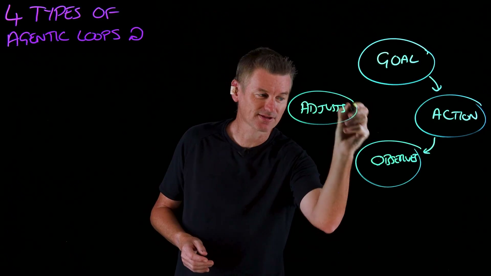
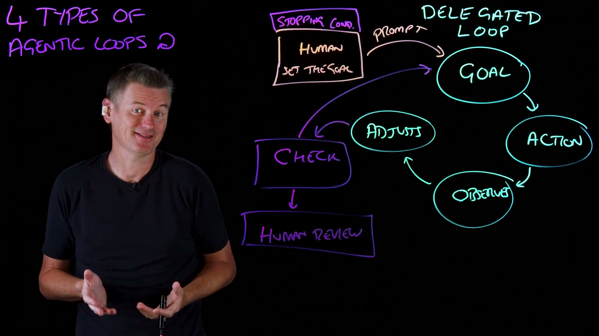
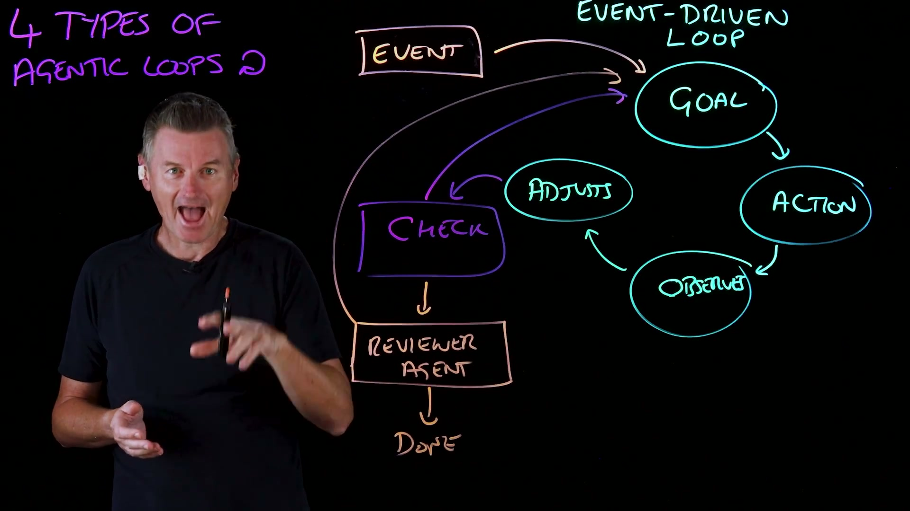

# 4 Types of AI Agent Loops: From Human-Led to Autonomous

**Source**: [raw/video-transcripts/4-types-of-ai-agent-loops-from-human-led-to-autonomous.md](../../raw/video-transcripts/4-types-of-ai-agent-loops-from-human-led-to-autonomous.md) | **Channel**: [IBM Technology](../entities/IBM%20Technology.md) ([IBM](../entities/IBM.md)) | **URL**: https://www.youtube.com/watch?v=4LINhsEZEDI | **Uploaded**: 2026-11-19 | **Duration**: 9m 8s
**Curated Keyframes**: [raw/screenshots/4-types-of-ai-agent-loops-from-human-led-to-autonomous/01.jpg](../../raw/screenshots/4-types-of-ai-agent-loops-from-human-led-to-autonomous/01.jpg), [raw/screenshots/4-types-of-ai-agent-loops-from-human-led-to-autonomous/02.jpg](../../raw/screenshots/4-types-of-ai-agent-loops-from-human-led-to-autonomous/02.jpg), [raw/screenshots/4-types-of-ai-agent-loops-from-human-led-to-autonomous/03.jpg](../../raw/screenshots/4-types-of-ai-agent-loops-from-human-led-to-autonomous/03.jpg), [raw/screenshots/4-types-of-ai-agent-loops-from-human-led-to-autonomous/04.jpg](../../raw/screenshots/4-types-of-ai-agent-loops-from-human-led-to-autonomous/04.jpg), [raw/screenshots/4-types-of-ai-agent-loops-from-human-led-to-autonomous/05.jpg](../../raw/screenshots/4-types-of-ai-agent-loops-from-human-led-to-autonomous/05.jpg), [raw/screenshots/4-types-of-ai-agent-loops-from-human-led-to-autonomous/06.jpg](../../raw/screenshots/4-types-of-ai-agent-loops-from-human-led-to-autonomous/06.jpg)

An [IBM Technology](../entities/IBM%20Technology.md) lightboard walkthrough tracing **how human responsibilities progressively hand off** across four increasingly autonomous agentic loop architectures—all built around the same inner `Goal -> Action -> Observe -> Adjust` execution ring introduced in [What Is Loop Engineering Building Better AI Agents](What%20Is%20Loop%20Engineering%20Building%20Better%20AI%20Agents.md).

---

## 1. Shared Inner Ring & The Two Control Questions (`00:00 - 01:31`)
Every autonomous agent loop runs the same core micro-cycle (`01.jpg`):
1. **Goal**: Target state passed into the run.
2. **Action**: Concrete step taken (*editing a file*, *running a command*).
3. **Observe**: Reading returned outputs/telemetry.
4. **Adjust**: Updating approach based on observation and cycling again until complete.

To design the right loop topology, ask two foundational questions (`01:06`):
- **Who sets the goal (and starts the loop)?**
- **Who decides when the loop is done?**

---

## 2. Four Agentic Loop Types Across the Autonomy Spectrum (`01:31 - 09:08`)

| Loop Type | Who Starts / Sets Goal | Mid-Loop Stopping Check | End-of-Run Review | Best For & Bottleneck |
| :--- | :--- | :--- | :--- | :--- |
| **1. Interactive Loop** *(`01:31–03:30`, `02.jpg`)* | **Human** types prompt | **Human Judges** after every turn (`Done` vs next prompt) | **Human** inline per turn | Fuzzy tasks with no measurable finish line (*"upgrade library X"* exploration); fails to scale when humans repeatedly judge routine runs |
| **2. Delegated Loop** *(`03:30–05:17`, `03.jpg`)* | **Human** writes goal + explicit **Stopping Condition** | Automated **AI `Check`** after `Adjust` loops until satisfied | **Human Review** once complete | Tasks with clear exit criteria (*"upgrade outdated libraries, stop when build turns green"*); removes mid-loop babysitting ([Goal-Driven Loop](../concepts/Goal-Driven%20Loop.md)) |
| **3. Scheduled Loop** *(`05:17–06:40`, `04.jpg`)* | **`Clock`** cron/schedule *(goal written once by human)* | Automated **AI `Check`** | **Human Review** every run *(can **`Cancel`** / tune schedule)* | Work that goes stale over time or recurs periodically (nightly dependency sweeps); removes manual start friction |
| **4. Event-Driven Loop** *(`06:40–09:08`, `05.jpg–06.jpg`)* | **`Event`** *(e.g., PR opened)* tailors goal to trigger payload | Automated **AI `Check`** | **Second `Reviewer Agent`** *(fresh context + optional diff model)*; **Human Review only on exceptions** | Reactive CI/ops workflows; scales without drowning humans by reviewing exceptions only |

---

## 3. Event-Driven Autonomy: Reviewer Agents & Exception Escalation (`07:15 - 08:32`)
Moving to full event-driven autonomy replaces routine human end-of-run sign-off with a two-stage safeguard (`05.jpg`, `06.jpg`):
1. **Independent `Reviewer Agent`**: A *second* agent running with **fresh isolated context** ([Subagent Context Isolation](../concepts/Subagent%20Context%20Isolation.md)) and optionally a different AI model ([Second Opinion Pattern](../concepts/Second%20Opinion%20Pattern.md)).
   - **Approves** $\rightarrow$ task marked `Done`.
   - **Finds unfinished work** $\rightarrow$ routes back (`Not Done`) to restart the agent loop.
   - **Uncertain / ambiguous edge case** $\rightarrow$ **escalates to `Human Review`** (`06.jpg`).
2. **Exception-Only Human Oversight**: Humans move from judging every turn (`Interactive`) $\rightarrow$ reviewing every completed run (`Delegated` / `Scheduled`) $\rightarrow$ **handling exceptions only** (`Event-Driven`).

---

## 4. Key Visual Lightboard Slides

| Slide | Timestamp | Title | Screenshot | Visual Progression |
| :-: | :-: | :--- | :--- | :--- |
| **01** | `01:01` | Core 4-Stage Cycle | [raw/screenshots/4-types-of-ai-agent-loops-from-human-led-to-autonomous/01.jpg](../../raw/screenshots/4-types-of-ai-agent-loops-from-human-led-to-autonomous/01.jpg) | Inner ring: `Goal -> Action -> Observe -> Adjust` |
| **02** | `03:08` | Type 1: Interactive Loop | [raw/screenshots/4-types-of-ai-agent-loops-from-human-led-to-autonomous/02.jpg](../../raw/screenshots/4-types-of-ai-agent-loops-from-human-led-to-autonomous/02.jpg) | `Human Set the Goal -> Prompt -> Loop -> Human Judges -> Done / Re-prompt` |
| **03** | `05:09` | Type 2: Delegated Loop | [raw/screenshots/4-types-of-ai-agent-loops-from-human-led-to-autonomous/03.jpg](../../raw/screenshots/4-types-of-ai-agent-loops-from-human-led-to-autonomous/03.jpg) | `Stopping Cond. + Human Goal -> Loop -> Check -> Human Review` |
| **04** | `06:28` | Type 3: Scheduled Loop | [raw/screenshots/4-types-of-ai-agent-loops-from-human-led-to-autonomous/04.jpg](../../raw/screenshots/4-types-of-ai-agent-loops-from-human-led-to-autonomous/04.jpg) | `Clock -> Goal -> Loop -> Check -> Human Review -> Cancel` |
| **05** | `07:55` | Type 4: Event-Driven Loop | [raw/screenshots/4-types-of-ai-agent-loops-from-human-led-to-autonomous/05.jpg](../../raw/screenshots/4-types-of-ai-agent-loops-from-human-led-to-autonomous/05.jpg) | `Event -> Loop -> Check -> Reviewer Agent -> Done / Loop-Back` |
| **06** | `08:30` | Exception Escalation | [raw/screenshots/4-types-of-ai-agent-loops-from-human-led-to-autonomous/06.jpg](../../raw/screenshots/4-types-of-ai-agent-loops-from-human-led-to-autonomous/06.jpg) | `Reviewer Agent -> Human Review` fallback branch on uncertain cases |

---

## Synthesis Notes
- **IBM Two-Video Progression**: [What Is Loop Engineering Building Better AI Agents](What%20Is%20Loop%20Engineering%20Building%20Better%20AI%20Agents.md) (`2026-10-19`) anatomized the internal infrastructure around one loop (triggers, context compaction/skills, state spine, MCP tools, subagent checks, and [Comprehension and Intent Debt](../concepts/Comprehension%20and%20Intent%20Debt.md)). This November 2026 sequel steps back to classify **when to hand off start triggers, stopping checks, and end-of-run review** from humans to agents.
- **Cross-Taxonomy Alignment in [Loop Engineering](../concepts/Loop%20Engineering.md)**: Directly mirrors Claude Code's progression in [Loop engineering Getting started with loops](Loop%20engineering%20Getting%20started%20with%20loops.md) (`Turn-Based -> Goal-Based /goal -> Time-Based /loop & /schedule -> Proactive`) while adding two concrete architectural details: explicitly pairing **`Event`-triggered goals** with a **fresh-context `Reviewer Agent` + exception-only `Human Review`** fallback (closely matching [Second Opinion Pattern](../concepts/Second%20Opinion%20Pattern.md) and [Automated Multi-Agent Code Review](../concepts/Automated%20Multi-Agent%20Code%20Review.md)).

## Related Pages
- **Primary Concept & Entity**:
  - [Loop Engineering](../concepts/Loop%20Engineering.md)
  - [IBM Technology](../entities/IBM%20Technology.md)
  - [IBM](../entities/IBM.md)
- **Direct IBM Series Companion**:
  - [What Is Loop Engineering Building Better AI Agents](What%20Is%20Loop%20Engineering%20Building%20Better%20AI%20Agents.md)
  - [AI Model vs Agentic Harness What Actually Drives AI](AI%20Model%20vs%20Agentic%20Harness%20What%20Actually%20Drives%20AI.md)
  - [Comprehension and Intent Debt](../concepts/Comprehension%20and%20Intent%20Debt.md)
- **Loop Taxonomies & Safeguards**:
  - [Loop engineering Getting started with loops](Loop%20engineering%20Getting%20started%20with%20loops.md)
  - [The Art of Loop Engineering](The%20Art%20of%20Loop%20Engineering.md)
  - [Loop Engineering explained in 8min](Loop%20Engineering%20explained%20in%208min.md)
  - [Loop Engineering from First Principles](Loop%20Engineering%20from%20First%20Principles.md)
  - [Control-Loop Engineering](../concepts/Control-Loop%20Engineering.md)
  - [Verification Loop](../concepts/Verification%20Loop.md)
  - [Goal-Driven Loop](../concepts/Goal-Driven%20Loop.md)
  - [Second Opinion Pattern](../concepts/Second%20Opinion%20Pattern.md)
  - [Subagent Context Isolation](../concepts/Subagent%20Context%20Isolation.md)
  - [Deterministic Lifecycle Hooks](../concepts/Deterministic%20Lifecycle%20Hooks.md)
  - [Automated Multi-Agent Code Review](../concepts/Automated%20Multi-Agent%20Code%20Review.md)
