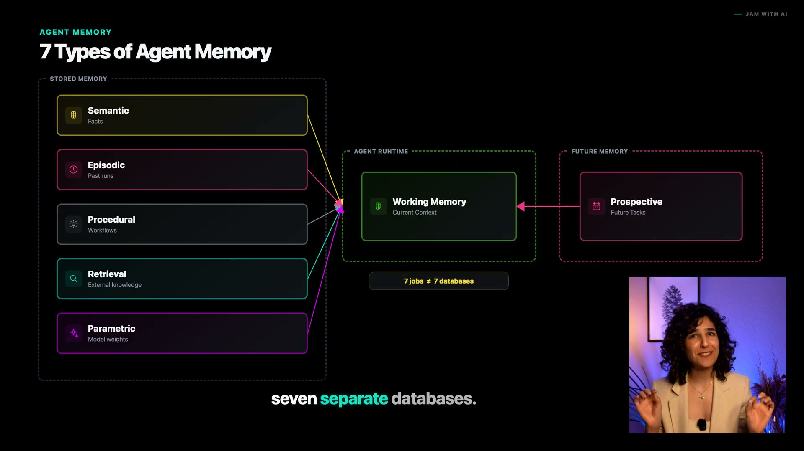
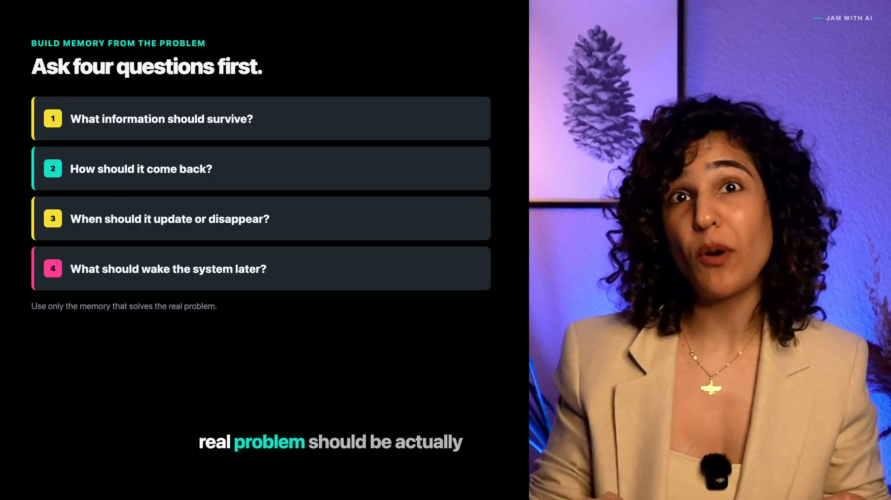

# AI Agent Memory: 7 Types Explained in 12 Minutes

**Channel**: [Jam With AI](../entities/Jam%20With%20AI.md) (`Jam With AI | Shirin Khosravi Jam`)
**Speaker**: Shirin Khosravi Jam
**URL**: https://www.youtube.com/watch?v=bK1clrG-boc *(Published 2026-08-28)*
**Companion Substack Article**: [Agent Memory The 7 Types You Should Know](Agent%20Memory%20The%207%20Types%20You%20Should%20Know.md) (https://jamwithai.substack.com/p/agent-memory-the-7-types-you-should, *Published 2026-07-01*)
**Duration**: 12m 06s
**Transcript**: [raw/video-transcripts/ai-agent-memory-7-types-explained-in-12-minutes.md](../../raw/video-transcripts/ai-agent-memory-7-types-explained-in-12-minutes.md)
**Curated Keyframes**: [raw/screenshots/ai-agent-memory-7-types-explained-in-12-minutes/01.jpg](../../raw/screenshots/ai-agent-memory-7-types-explained-in-12-minutes/01.jpg), [raw/screenshots/ai-agent-memory-7-types-explained-in-12-minutes/02.jpg](../../raw/screenshots/ai-agent-memory-7-types-explained-in-12-minutes/02.jpg), [raw/screenshots/ai-agent-memory-7-types-explained-in-12-minutes/03.jpg](../../raw/screenshots/ai-agent-memory-7-types-explained-in-12-minutes/03.jpg), [raw/screenshots/ai-agent-memory-7-types-explained-in-12-minutes/04.jpg](../../raw/screenshots/ai-agent-memory-7-types-explained-in-12-minutes/04.jpg), [raw/screenshots/ai-agent-memory-7-types-explained-in-12-minutes/05.jpg](../../raw/screenshots/ai-agent-memory-7-types-explained-in-12-minutes/05.jpg), [raw/screenshots/ai-agent-memory-7-types-explained-in-12-minutes/06.jpg](../../raw/screenshots/ai-agent-memory-7-types-explained-in-12-minutes/06.jpg), [raw/screenshots/ai-agent-memory-7-types-explained-in-12-minutes/07.jpg](../../raw/screenshots/ai-agent-memory-7-types-explained-in-12-minutes/07.jpg), [raw/screenshots/ai-agent-memory-7-types-explained-in-12-minutes/08.jpg](../../raw/screenshots/ai-agent-memory-7-types-explained-in-12-minutes/08.jpg), [raw/screenshots/ai-agent-memory-7-types-explained-in-12-minutes/09.jpg](../../raw/screenshots/ai-agent-memory-7-types-explained-in-12-minutes/09.jpg), [raw/screenshots/ai-agent-memory-7-types-explained-in-12-minutes/10.jpg](../../raw/screenshots/ai-agent-memory-7-types-explained-in-12-minutes/10.jpg), [raw/screenshots/ai-agent-memory-7-types-explained-in-12-minutes/11.jpg](../../raw/screenshots/ai-agent-memory-7-types-explained-in-12-minutes/11.jpg)

An architectural taxonomy of **AI Agent Memory** framed explicitly as a core pillar of [Context Engineering](../concepts/Context%20Engineering.md)—distinguishing **"saving information" from "remembering it"**, breaking memory down into **seven functional jobs** (*not seven separate databases*), walking all seven through a concrete customer-support **Email Agent** (Maya's late-order inquiry + Friday follow-up), and offering four first-principles questions for agent memory design.

---

## 1. Foundational Framing (`00:00 - 01:28`)
- **Part of Context Engineering**: [Context Engineering](../concepts/Context%20Engineering.md) determines what payload the model sees before answering or acting; agent memory supplies the right slices across time.
- **Saving $\neq$ Remembering**: Dumping thousands of chat logs into storage is useless unless the right record comes back at the right moment.
- **`7 Jobs != 7 Databases` (`01.jpg`)**: The seven types represent **distinct functional responsibilities** that often overlap and share underlying storage (`PostgreSQL + pgvector`, `Redis`, system files, etc.).

---

## 2. The Seven Agent Memory Types (`01:28 - 09:36`)

| # | Memory Type | Core Definition & Slides | Critical Engineering Rules & Pitfalls |
| :-: | :--- | :--- | :--- |
| **01** | **Working Memory** *(Slide `02.jpg`)* | What the model uses **right now**: system instructions, active question, recent turns, selected docs, latest tool results | Bounded by the **context window**; growing history inflates cost/latency and causes attention loss ([Context Rot](../concepts/Context%20Rot.md)) $\rightarrow$ curate, summarize, prune |
| **02** | **Semantic Memory** *(Slide `03.jpg`)* | **What is true**: durable user/org facts & preferences surviving across sessions (`Name`, `timezone`, `language`, `coding preference`) | Every record needs **owner + scope + lifetime/TTL**; validate untrusted sources (emails/web/tool outputs) before trusting; overwrite stale facts (`Python -> TypeScript`) and allow user edits/deletions |
| **03** | **Episodic Memory** *(Slide `04.jpg`)* | **What happened**: specific past runs (`goal`, `actions`, `tool results`, `errors`, `feedback`, `outcome`, `date`) | Retrieved when similar edge cases recur so the agent learns which troubleshooting paths failed vs. succeeded |
| **04** | **Procedural Memory** *(Slide `05.jpg`)* | **How the agent should work**: repeatable workflows, guardrails, SOPs (*search internal docs $\rightarrow$ validate query $\rightarrow$ human approval $\rightarrow$ execute*) | Stored in **system instructions, tool descriptions, reusable skills, or workflow code** (not model facts about the user) |
| **05** | **External Memory & Retrieval** *(Slide `06.jpg`)* | Records outside the model (`DB`, document stores, email inbox, APIs) surfaced via **exact lookup, keyword, or embedding search** | **Semantic search $\neq$ Semantic memory!** Retrieval can return outdated policies, unrelated events, or another user's private data $\rightarrow$ filter by **relevance, date, user, permissions**, and **test retrieval separately** from final LLM answers |
| **06** | **Parametric Memory** *(Slide `07.jpg`)* | General linguistic, coding, and reasoning capability encoded in **model weights** during training | Immutable during normal inference calls; **fine-tuning** shifts style/behavior, *not* volatile or private facts—supply current/exact/private data from controlled sources |
| **07** | **Prospective Memory** *(Slide `08.jpg`)* | Remembering **future work + triggers** (*time*, *event*, *condition*) with saved context, status (`pending/completed`), and approval gates | Because the model is idle when Friday arrives, a **scheduler/queue** wakes the app, re-checks latest state (*did the user already reply?*), and enforces idempotency across scheduler retries (*stop the same action from running twice*) |

---

## 3. Case Study: All Seven Types in One Email Agent & Design Rules (`09:36 - 12:06`)
- **Customer Support Scenario ("Maya's Late Order", Slides `09.jpg–10.jpg`)**:
  1. **External Memory**: Customer Maya's email, order record, live shipping status, and company shipping policy.
  2. **Semantic Memory**: Confirmed company tone (*friendly*) and Maya's preferred language.
  3. **Episodic Memory**: One similar past delivery-delay support case and how it resolved.
  4. **Working Memory (`09.jpg`)**: Curated temporary *Context package* (Maya's message + current task + selected evidence) assembled inside the active prompt.
  5. **Parametric Memory (`09.jpg`)**: Base LLM weights providing language understanding and drafting fluency.
  6. **Procedural Memory**: Stepwise agent rule (`Check order -> Check policy -> Draft reply -> Wait for HITL approval` before sending).
  7. **Prospective Memory (`10.jpg`)**: Persistent `"Friday 09:00 / condition: no reply / status: pending"` follow-up task; scheduler wakes the workflow on Friday, fetches the latest email thread via Retrieval, marks complete if Maya already replied, or drafts a follow-up for human approval.
- **Four Design Questions (`11.jpg`, `"Build memory from the problem"`)**:
  1. *What information should survive?*
  2. *How should it come back?*
  3. *When should it update or disappear?*
  4. *What should wake the system later?*
  - **North Star**: *"Use only the memory that solves the real problem. The goal is not to remember everything—it is to give the agent the right information for the right decision at the right time."*

---

## Synthesis Notes
- **Completing the Shirin / Jam With AI Triad**: Together with [How a Production AI Agent System Actually Works](How%20a%20Production%20AI%20Agent%20System%20Actually%20Works.md) (inner 9-layer Python runtime [Production AI Agent Service Stack](../concepts/Production%20AI%20Agent%20Service%20Stack.md)) and [AI System Design 7 Patterns Explained in 17 Minutes](AI%20System%20Design%207%20Patterns%20Explained%20in%2017%20Minutes.md) (outer 7 infrastructure patterns [Production AI Resilience and Scaling Patterns](../concepts/Production%20AI%20Resilience%20and%20Scaling%20Patterns.md)), this video supplies the **state, retrieval, and temporal trigger semantics** running inside LangGraph/Postgres/pgvector/Redis/queues—notably mapping **Prospective Memory** directly onto durable task tables + scheduler queues + idempotent workers.
- **Companion Substack Precursor**: Expands upon the July 1, 2026 Substack guide [Agent Memory The 7 Types You Should Know](Agent%20Memory%20The%207%20Types%20You%20Should%20Know.md) (Shantanu Ladhwe & Shirin Khosravi Jam), which anchors the taxonomy in **CoALA** / **MemGPT** / **Generative Agents**, separates **Stored vs. Active** and **What vs. Where** axes, details `Thread ID` checkpointers, reflection summaries, guardrail loops, graph/time lookups, and `Temporal` durable tasks—while this video supplies the end-to-end Maya Email Agent walkthrough omitted behind Substack's paywall plus stricter untrusted-input & idempotency guardrails.
- **Terminology Clarification for Vault Graph**: Resolves a frequent conceptual collision across [Retrieval-Augmented Generation and Vector DBs](../concepts/Retrieval-Augmented%20Generation%20and%20Vector%20DBs.md) and [Context Engineering](../concepts/Context%20Engineering.md): **Semantic Memory** *(fact store: what is true)* vs. **Semantic Search** *(vector similarity lookup over External Memory)*; additionally aligns **Procedural Memory** with [Agent Skills Architecture](../concepts/Agent%20Skills%20Architecture.md) & [Memory Promotion Path](../concepts/Memory%20Promotion%20Path.md), and **Working Memory** limits with [Context Rot](../concepts/Context%20Rot.md) & [Context Window Management](../concepts/Context%20Window%20Management.md).

## Related Pages
- **Entities**: [Jam With AI](../entities/Jam%20With%20AI.md)
- **Concepts**:
  - [AI Agent Memory Types](../concepts/AI%20Agent%20Memory%20Types.md)
  - [Context Engineering](../concepts/Context%20Engineering.md)
  - [Context Rot](../concepts/Context%20Rot.md)
  - [Context Window Management](../concepts/Context%20Window%20Management.md)
  - [Retrieval-Augmented Generation and Vector DBs](../concepts/Retrieval-Augmented%20Generation%20and%20Vector%20DBs.md)
  - [Memory Architecture](../concepts/Memory%20Architecture.md)
  - [Memory Promotion Path](../concepts/Memory%20Promotion%20Path.md)
  - [Agent Skills Architecture](../concepts/Agent%20Skills%20Architecture.md)
  - [Production AI Agent Service Stack](../concepts/Production%20AI%20Agent%20Service%20Stack.md)
  - [Production AI Resilience and Scaling Patterns](../concepts/Production%20AI%20Resilience%20and%20Scaling%20Patterns.md)
  - [Product Evals and Error Analysis](../concepts/Product%20Evals%20and%20Error%20Analysis.md)
- **Sources**:
  - [Agent Memory The 7 Types You Should Know](Agent%20Memory%20The%207%20Types%20You%20Should%20Know.md)
  - [How a Production AI Agent System Actually Works](How%20a%20Production%20AI%20Agent%20System%20Actually%20Works.md)
  - [AI System Design 7 Patterns Explained in 17 Minutes](AI%20System%20Design%207%20Patterns%20Explained%20in%2017%20Minutes.md)
  - [What Is Context Engineering Why It Matters for AI Agents](What%20Is%20Context%20Engineering%20Why%20It%20Matters%20for%20AI%20Agents.md)
