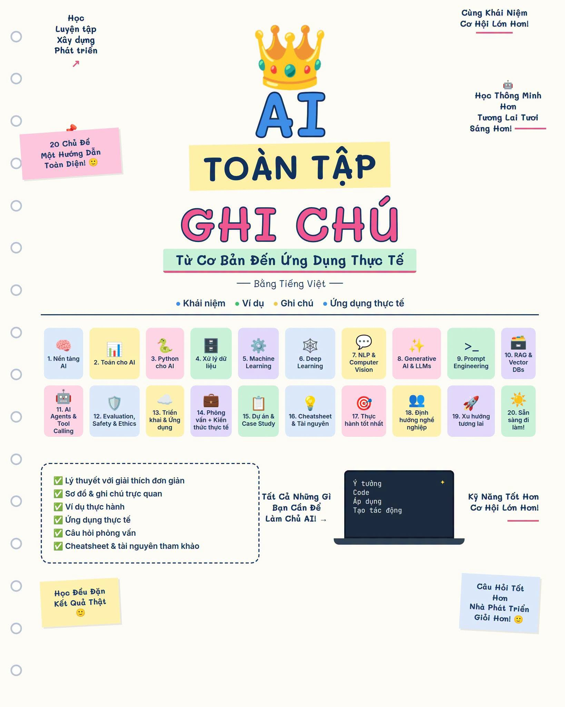

# AI Complete Handbook (Cẩm nang AI toàn tập bằng tiếng Việt)

**Author / Translator:** [[Viet Nguyen AI]] (`vietnh1009`)
**Published Date:** `2026-10-29`
**Source Post:** [Facebook Post](https://web.facebook.com/vietnh1009/posts/pfbid02tqE2HNnmhrRkUSQpqeaCSAJ7XVh7jZ2PKHHgp4tPw9WbAbfH2R7uhz3sbvuiFScil) (115 reactions, 0 comments, 122 shares)
**Original Source Cited:** [Instagram Carousel](https://www.instagram.com/p/DdL7cWIH0Wb/)
**Raw Source File:** [[raw/articles/ai-other/ai-complete-handbook.md]] (`20` visual pages stored in `raw/screenshots/ai-complete-handbook/00.jpg`–`19.jpg`)

---

## Executive Summary

**AI Complete Handbook** is a 20-page Vietnamese visual cheatsheet deck translated and adapted by [[Viet Nguyen AI]] that spans the entire conceptual arc of Artificial Intelligence—uniquely bridging **Classical Symbolic AI** (Chapters 1–9: Intelligent Agents, State-Space Search, Heuristic/`A*`, Adversarial `Minimax`, Knowledge Representation, Formal Logic, and Bayesian Inference) directly into **Modern Statistical & Generative AI** (Chapters 10–19: ML, Deep Learning, NLP/CV, LLMs, Prompt Engineering, RAG, AI Agents, Evaluation/Safety/Governance, and Production Deployment).

Whereas Viet Nguyen AI's specialized guides drill deep into individual domains ([[LLM Handbook 50 Concepts]], [[Machine Learning Basics Notes]], [[Types of Machine Learning Handbook]], [[Computer Vision Handbook]], [[Prompt Engineering Handbook]], [[AI Deployment Notes]]), this handbook serves as the **unifying curriculum map** connecting symbolic reasoning and probabilistic inference to modern neural architectures.

---

## 20-Slide Curriculum Map

> [!NOTE] Cover TOC vs. Actual Slides Observation
> Slide `00.jpg` displays a generic 20-tile cover graphic (*Toán cho AI*, *Python cho AI*, *Phỏng vấn*, etc.), whereas the Facebook post caption and the actual 19 content slides (`01.jpg`–`19.jpg`) follow the **Classical AI → Modern GenAI & Deployment** curriculum detailed below.

### Track A — Classical AI Foundations & Search (`01.jpg`–`06.jpg`)
| Page | Slide Title | Key Frameworks & Algorithms | Linked Wiki Concept |
| :--- | :--- | :--- | :--- |
| `01.jpg` | **1. Nền tảng AI** | `Narrow AI` / `AGI` / `Super AI`; 8 AI domains; `AI ⊃ ML ⊃ DL` | [[Machine Learning Paradigms]] |
| `02.jpg` | **2. Tác nhân thông minh** | Sensors/Actuators/PEAS; 5 Agent types (`Simple Reflex` → `Learning Agent`); 5 agent properties | [[Classical AI Agents and State-Space Search]] |
| `03.jpg` | **3. Giải quyết vấn đề & Tìm kiếm** | 5-tuple $P=(S,A,s_0,G,C)$; Romania Arad→Bucharest graph; Frontier search loop | [[Classical AI Agents and State-Space Search]] |
| `04.jpg` | **4. BFS, DFS & Uniform Cost Search** | Queue (FIFO) vs Stack (LIFO) vs Min-Heap; Complexity table $O(b^d)$, $O(b^m)$, $O(bm)$, $O(b^{1+\lfloor C^*/\epsilon \rfloor})$ | [[Classical AI Agents and State-Space Search]] |
| `05.jpg` | **5. Tìm kiếm Heuristic & A*** | Admissible & Consistent heuristics; Greedy Best-First $f(n)=h(n)$ vs `A*` $f(n)=g(n)+h(n)$ | [[Classical AI Agents and State-Space Search]] |
| `06.jpg` | **6. Trò chơi & Minimax** | Zero-sum adversarial game trees; recursive Minimax pseudocode; Alpha-Beta Pruning ($\alpha$/$\beta$) | [[Classical AI Agents and State-Space Search]] |

### Track B — Knowledge Representation, Logic & Uncertainty (`07.jpg`–`09.jpg`)
| Page | Slide Title | Key Frameworks & Formulas | Linked Wiki Concept |
| :--- | :--- | :--- | :--- |
| `07.jpg` | **7. Biểu diễn tri thức** | 5 knowledge types; 7 KR formalisms (FOL, Semantic Networks, Frames, Scripts, Ontologies, Rules, Probabilistic) | [[Knowledge Representation, Logic and Bayesian Inference]] |
| `08.jpg` | **8. Logic & Suy luận** | Propositional truth tables ($\neg,\land,\lor,\rightarrow,\leftrightarrow$); FOL quantifiers ($\forall,\exists$); Modal/Temporal/Description Logic; Modus Ponens/Tollens, Resolution, Forward/Backward Chaining | [[Knowledge Representation, Logic and Bayesian Inference]] |
| `09.jpg` | **9. Xác suất & Suy luận Bayesian** | Bayes' Theorem; Base Rate Fallacy medical example (`8.3%` posterior on 1% base rate); Spam filter (`63.6%`); Bernoulli/Binomial/Gaussian/Poisson distributions | [[Knowledge Representation, Logic and Bayesian Inference]] |

### Track C — Machine Learning, Deep Learning, NLP & Vision (`10.jpg`–`13.jpg`)
| Page | Slide Title | Core Takeaways | Linked Wiki Concepts |
| :--- | :--- | :--- | :--- |
| `10.jpg` | **10. Nền tảng Machine Learning** | `Data -> Preprocessing -> Model -> Eval -> Predict`; 8 core algorithms; `Underfitting` vs `Overfitting` | [[Machine Learning Paradigms]], [[Data Preprocessing and Feature Engineering]] |
| `11.jpg` | **11. Supervised & Unsupervised** | Regression/Classification vs Clustering/Dimensionality Reduction/Association Rules/Anomaly Detection | [[Supervised Learning Algorithms]], [[Unsupervised Learning and Dimensionality Reduction]] |
| `12.jpg` | **12. Neural Networks & Deep Learning** | Biological vs Artificial neuron $z = \sum w_i x_i + b$; `Sigmoid`/`Tanh`/`ReLU`/`Leaky ReLU`; `MSE`/`BCE`/`CCE`; Backprop; `CNN`/`RNN`/`LSTM`/`Transformer`/`Autoencoder`/`GAN` | [[Transformer Architecture and Pre-training]], [[Convolutional Neural Networks and Object Detection]] |
| `13.jpg` | **13. NLP & Computer Vision** | NLP tasks (NER, Sentiment, MT, QA) & `BoW/TF-IDF/Word2Vec/RNN/Transformer`; CV tasks & `CNN/YOLO/R-CNN/U-Net/ViT` | [[Convolutional Neural Networks and Object Detection]], [[Vision Transformers and Multimodal AI]] |

### Track D — Generative AI, Agents, Governance & Deployment (`14.jpg`–`19.jpg`)
| Page | Slide Title | Core Takeaways | Linked Wiki Concepts |
| :--- | :--- | :--- | :--- |
| `14.jpg` | **14. Generative AI & LLMs** | Multimodal GenAI (Text/Image/Code/Audio/Video); Transformer next-token prediction; GPT/Gemini/Claude/Llama/DALL·E/Stable Diffusion/Sora | [[Transformer Architecture and Pre-training]] |
| `15.jpg` | **15. Prompt Engineering** | 5-part prompt anatomy (`Role, Task, Context, Format, Constraints`); Zero/Few-Shot, `CoT`, Role/Instruction/Iterative; 6 common anti-patterns | [[Prompt Engineering]], [[Few-Shot Prompting]], [[Chain-of-Thought Prompting]] |
| `16.jpg` | **16. RAG & Vector Databases** | Ingestion + Retrieval (`Pinecone`, `Weaviate`, `Milvus`, `Qdrant`, `Chroma`, `FAISS`, `ElasticSearch`); `RAG` vs `Fine-tuning` trade-off matrix | [[Retrieval-Augmented Generation and Vector DBs]] |
| `17.jpg` | **17. AI Agents & Tool Calling** | Agent = `Memory + Planning + Reasoning + Tools`; Reactive $\rightarrow$ Planning $\rightarrow$ Tool-Using $\rightarrow$ Autonomous ladder; 7 tool categories | [[Domain-Specific Agents]], [[Agentic Engineering]] |
| `18.jpg` | **18. Đánh giá, An toàn & Đạo đức AI** | Evaluation metrics (`BLEU`/`ROUGE`/`BERTScore`, `Red Teaming`, `Demographic Parity`); 4 Bias classes; 5 Ethics pillars; `EU AI Act`, `NIST AI RMF`, `OECD`, `UN AI for Good` | [[AI Evaluation, Safety and Governance]], [[Product Evals and Error Analysis]] |
| `19.jpg` | **19. Triển khai AI & Ứng dụng thực tế** | Cloud/On-Prem/Containers/Edge; 5-step deployment loop; REST/Batch/Real-time/Streaming/Edge; `FastAPI/Docker/K8s/MLflow/Streamlit/Gradio`; Model drift | [[AI Deployment Lifecycle and Environments]], [[Inference Serving and Deployment Patterns]] |

---

## Cross-Source Synthesis & Knowledge Gaps Filled

1. **Closes the Symbolic AI Gap**: Prior to this source, `tluc-wiki` held deep agentic-coding and neural-LLM documentation but lacked foundational references for **Search Algorithms (`BFS`, `DFS`, `UCS`, `A*`, `Minimax` + Alpha-Beta)**, **First-Order Logic / Knowledge Representation**, and **Bayesian Base-Rate Reasoning**—all now captured cleanly in [[Classical AI Agents and State-Space Search]] and [[Knowledge Representation, Logic and Bayesian Inference]].
2. **Elevates Governance & Ethics Beyond Engineering Evals**: Slide 18 complements [[Hamel Husain]]'s empirical [[Product Evals and Error Analysis]] (`Pass/Fail` trace grading) with macro-level **4-class Bias taxonomies** and statutory **Governance frameworks (`EU AI Act`, `NIST AI RMF`, `OECD AI Principles`)**, formalized in [[AI Evaluation, Safety and Governance]].
3. **Continuity with Specialized Handbooks**: Slides 10–19 function as an executive index pointing directly into Viet Nguyen AI's dedicated handbooks: [[Machine Learning Basics Notes]], [[Types of Machine Learning Handbook]], [[Computer Vision Handbook]], [[LLM Handbook 50 Concepts]], [[Prompt Engineering Handbook]], and [[AI Deployment Notes]].

---

## Related Pages
- **Entities**: [[Viet Nguyen AI]]
- **Companion Visual Handbooks**: [[Prompt Engineering Handbook]], [[Types of Machine Learning Handbook]], [[AI Deployment Notes]], [[LLM Handbook 50 Concepts]], [[Machine Learning Basics Notes]], [[Computer Vision Handbook]]
- **New Core Concepts**: [[Classical AI Agents and State-Space Search]], [[Knowledge Representation, Logic and Bayesian Inference]], [[AI Evaluation, Safety and Governance]]
- **Related Concepts**: [[Transformer Architecture and Pre-training]], [[Retrieval-Augmented Generation and Vector DBs]], [[Domain-Specific Agents]], [[AI Deployment Lifecycle and Environments]]
