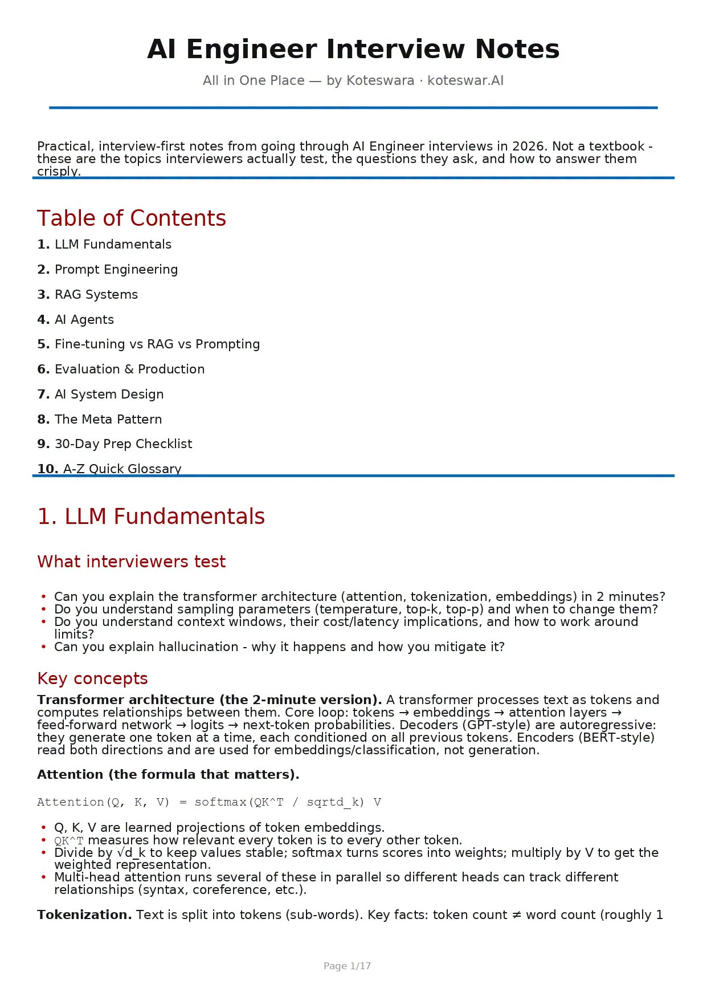

# AI Engineer Interview Notes

**Original Author:** [[Koteswara]] (`koteswar.AI`)
**Shared & Curated by:** [[Viet Nguyen AI]] (`vietnh1009`, `2026-10-30`)
**Source Post:** [Facebook Post](https://web.facebook.com/vietnh1009/posts/pfbid02fLqtSEEF2VCZd8iEGMLNxH8H3yg9zh9wH8bsrCfR9681kgUar2hTvCJst6pTJgKQl) (269 reactions, 391 shares)
**Raw Source File:** [[raw/articles/ai-other/ai-engineer-interview-notes.md]] (`17` pages in `raw/screenshots/ai-engineer-interview-notes/00.jpg`–`16.jpg`)

---

## Executive Summary

**AI Engineer Interview Notes** is a 17-page, pragmatic, interview-first engineering handbook authored by [[Koteswara]] (`koteswar.AI`) and shared by [[Viet Nguyen AI]]. Rather than textbook theory, it isolates what 2026 AI Engineering interviewers explicitly test, the exact failure modes behind production LLM applications, senior-level vs. junior-level framing, crisp oral Q&As, decision matrices, a 10M-user **AI System Design** blueprint, and a 30-day hands-on preparation roadmap.

---

## 10-Section Breakdown & Cross-Links

| Pages | Section | Core Frameworks & Senior Signal Takeaways | Linked Wiki Concepts |
| :--- | :--- | :--- | :--- |
| `00.jpg`–`02.jpg` | **1. LLM Fundamentals** | 2-min Transformer loop + $\text{Attention}(Q,K,V)$; `temperature` (`0` factual / `0.7–1.0` creative) OR `top-p` (`0.9–0.95`), never tune both simultaneously; `Lost in the middle`; hallucination fixes; Decoder vs Encoder selection | [[Transformer Architecture and Pre-training]], [[Tokenization]] |
| `02.jpg`–`04.jpg` | **2. Prompt Engineering** | Escalation rule (`Zero-shot` $\rightarrow$ `Few-shot` $\rightarrow$ `CoT`); **6-step Systematic Debugging** (`Reproduce -> Isolate -> Inspect -> Change one thing -> Regression set -> Version in config`); **Indirect Prompt Injection defense-in-depth** (`<user_content>`, least privilege, HITL) | [[Prompt Engineering]], [[Few-Shot Prompting]], [[Chain-of-Thought Prompting]] |
| `04.jpg`–`06.jpg` | **3. RAG Systems** | 4 chunking modes (never split tables/code blocks); API vs `BGE/E5/Nomic` (index/query model must match); `pgvector`/`Qdrant` defaults; `Hybrid (dense + BM25)` for SKUs/IDs; Top-50 $\rightarrow$ Top-5 reranking; **Pre-retrieval ACL metadata filtering**; Senior eval triad (`recall@k` + `faithfulness` + citation accuracy) | [[Retrieval-Augmented Generation and Vector DBs]], [[AI System Design and Production Architecture]] |
| `06.jpg`–`08.jpg` | **4. AI Agents** | `ReAct` (`Thought -> Action -> Observation`) + stop caps; **Tool-calling design** (strict JSON enums, error strings as observations, idempotency, least privilege); Single-agent default before splitting; Short-term = context window vs Long-term = data/freshness problem; Per-run budgets & kill switches | [[Agentic Engineering]], [[Domain-Specific Agents]], [[Memory Architecture]] |
| `08.jpg`–`10.jpg` | **5. Fine-tuning vs RAG vs Prompting** | 3-rung escalation rule (**Prompting first $\rightarrow$ RAG for fresh facts $\rightarrow$ LoRA/distillation for style/cost**, never fine-tune to inject facts); `RLHF`/`DPO` vocabulary; exact interview tradeoff sentence | [[LLM Fine-Tuning and Alignment]], [[Cost Optimization]] |
| `10.jpg`–`12.jpg` | **6. Evaluation & Production** | **4 LLM-Judge biases** (`Verbosity`, `Position`, `Self-preference`, `Leniency drift`) & position-swapping + human calibration; Latency levers (`Streaming TTFT`, exact/semantic caching, small-model routing, shorter context); **Unit economics** (`cost per query/task`) & agent trajectory monitoring | [[LLM-as-a-Judge and Eval Alignment]], [[Product Evals and Error Analysis]], [[Inference Speed vs Intelligence Trade-off]] |
| `12.jpg`–`14.jpg` | **7. AI System Design** | **5-Step Design Framework**; Full worked architecture for a **10M-User Customer Support AI** (`<300ms` complexity router splitting FAQ RAG vs Tool-using Agent, hybrid search + rerank, PII/injection guardrails, confidence-gated human escalation queue + weekly triage) | [[AI System Design and Production Architecture]] |
| `14.jpg` | **8. The Meta Pattern** | Tie every technical choice directly to measurable business impact (`cost/1M queries`, `p95 TTFT`, `recall@k`, `faithfulness`): *"Build systems, measure them, understand tradeoffs."* | [[AI System Design and Production Architecture]] |
| `14.jpg` | **9. 30-Day Prep Checklist** | 4-week math-free sprint (`1–2 hrs/day`): W1 Foundations/Prompting $\rightarrow$ W2 `pgvector`/`Qdrant` RAG + 20-query eval $\rightarrow$ W3 ReAct agent + Build-vs-Train $\rightarrow$ W4 LLM-Judge + 3 System Design mocks | [[AI Engineering Mastery 2026]] |
| `14.jpg`–`16.jpg` | **10. A-Z Quick Glossary** | 38 crisp one-line definitions spanning `Agent`, `Attention`, `BM25`, `Cross-encoder`, `HyDE`, `Lost in the middle`, `PGVector`, `TTFT`, `Zero-shot` | All Core Concepts |

---

## Cross-Source Synthesis Notes

1. **Complements Visual Handbooks with Senior Production Pragmatism**: Whereas [[LLM Handbook 50 Concepts]] focuses on breadth across neural mechanisms, **AI Engineer Interview Notes** focuses on **engineering judgment under production constraints**—adding critical operational specifics missing in introductory guides, including `pgvector` for Postgres-native stacks, **pre-retrieval ACL metadata filtering** (never asking an LLM to conceal retrieved text), and explicit warnings against fine-tuning for factual recall.
2. **Convergence with [[Hamel Husain]] on Evals & Downsizing**: Reinforces [[LLM-as-a-Judge and Eval Alignment]] and [[Product Evals and Error Analysis]] on human-calibrated judges, routing easy traffic to cheaper models, and never letting a model grade its own outputs uncritically.

---

## Related Pages
- **Entities**: [[Koteswara]], [[Viet Nguyen AI]], [[Hamel Husain]]
- **Core Concepts**: [[AI System Design and Production Architecture]], [[Retrieval-Augmented Generation and Vector DBs]], [[Prompt Engineering]], [[LLM-as-a-Judge and Eval Alignment]], [[LLM Fine-Tuning and Alignment]], [[Cost Optimization]]
- **Personal Goals**: [[AI Engineering Mastery 2026]]
