# AI Eval Concepts Explained in 15 Minutes

**Source**: [raw/video-transcripts/ai-eval-concepts-explained-in-15-minutes.md](../../raw/video-transcripts/ai-eval-concepts-explained-in-15-minutes.md) | **Speaker / Channel**: [Hamel Husain](../entities/Hamel%20Husain.md) | **URL**: https://www.youtube.com/watch?v=3rlYBCDK0K4 | **Uploaded**: 2026-11-10 | **Duration**: 14m 23s

---

## Executive Summary

[Hamel Husain](../entities/Hamel%20Husain.md) provides a complete, grounded introduction to **AI product evaluations (evals)**—explaining why generic foundation-model benchmarks fail to predict production quality, how to instrument and inspect multi-turn agent **traces**, how to perform human-centered **error analysis** and **trace sampling**, and how to build, validate, and deploy **automated binary evals** without falling into common evaluation traps.

The presentation establishes a clear lifecycle connecting product observation to iterative optimization: **Instrument Traces -> Annotate & Cluster Failures -> Count Priorities -> Build Specific Binary Evals -> Align Evaluators (`Train / Dev / Test`) -> Deploy (`CI/CD`, `Monitoring`, `Guardrails`) -> Improve Product & Downsize Models**.

---

## Core Takeaways by Chapter

### 1. Product Evals vs. Model Benchmarks (`00:19 - 01:53`)
- **Foundation Model Benchmarks**: General intelligence exams comparable to SAT or IQ tests (`MMLU`, `Terminal Bench`, `Humanity's Last Exam`). Usually plotted on a **Performance vs. Cost per Task** Pareto chart, reflecting test-time compute / token trade-offs (compare [Inference Speed vs Intelligence Trade-off](../concepts/Inference%20Speed%20vs%20Intelligence%20Trade-off.md)).
- **Product-Specific Evals**: End-to-end outcome checks tailored to exact user workflows (e.g., an e-commerce assistant receiving `"Cancel my order"`, pulling context across multiple LLM calls/tools, and measuring whether the order was actually canceled).
- **Shifted Pareto Frontier**: On product-specific evals, models that ranked near the bottom of public benchmarks often climb straight onto the active Pareto frontier because domain task success diverges sharply from general intelligence tests.

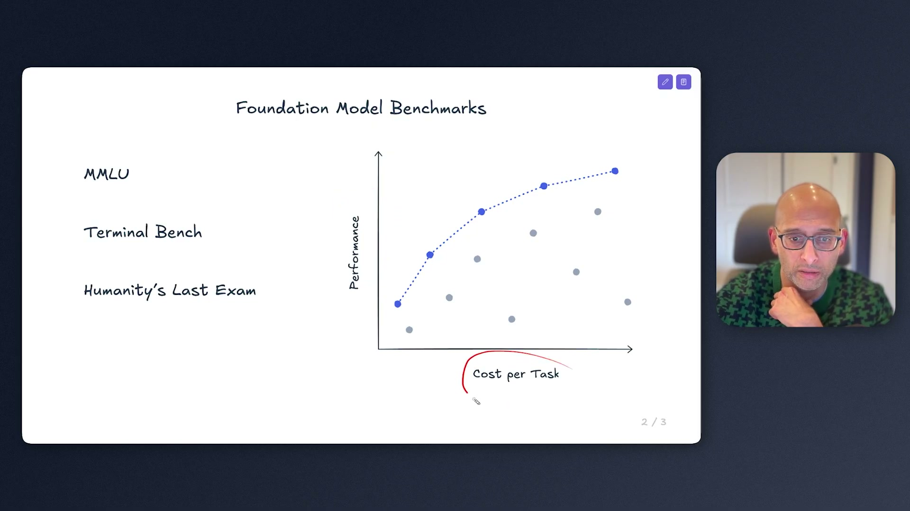
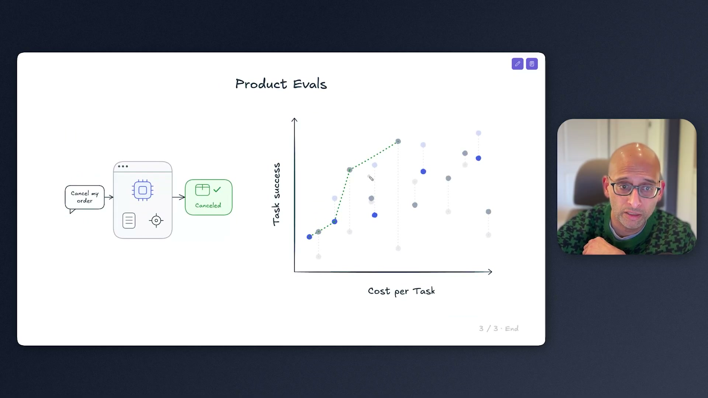

### 2. Traces (`01:53 - 02:57`)
- A **Trace** is a comprehensive record of everything executed inside a user session or workflow: `System` prompt, `User` queries, `Assistant: Tool Call`, `Tool Result`, subsequent `Assistant` replies, follow-up turns, retrieved context, and subagent calls.
- Requires **three infrastructure pillars**: code instrumentation, centralized storage (typically a database), and a human-readable **trace viewer** to spot defects, replay proposed fixes, and debug failures.

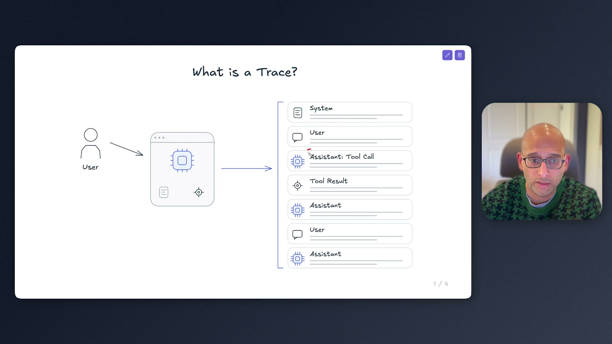

### 3. Error Analysis (`02:57 - 04:06`)
- **Open Annotation**: Read traces and note concrete failures in plain language (e.g., *"tool call failed, yet assistant claimed order was canceled"*).
- **Failure Taxonomy & Iterative Refinement**: Use AI assistance to group notes into failure themes—such as **False confirmations**, **Wrong orders**, and **Missed handoffs**—then split broad clusters into actionable root causes (e.g., splitting `False confirmations` into `Tool failed` vs. `Never called`).
- **Count Failures First**: Simply counting category frequencies in a reviewed sample (e.g., `8` False confirmations, `5` Wrong orders, `3` Missed handoffs) directly guides engineering priority and what evals to build next.

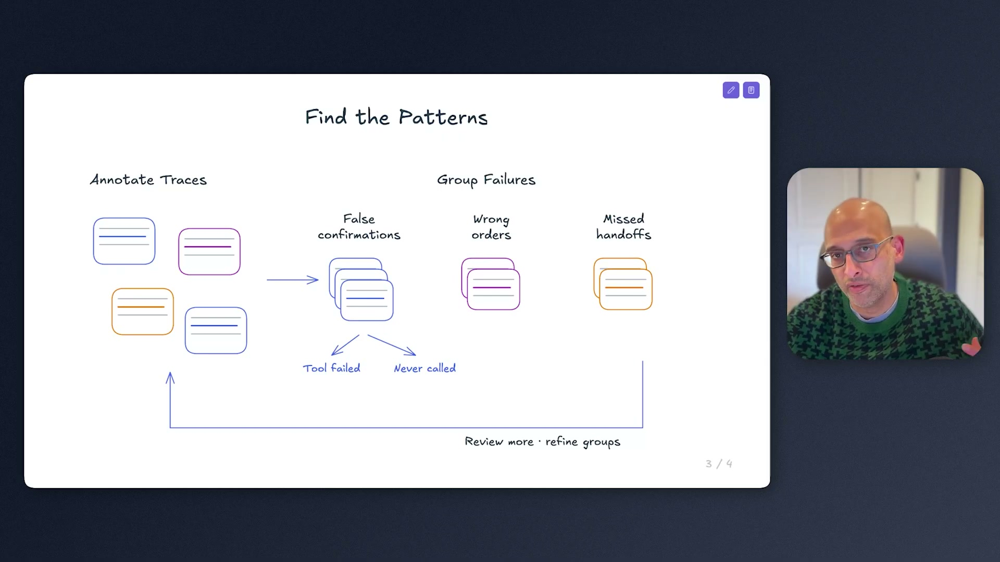
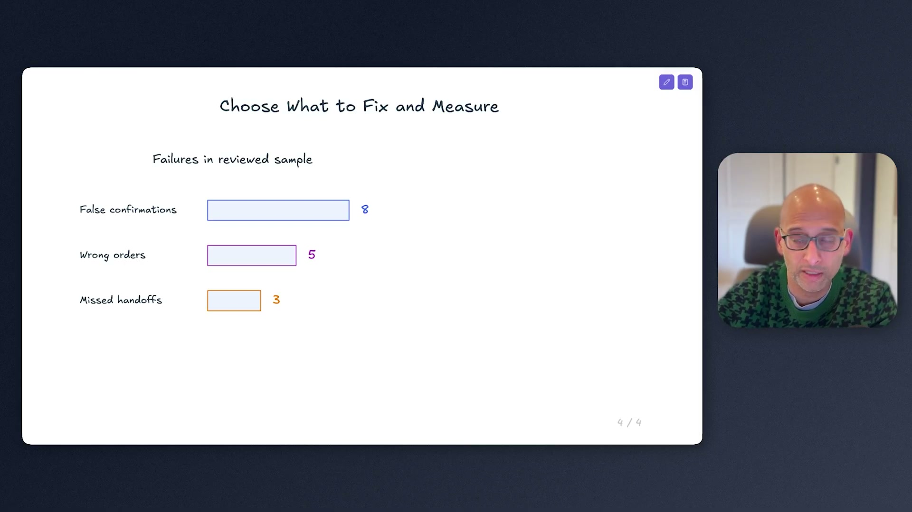

### 4. Sampling Traces & Synthetic Data (`04:06 - 06:55`)
- **Sampling Spectrum (`Explore -> Use signals`)**:
  - **Random Sampling (Explore)**: Essential early on (and continuously at some baseline) to uncover *unknown unknowns*.
  - **Clustering**: Structured exploration grouping semantically similar conversations/traces.
  - **Data Analysis / Signals**: Computing quantitative metrics (turn count, latency, tool-call count) to surface statistical outliers worth auditing.
- **Synthetic User Inputs (Never Fake Full Traces)**: Use LLMs only to generate realistic, messy **inputs** (`"Please cancel the blue one"`, scenario matrices for *before/after shipping* or *unclear order numbers*), feed them into your real application to generate authentic traces, and inspect those traces with humans.
- **Reverse Synthetic Data for [RAG](../concepts/Retrieval-Augmented%20Generation%20and%20Vector%20DBs.md)**: Start from a source document chunk (`"Returns accepted within 30 days"`), have an LLM synthesize a plausible user question (`"How long do I have to return it?"`), and test whether retrieval fetches that exact document.

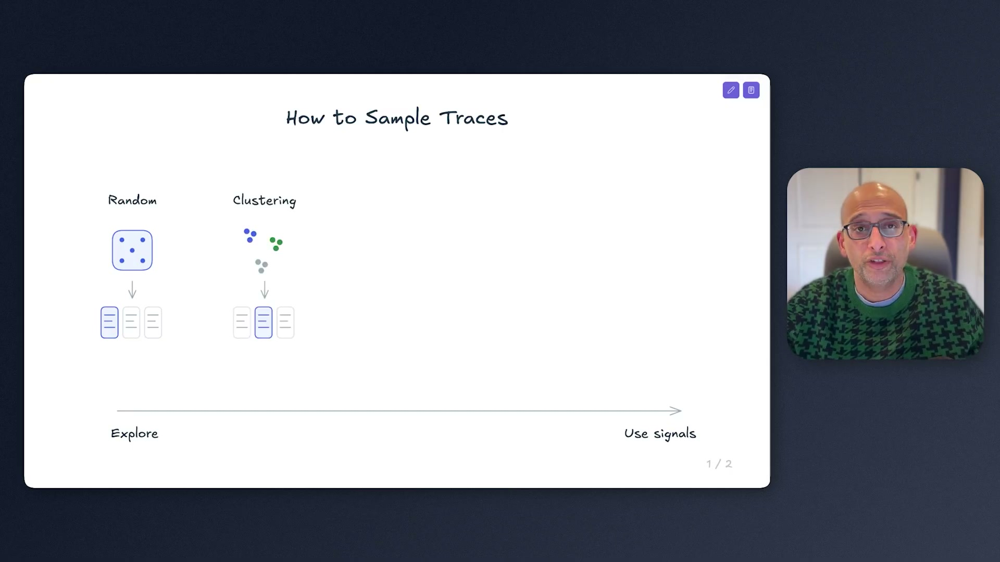
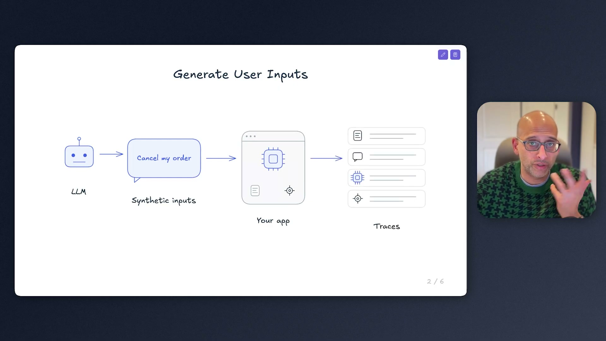
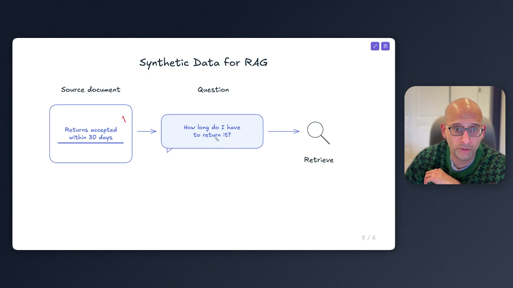

### 5. Automated Evals & Trust Alignment (`06:55 - 10:18`)
- **Three Trace-Grading Mechanisms**:
  1. **Code** (deterministic assertions—e.g., verify tool calls or user IDs).
  2. **Classifier / Decision Model** (supervised binary classifier).
  3. **LLM Judge** (prompted evaluator using [Few-Shot Prompting](../concepts/Few-Shot%20Prompting.md) examples).
- **Mandate Binary Grading (`Pass / Fail`)**: Reject opaque `1–5` or `0–100` scales so evaluator calibration and release decisions remain unambiguous.
- **Three-Way Human Ground-Truth Split (`Train / Dev / Test`)**:
  - Track two disagreement modes between Human and Evaluator: **Missed failures** (False Negatives) and **False alarms** (False Positives).
  - **Train set**: Supplies `Pass` / `Fail` example demonstrations inside the evaluator prompt.
  - **Dev set** (~40% of labeled traces): Used to iteratively refine/hill-climb evaluator instructions until human–evaluator alignment converges.
  - **Test set**: Final held-out audit run *only* on the finished evaluator prompt to prove generalization without overfitting.
- **Three Deployment Targets**: **CI/CD** gating before merge, near-real-time production **Monitoring**, and inline **Guardrails** sitting directly in the request-response path to block unsafe outputs.

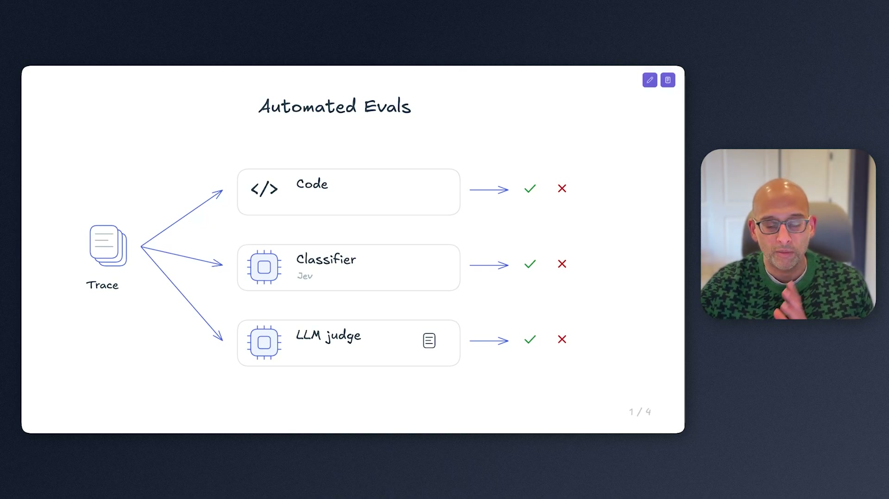
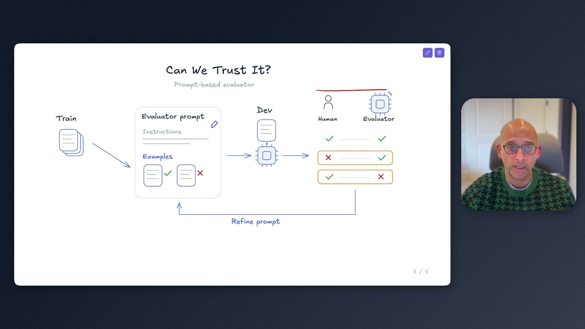
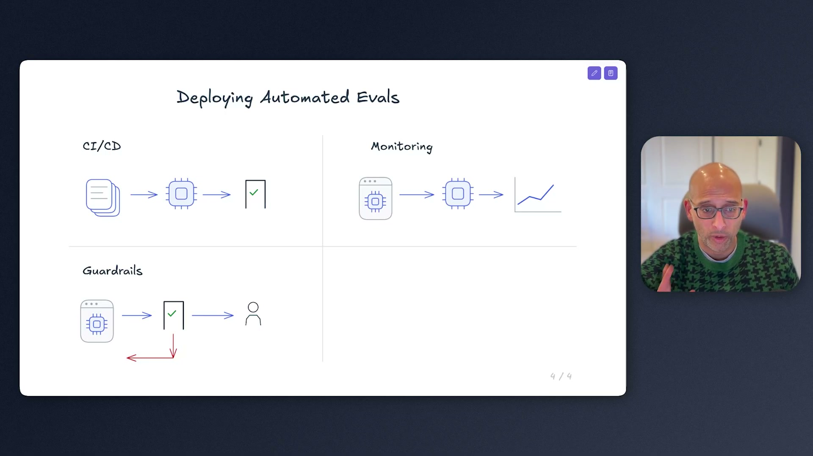

### 6. Common Eval Traps & Decision Filter (`10:18 - 12:14`)
- **Trap 1 — Generic Metrics**: Scores like `4.2` vs. `4.5` on a `1–5` rubric provide zero actionable engineering signal.
- **Trap 2 — Building Evals for Everything**: Evals carry steep authoring and maintenance costs. Apply a **4-point gate ("Is This Eval Worth Building?")**:
  1. **Observed**: Already seen in traces or reliably reproducible.
  2. **You'll iterate on it**: Requires experimentation (`Change -> Check again`), rather than an obvious one-line bug fix.
  3. **Specific**: Targets a concrete claim or result rather than vague quality.
  4. **Binary**: Defines an unambiguous **Pass / Fail** shipping bar.

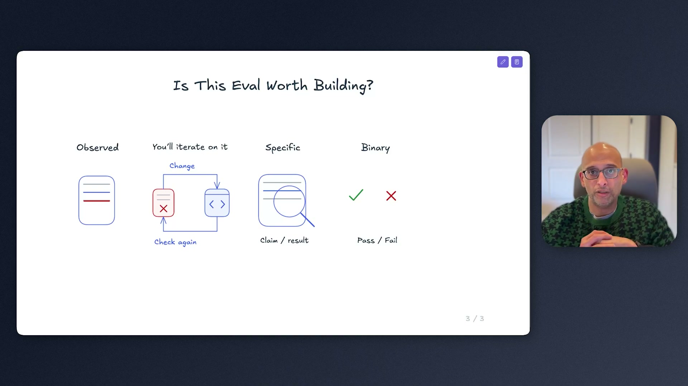

### 7. Improving Your AI Product (`12:14 - 14:23`)
- **Human-Guarded Self-Improvement Loops**: Agents can autonomously iterate on prompts/code using eval feedback (`Change -> Run Evals -> Candidate / Revert`), but blindly shipping agent-edited prompts invites **metric hacking** against incomplete eval suites and prompt degradation. Always check unseen test cases and have a human review, simplify, and distill candidate prompts.
- **Smaller-Model Cost Optimization**: With trustworthy product evals locking down a **Required quality** threshold, benchmark cheaper/smaller models against the exact same eval suite to slash **Cost per task** while holding or improving task success.

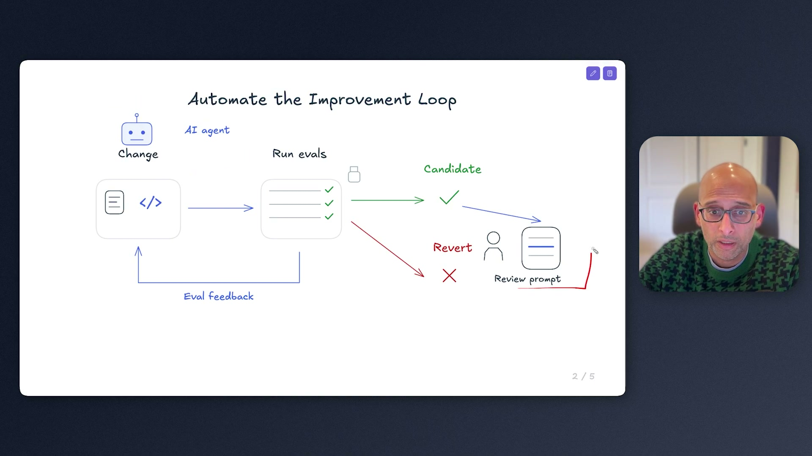
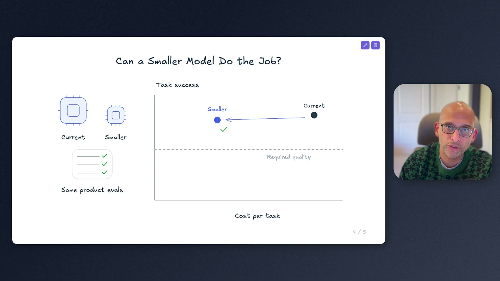

---

## Synthesis & Connections

- Bridges classical validation principles ([Model Evaluation and Validation](../concepts/Model%20Evaluation%20and%20Validation.md)) with autonomous agent improvement systems ([Closed-Loop Evals](../concepts/Closed-Loop%20Evals.md), [Hill-Climbing Loop](../concepts/Hill-Climbing%20Loop.md), [Self-Improving Agents](../concepts/Self-Improving%20Agents.md)).
- Complements Uber's large-scale autonomous auto-tuning architecture ([Building Closed-Loop Evals for a Multimodal Agent at Scale](Building%20Closed-Loop%20Evals%20for%20a%20Multimodal%20Agent%20at%20Scale.md)) by highlighting the human review gate needed to prevent metric hacking when autonomous prompt optimizers operate without exhaustive eval coverage.
- Reinforces [Poteto Trust Pyramid](../concepts/Poteto%20Trust%20Pyramid.md) and [Verification Loop](../concepts/Verification%20Loop.md) principles: prefer deterministic code assertions before LLM judges, and focus tokens and evals on concrete, observed failure modes.

## Related Pages
- **Entities**: [Hamel Husain](../entities/Hamel%20Husain.md)
- **Concepts**:
  - [Product Evals and Error Analysis](../concepts/Product%20Evals%20and%20Error%20Analysis.md)
  - [LLM-as-a-Judge and Eval Alignment](../concepts/LLM-as-a-Judge%20and%20Eval%20Alignment.md)
  - [Closed-Loop Evals](../concepts/Closed-Loop%20Evals.md)
  - [Hill-Climbing Loop](../concepts/Hill-Climbing%20Loop.md)
  - [Verification Loop](../concepts/Verification%20Loop.md)
  - [Model Evaluation and Validation](../concepts/Model%20Evaluation%20and%20Validation.md)
  - [Inference Speed vs Intelligence Trade-off](../concepts/Inference%20Speed%20vs%20Intelligence%20Trade-off.md)
  - [Cost Optimization](../concepts/Cost%20Optimization.md)
