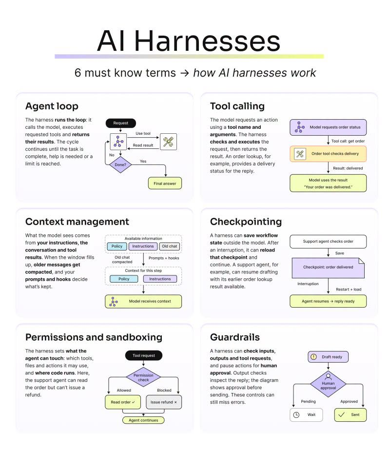

# AI Harness 6 Core Components (AI Harness làm gì để agent hoàn thành công việc?)

**Curated & Shared by:** [[Viet Nguyen AI]] (`vietnh1009`, `2026-11-21`)
**Source Post:** [Facebook Post](https://www.facebook.com/vietnh1009/posts/pfbid0VejzMavZhUeQeLTd2UH1fPE85gJmK9ZeRiYDbo48aVeJr6ToxfjWsupR6HweFY82l)
**Raw Source File:** [[raw/articles/ai-other/ai-harness-six-components.md]]
**Infographic Diagram:** `raw/assets/ai-harness-six-components-01.jpg` (`800x934`)

---

## Executive Summary

A concise visual synthesis shared by [[Viet Nguyen AI]] unpacking the foundational equation `Agent = Model + Harness`—where the language model provides next-step **predictions** while the **harness** orchestrates execution, state, safety, and boundaries. Using a concrete **e-commerce customer support agent** (looking up delivery status and drafting a reply), the diagram breaks a working harness down into six orthogonal operational subsystems.

---

## Six Core Harness Subsystems (Order Support Reference Flow)

| # | Term (EN / VI) | Core Harness Responsibility | Order-Support Concrete Flow | Related Wiki Concepts |
| :--- | :--- | :--- | :--- | :--- |
| 1 | **Agent Loop** *(Vòng lặp agent)* | Calls model, executes requested tools, feeds observations back until done, blocked for help, or capped by iteration limits | `Request -> Model <-> Tool -> Done? -> Final answer` | [[Agent Loop Lifecycle]], [[Loop Engineering]] |
| 2 | **Tool Calling** *(Gọi công cụ)* | Validates model-emitted tool names/arguments, runs deterministic handlers, returns structured observations | `get order` $\rightarrow$ checks delivery $\rightarrow$ `"delivered"` | [[Programmatic Tool Calling]], [[AI System Design and Production Architecture]] |
| 3 | **Context Management** *(Quản lý ngữ cảnh)* | Combines policy, instructions, chat history, and tool results; compacts old turns via prompts and hooks when windows fill | Compacts `Old chat` while keeping `Policy` + `Instructions` | [[Context Window Management]], [[Context Engineering]] |
| 4 | **Checkpointing** *(Lưu trạng thái)* | Persists external workflow state outside the model so interrupted runs reload cleanly and resume | Saves `Checkpoint: order delivered` $\rightarrow$ resumes drafting post-restart | [[Session Checkpoints]], [[Memory Architecture]] |
| 5 | **Permissions & Sandboxing** *(Phân quyền & cách ly)* | Enforces allow/block lists on tools, files, actions, and code execution sandboxes before execution | `Read order ✓` allowed vs. `Issue refund ✗` blocked | [[Cloud Agent Sandbox and Auto Mode]], [[Deterministic Lifecycle Hooks]] |
| 6 | **Guardrails** *(Kiểm soát an toàn)* | Inspects inputs, outputs, and tool requests; pauses sensitive deliveries for human approval—**explicitly noting controls can still miss errors** | `Draft ready -> Human approval (Pending / Approved -> Sent)` | [[Verification Loop]], [[AI Evaluation, Safety and Governance]] |

---

## Cross-Source Synthesis

1. **Generalizes Coding Harness Concepts to Domain Agents**: Whereas [[Agent Harness explained in 8min]] and [[AI Model vs Agentic Harness What Actually Drives AI]] focus on software-engineering CLI harnesses (worktrees, linters, file checkpoints), this infographic grounds the exact same six primitives inside a customer-facing order-support workflow—mirroring the transactional escalation architecture in [[AI System Design and Production Architecture]] and [[Domain-Specific Agents]].
2. **Non-Overlapping Defense Warning**: Emphasizing that *"each layer has a distinct role and can still miss errors"* aligns with defense-in-depth principles in [[Cloud Agent Sandbox and Auto Mode]], [[Poteto Trust Pyramid]], and prompt-injection defenses in [[Prompt Engineering]].

---

## Related Pages
- **Entities**: [[Viet Nguyen AI]]
- **Primary Concept Hub**: [[Harness Engineering]]
- **Connected Concepts**: [[Agent Loop Lifecycle]], [[Context Window Management]], [[Session Checkpoints]], [[Cloud Agent Sandbox and Auto Mode]], [[Deterministic Lifecycle Hooks]], [[AI System Design and Production Architecture]], [[Domain-Specific Agents]]
- **Companion Sources**: [[AI Model vs Agentic Harness What Actually Drives AI]], [[Agent Harness explained in 8min]], [[12 Agentic Harness Patterns from Claude Code]]
