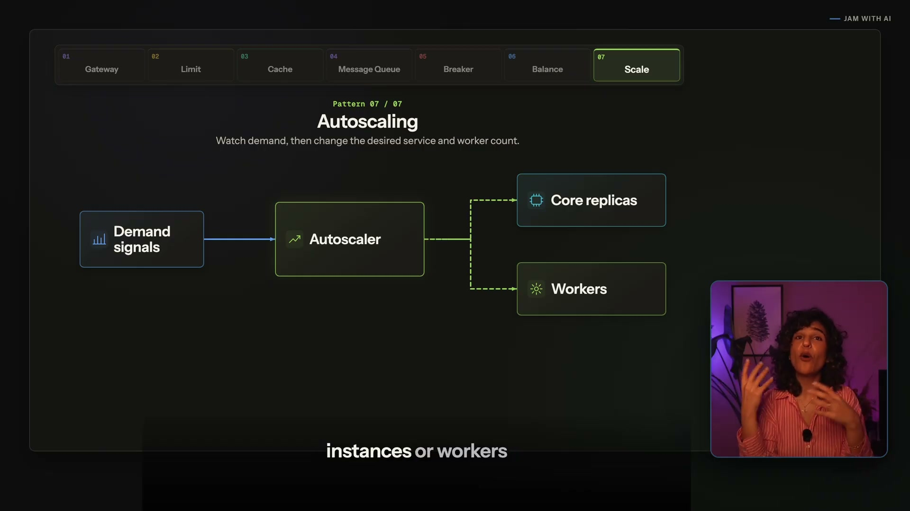
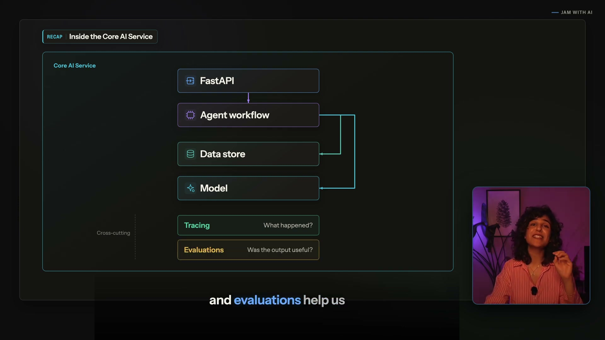
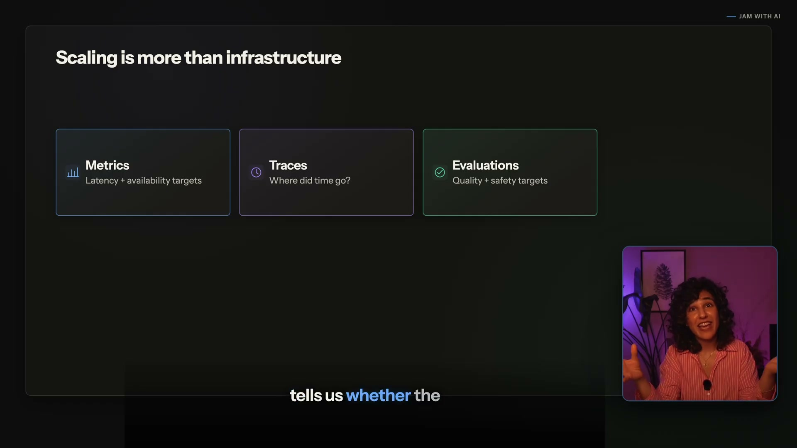

# AI System Design: 7 Patterns Explained in 17 Minutes

**Channel**: [[Jam With AI]] (`Jam With AI | Shirin Khosravi Jam`)
**Speaker**: Shirin Khosravi Jam
**URL**: https://www.youtube.com/watch?v=0jCss9xfOiw
**Duration**: 17m 11s *(Published 2026-09-10)*
**Transcript**: [[raw/video-transcripts/ai-system-design-7-patterns-explained-in-17-minutes.md]]
**Curated Keyframes**: [[raw/screenshots/ai-system-design-7-patterns-explained-in-17-minutes/01.jpg]], [[raw/screenshots/ai-system-design-7-patterns-explained-in-17-minutes/02.jpg]], [[raw/screenshots/ai-system-design-7-patterns-explained-in-17-minutes/03.jpg]], [[raw/screenshots/ai-system-design-7-patterns-explained-in-17-minutes/04.jpg]], [[raw/screenshots/ai-system-design-7-patterns-explained-in-17-minutes/05.jpg]], [[raw/screenshots/ai-system-design-7-patterns-explained-in-17-minutes/06.jpg]], [[raw/screenshots/ai-system-design-7-patterns-explained-in-17-minutes/07.jpg]], [[raw/screenshots/ai-system-design-7-patterns-explained-in-17-minutes/08.jpg]], [[raw/screenshots/ai-system-design-7-patterns-explained-in-17-minutes/09.jpg]], [[raw/screenshots/ai-system-design-7-patterns-explained-in-17-minutes/10.jpg]], [[raw/screenshots/ai-system-design-7-patterns-explained-in-17-minutes/11.jpg]], [[raw/screenshots/ai-system-design-7-patterns-explained-in-17-minutes/12.jpg]], [[raw/screenshots/ai-system-design-7-patterns-explained-in-17-minutes/13.jpg]], [[raw/screenshots/ai-system-design-7-patterns-explained-in-17-minutes/14.jpg]]

An end-to-end architectural walkthrough explaining why a working `FastAPI` + AI agent prototype breaks under `10,000+` concurrent users—and how wrapping the unchanged core AI service in seven foundational infrastructure patterns (gateway, admission control, caching, message queues, resilience controls, stateless load balancing, and GPU-aware autoscaling) turns a fragile app into a scalable production system.

---

## 1. Zooming Out from the Core AI Service (`00:00 - 01:40`)
- **The Load Gap**: A single request (`User -> FastAPI -> Agent -> Model`) works effortlessly in development, yet collapses when `10,000` users hit the endpoint in bursts or when a single dependency stalls. Asynchronous web frameworks like `FastAPI` reclaim idle I/O wait time, but **cannot invent capacity** when downstream compute/provider quotas saturate.
- **Core AI Service Boundary (`13.jpg`)**: Inside the core service, `FastAPI` handles routes and passes work to the `Agent workflow` backed by a `Data store` and `Model`, instrumented by cross-cutting `Tracing` (*"What happened?"*) and `Evaluations` (*"Was the output useful?"*). System design focuses on the **outer lifecycle wrapping** that unchanged core: *how requests enter, wait, reuse work, survive failures, and scale*.

---

## 2. The Seven Surrounding Infrastructure Patterns (`01:40 - 15:37`)

| # | Pattern | Core Problem Solved | AI-Specific Design Nuance |
| :-: | :--- | :--- | :--- |
| **01** | **API Gateway** *(Slides `01–02`)* | Controlled single entrance (`check request`, attach `request ID`, `route/choose destination`) | **Inbound API Gateway** (users $\rightarrow$ internal services, complementing not replacing FastAPI) is distinct from an **Outbound Model Gateway** (Core AI Service $\rightarrow$ OpenAI / Anthropic / self-hosted providers) |
| **02** | **Rate Limiting & Admission Control** *(Slide `03`)* | Protects capacity via `Start / Wait / Reject` + `HTTP 429 Retry-After` **backpressure** | Request counts alone fail for AI: one tiny classification prompt vs. a multi-tool agent prompt can differ by orders of magnitude $\rightarrow$ throttle **RPM, input/output tokens (TPM), and active model calls** |
| **03** | **Safe Caching** *(Slides `04–05`)* | Reuses work (`embeddings`, retrieval chunks, common docs, safe responses) in stores like **Redis** | Strict **tenant & permission isolation** (`Tenant + Permissions` in cache key), TTL / config-version invalidation, and avoiding naive reuse across merely similar-sounding queries |
| **04** | **Message Queue** *(Slide `06`)* | Smooths spikes by moving non-blocking work (`ingestion`, `embeddings`, long reports, emails) to worker pools | Separate **Live lane (Reserved)** from **Batch lane (Capped)** pools so bulk ingestion never starves chat DB/compute; enforce max backlog/wait, **Dead Letter Queues (DLQ)**, and **idempotent** workers |
| **05** | **Timeouts, Retries & Circuit Breakers** *(Slides `07–08`)* | Bounds waiting (`timeouts`), prevents retry storms (**exponential backoff + jitter**, bounded retries), and trips open failing dependencies (`CLOSED -> OPEN -> HALF-OPEN`) | Pair tripped circuits with **Bulkheads** (isolated pools per provider) and **Graceful Degradation** (verified fallback model or cached answer—**never** fabricate/guess missing facts) |
| **06** | **Load Balancing & Shared State** *(Slide `09`)* | Distributes live load across healthy service replicas (`Core A / B / C`) | Keep FastAPI replicas **stateless**: persist durable conversation checkpoints/job status in **PostgreSQL** and short-lived shared state in **Redis** so retries resume cleanly on any replica |
| **07** | **Autoscaling & Cold Starts** *(Slides `10–12`)* | Matches replica & worker counts dynamically to real demand | Scale on waiting-work signals (**queue depth, oldest job age, active requests, GPU utilization**) because CPU misses full GPUs; account for multi-minute **GPU weight-loading cold starts** via warm pools and remember: *control work first, then add capacity* |

See [[Production AI Resilience and Scaling Patterns]] for a full architectural synthesis and visual diagrams for each pattern.

---

## 3. Production Observability & System Design Interview Method (`15:37 - 17:11`)
- **Scaling Is More Than Infrastructure (`14.jpg`)**:
  1. **Metrics** (*Latency + availability targets*): Did the system stay fast and up?
  2. **Traces** (*Where did time go?*): Where inside a specific request did latency or failure occur?
  3. **Evaluations** (*Quality + safety targets*): Did the AI answer remain useful and grounded? *"Scaling a wrong answer faster is not success."*
- **Senior System Design Interview Habit (`"Start with the problem, not a product"`)**: Never open by listing seven vendor names (`Redis`, `Kafka`, etc.). Walk sequentially from the user request: establish expected traffic/bursts, split synchronous streaming work from async queueable work, identify the scarcest dependency/bottleneck, and introduce each pattern strictly when it solves a concrete failure mode.

---

## Synthesis Notes
- **Video 1 Inner Core + Video 2 Outer Wrapper**: Direct sequel to [[How a Production AI Agent System Actually Works]] *(2026-08-21)*, which defines the internal 9-layer Core AI Service ([[Production AI Agent Service Stack]]) that this video zooms out from and wraps in seven outer request-lifecycle infrastructure patterns ([[Production AI Resilience and Scaling Patterns]]).
- **Complementary Two-Halves Blueprint**: Whereas [[AI System Design and Production Architecture]] (`koteswar.AI`, [[AI Engineer Interview Notes]]) details the *internal* orchestration of a 10M-user support system (intent routing, Hybrid RAG + Cross-Encoder rerank, tool contracts, escalation queue), Shirin Khosravi Jam's 7 patterns define the *outer request-lifecycle wrapper* protecting that inner core (`FastAPI` + `Agent` + `Data Store` + `Model`) from bursts, slow third-party APIs, and cold-start cliffs.
- **Written Substack Precursor**: Builds upon [[System Design for AI Engineers 7 Patterns]] *(2026-04-09)*, extending those interview patterns (Denial-of-Wallet defense, weighted/least-connections `vLLM` balancing, semantic caching) with explicit Model Gateway separation, Live vs. Batch worker lane isolation, PostgreSQL/Redis external state stores, and the Metrics + Traces + Evals triad.
- **Terminology Precision**: Distinguishes **API Gateway** (client-facing ingress, paired with FastAPI) from **Model Gateway** (provider-facing egress to OpenAI/Anthropic), and **API Gateway vs. Load Balancer** (route selection & request hygiene vs. replica-level health distribution).
- **Observability Convergence**: Aligns tightly with [[Product Evals and Error Analysis]] (`Traces` before heuristics; metrics alone miss silent AI quality degradation) and [[LLM Inference Optimization and Security]] (`GPU memory`, quantization, and serving efficiency that dictate cold-start duration and scaling ceilings).

## Related Pages
- **Entities**: [[Jam With AI]]
- **Concepts**: [[Production AI Resilience and Scaling Patterns]], [[Production AI Agent Service Stack]], [[AI System Design and Production Architecture]], [[Inference Serving and Deployment Patterns]], [[LLM Inference Optimization and Security]], [[System Prompt Caching Optimization]], [[Product Evals and Error Analysis]], [[Closed-Loop Evals]]
- **Sources**: [[How a Production AI Agent System Actually Works]], [[System Design for AI Engineers 7 Patterns]], [[AI Engineer Interview Notes]], [[AI Deployment Notes]]
