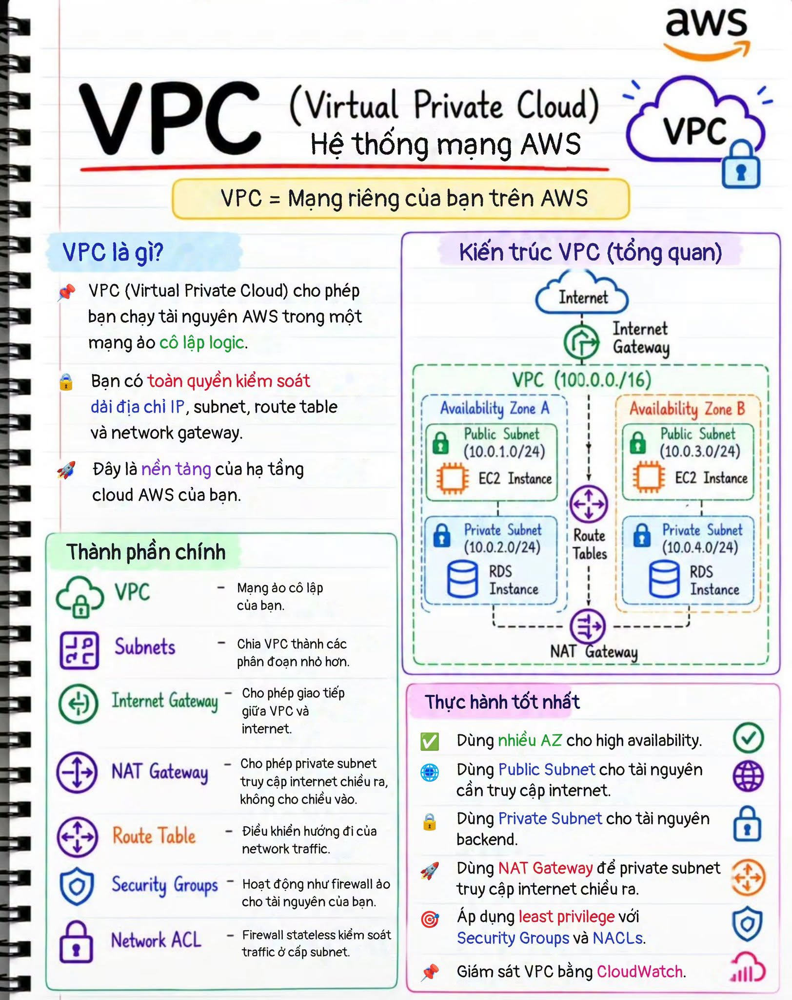
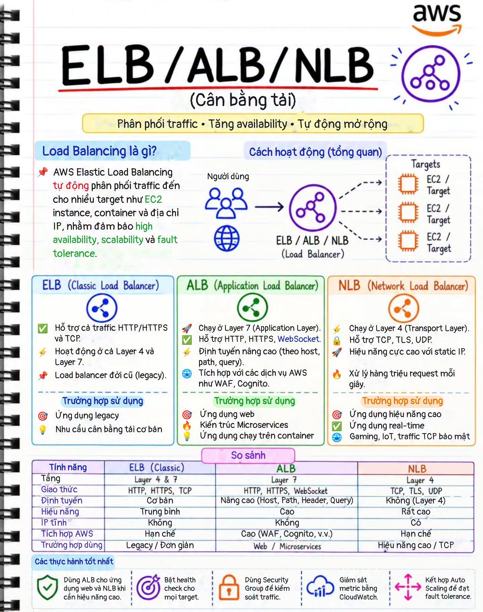
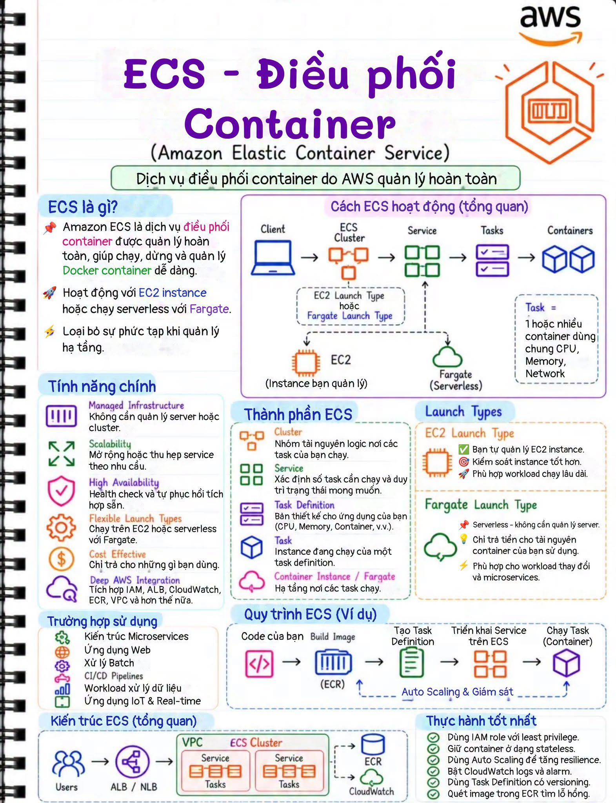
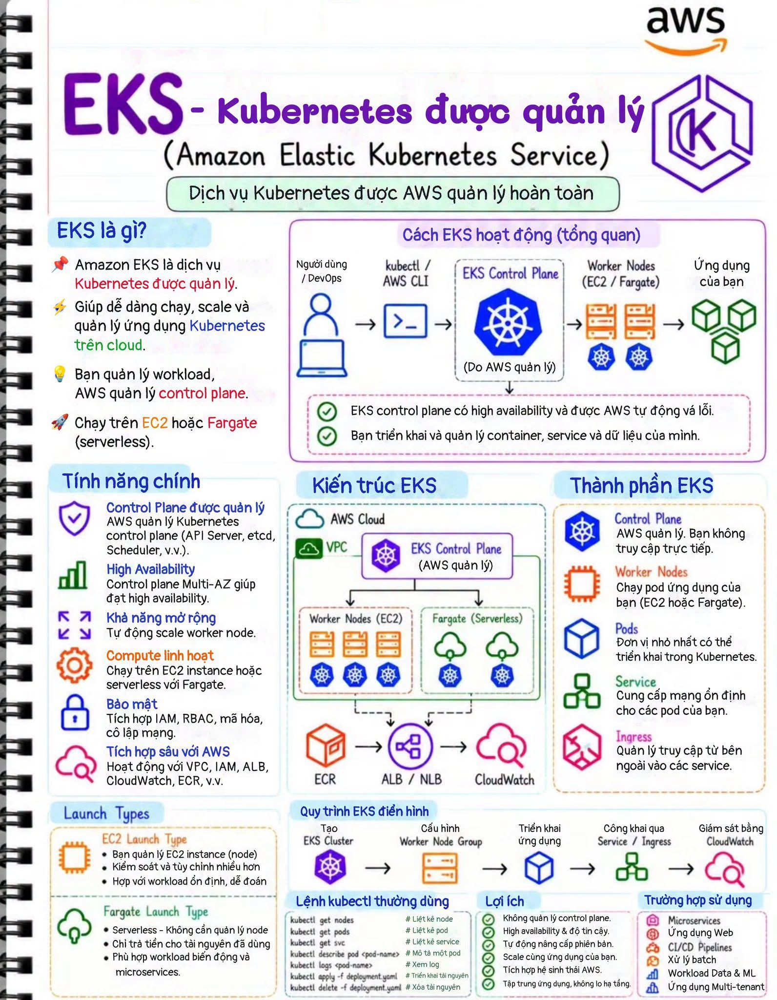
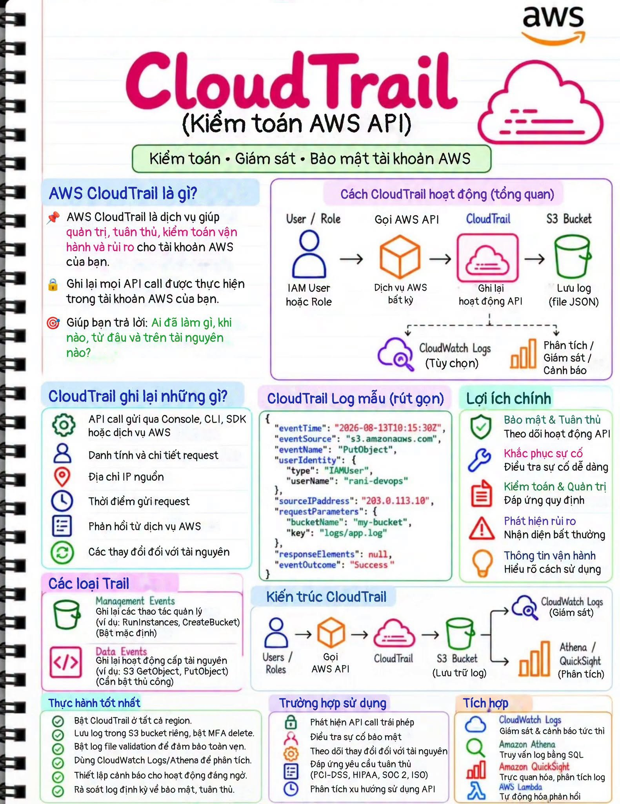
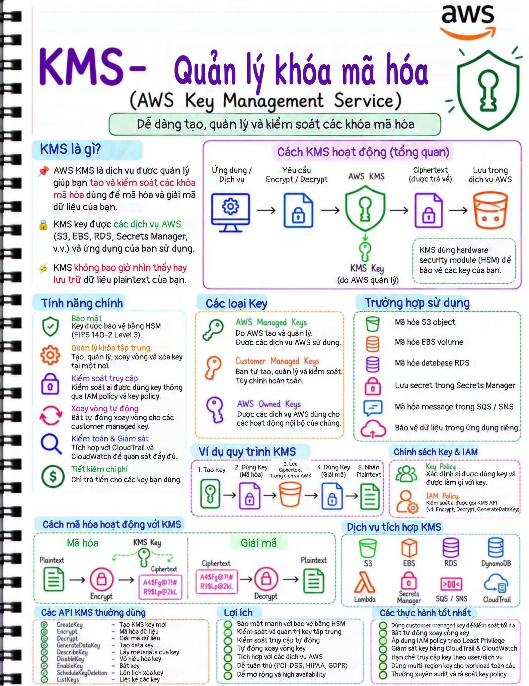

# AWS Core Services Notes (Ghi chú các dịch vụ AWS cốt lõi bằng tiếng Việt)

**Author**: [Viet Nguyen AI](../entities/Viet%20Nguyen%20AI.md) | **Source**: [Facebook Post](https://web.facebook.com/vietnh1009/posts/pfbid0tjDepyu8Q5XSfMnCrW5XbbUSU1w6rzKafgWq7W6oXtV6T8ajuQnLZDuAnEJ9a9F2l) (original English IG: `https://www.instagram.com/p/Ddpj30hEnZK/?img_index=1`) | **Raw Transcript & Visuals**: [raw/articles/ai-other/aws-core-services-notes.md](../../raw/articles/ai-other/aws-core-services-notes.md) | **Pages**: 18 visual sketchnote slides (`2026-11-16`)

---

## Executive Summary

An 18-page Vietnamese visual reference notebook compiled and translated by [Viet Nguyen AI](../entities/Viet%20Nguyen%20AI.md) covering **17 core [AWS](../entities/Amazon%20Web%20Services%20%28AWS%29.md) services and infrastructure primitives** across foundation/networking, compute/storage, DNS/load balancing, relational & NoSQL databases, containers & queues, observability/auditing, and cryptographic security. Built for cloud newcomers, backend/AI deployment engineers, and DevOps interview preparation.

---

## Structured Thematic Synthesis

### 1. Foundation, Identity, Networking & Compute (Pages 1–7)
Synthesized in depth at [AWS Foundation, Networking and Compute](../concepts/AWS%20Foundation%2C%20Networking%20and%20Compute.md):
- **Global Regions & AZs (Page 1)**: Physical isolation across Regions (`us-east-1`, `ap-southeast-1`, etc.), multi-data-center Availability Zones (`AZ`), Data Centers, and CloudFront Edge Locations balancing latency, HA/DR, data residency compliance, and regional pricing.
- **IAM (Page 2)**: Authentication vs. Authorization via **Users**, **Groups**, temporary **Roles**, and JSON **Policies**—enforcing MFA, Least Privilege, Root User restriction, key rotation, and Role assumption over static credentials.
- **EC2 & EBS (Pages 3–4)**: Virtual servers configured by AMI, Instance Type, Security Group, and attached **EBS** volumes replicated inside an AZ (`gp3` default SSD, `io2`/`io1` high IOPS, `st1` throughput HDD, `sc1` cold HDD) with point-in-time Snapshots and KMS encryption.
- **VPC (Page 5)**: Logically isolated virtual network partitioned across Multi-AZ Public Subnets (`Internet Gateway`) and Private Subnets (`NAT Gateway` outbound-only), controlled via Route Tables, stateful **Security Groups**, and stateless **Network ACLs**.
- **Load Balancing & DNS (Pages 6–7)**: Comparative breakdown of **Classic ELB**, **ALB** (Layer 7 HTTP/HTTPS/WebSocket, Host/Path/Header/Query routing, WAF/Cognito integration), and **NLB** (Layer 4 TCP/TLS/UDP, Static IPs, millions req/s), paired with **Route 53** (`A`, `AAAA`, `CNAME`, `MX`, `TXT` Hosted Zones, Health Checks, DNSSEC, and 8 routing policies).

### 2. Databases, Queues & Container Orchestration (Pages 8–13)
Synthesized in depth at [AWS Databases, Containers and Messaging](../concepts/AWS%20Databases%2C%20Containers%20and%20Messaging.md):
- **RDS & DynamoDB (Pages 8–9)**: Managed relational SQL engines (`MySQL`, `PostgreSQL`, `MariaDB`, `Oracle`, `SQL Server`, `Amazon Aurora`) with Multi-AZ failover and PITR backups vs. serverless **DynamoDB** NoSQL (`Partition Key + Sort Key`, millisecond latency, Provisioned `RCU/WCU` vs. `On-Demand`, `Strong` vs. `Eventually` consistent reads, `TTL`, and Global Tables).
- **SQS (Page 10)**: Asynchronous decoupling between producers and consumers comparing **Standard Queue** (at-least-once, best-effort order) and **FIFO Queue** (strict FIFO, exactly-once deduplication), Visibility Timeout, Long Polling, Delay Queues, and Dead Letter Queues (`DLQ`).
- **ECS, EKS & ECR (Pages 11–13)**: Container image lifecycle in **ECR** (with Amazon Inspector vulnerability scanning and lifecycle cleanup) deployed to either AWS-native **ECS** (`Cluster -> Service -> Task Definition -> Task` on EC2 or serverless **Fargate**) or managed Kubernetes **EKS** (AWS-managed Control Plane + Worker Nodes/Pods/Service/Ingress).

### 3. Observability, Auditing & Security Controls (Pages 14–17)
Synthesized in depth at [AWS Observability and Cryptographic Security](../concepts/AWS%20Observability%20and%20Cryptographic%20Security.md):
- **CloudWatch (Page 14)**: Unified metrics, centralized logs, events, alarms, dashboards, AI-driven Insights, Synthetics, and ServiceLens driving automated actions (`SNS`, `Lambda`, `Auto Scaling`).
- **CloudTrail (Page 15)**: Account-wide API audit ledger recording **Management Events** (default) and **Data Events** (manual, e.g., `S3 PutObject`), persisted to tamper-validated S3 buckets (with MFA Delete) and queried via CloudWatch Alarms, Amazon Athena, QuickSight, and Lambda.
- **Secrets Manager & KMS (Pages 16–17)**: Eliminating hardcoded credentials via KMS-encrypted secret storage and 5-step **automated Lambda rotation**, underpinned by **AWS KMS** FIPS 140-2 Level 3 HSM keys (`AWS Managed`, `Customer Managed`, `AWS Owned`) governed jointly by Key Policies and IAM Policies.

---

## Editorial Notes & Second Brain Context

- **Minor OCR / Visual Infographic Typos Noted in Source Slides**:
  - Page 5 diagram lists `VPC (100.0.0./16)` while its subnets use `10.0.1.0/24..10.0.4.0/24` (standard CIDR is `10.0.0.0/16`).
  - Page 10 retains SQS Message Retention max of `14 days` in the concept table while the overview pill prints `(tối đa 14 ngày)` alongside an erroneous parenthetical `(O giây - 15 phút)` belonging to Delay Seconds (`0–15 min`); Page 10 Standard Queue bullet reads *"Hỗ trợ FIFO và non-FIFO"* which refers to SQS supporting both queue families rather than Standard Queues offering FIFO ordering.
  - Page 15 sample JSON prints `"s3.amzonaaws.com"` (for `"s3.amazonaws.com"`); Page 16 sample IAM JSON prints `"Stalement"` (for `"Statement"`). All technical notes in `wiki/concepts/` record the exact production syntax.
- Connects infrastructure cloud primitives directly to [AI Deployment Notes](AI%20Deployment%20Notes.md), [Inference Serving and Deployment Patterns](../concepts/Inference%20Serving%20and%20Deployment%20Patterns.md), [Enterprise Agent Stack](../concepts/Enterprise%20Agent%20Stack.md), and [Software Supply Chain Security](../concepts/Software%20Supply%20Chain%20Security.md).

---

## Related Pages
- **Entities**: [Amazon Web Services (AWS)](../entities/Amazon%20Web%20Services%20%28AWS%29.md), [Viet Nguyen AI](../entities/Viet%20Nguyen%20AI.md)
- **Concepts**:
  - [AWS Foundation, Networking and Compute](../concepts/AWS%20Foundation%2C%20Networking%20and%20Compute.md)
  - [AWS Databases, Containers and Messaging](../concepts/AWS%20Databases%2C%20Containers%20and%20Messaging.md)
  - [AWS Observability and Cryptographic Security](../concepts/AWS%20Observability%20and%20Cryptographic%20Security.md)
  - [Inference Serving and Deployment Patterns](../concepts/Inference%20Serving%20and%20Deployment%20Patterns.md)
  - [AI Deployment Lifecycle and Environments](../concepts/AI%20Deployment%20Lifecycle%20and%20Environments.md)
