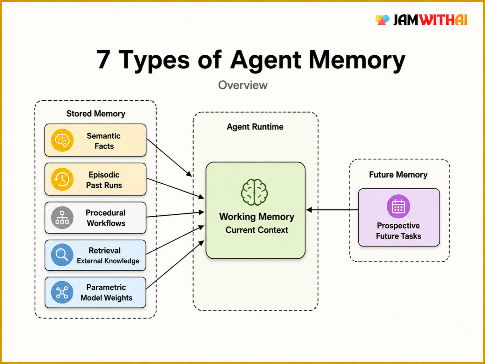
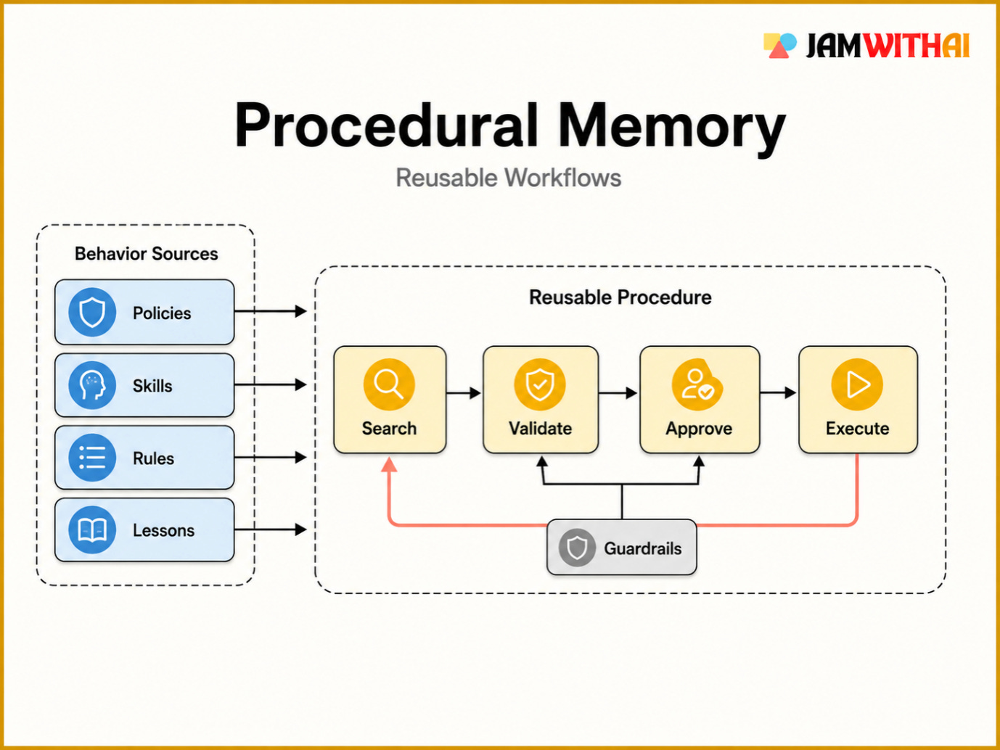
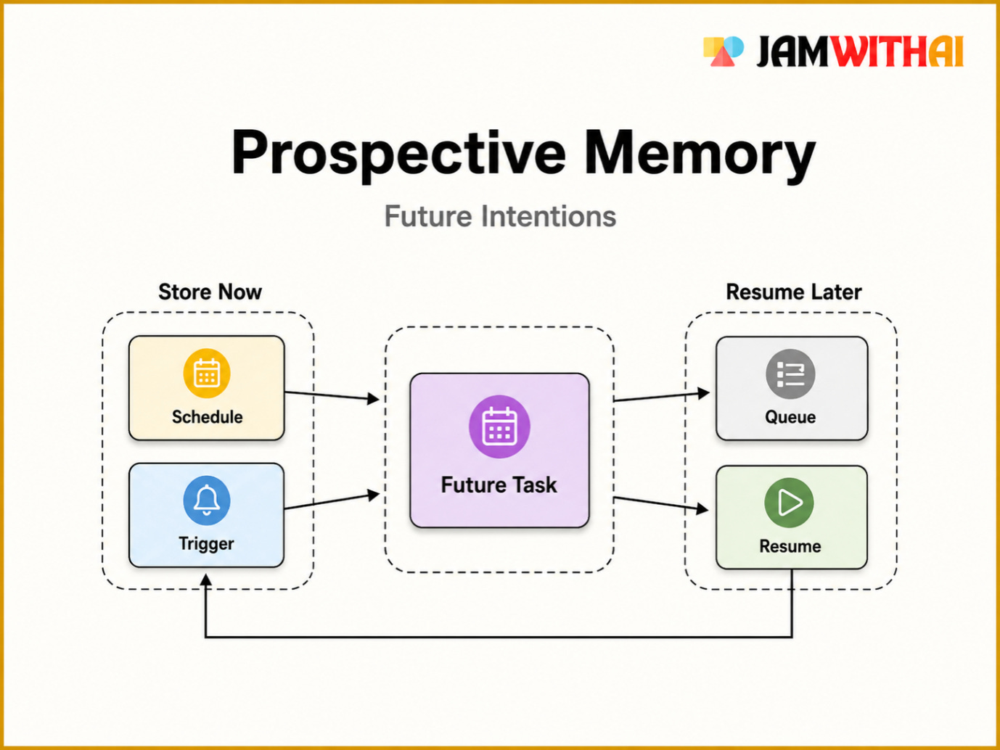

# Agent Memory: the 7 types you should know before you ship to production

**Authors**: Shantanu Ladhwe, Shirin Khosravi Jam ([[Jam With AI]])
**URL**: https://jamwithai.substack.com/p/agent-memory-the-7-types-you-should *(Published 2026-07-01)*
**Companion YouTube Video**: [[AI Agent Memory 7 Types Explained in 12 Minutes]] *(Published 2026-08-28)*
**Source File**: [[raw/articles/ai-other/agent-memory-the-7-types-you-should-know.md]]
**Visual Diagrams**: [[raw/screenshots/agent-memory-the-7-types-you-should-know/01.jpg]], [[raw/screenshots/agent-memory-the-7-types-you-should-know/02.jpg]], [[raw/screenshots/agent-memory-the-7-types-you-should-know/03.jpg]], [[raw/screenshots/agent-memory-the-7-types-you-should-know/04.jpg]], [[raw/screenshots/agent-memory-the-7-types-you-should-know/05.jpg]], [[raw/screenshots/agent-memory-the-7-types-you-should-know/06.jpg]], [[raw/screenshots/agent-memory-the-7-types-you-should-know/07.jpg]], [[raw/screenshots/agent-memory-the-7-types-you-should-know/08.jpg]] *(Note: `00.jpg` in raw capture is an embedded AWS Marketplace sponsor panel card)*

A production-oriented engineering framework organizing agent memory into **seven distinct systems** rooted in cognitive science and **CoALA**—diagnosing why naive *"just dump everything into a vector DB"* designs fail and detailing exact storage mechanisms, failure modes, and runtime loops for each memory type.

> **Coverage Note**: The free article preview captures the complete foundational mental model and all seven memory types (`~19,000` characters across `01.jpg–08.jpg`), while the concluding `"How the seven work together"` end-to-end walkthrough is gated behind a paid Substack paywall. That missing synthesis example is fully covered in the companion video [[AI Agent Memory 7 Types Explained in 12 Minutes]].

---

## 1. Foundational Mental Model (CoALA & Two Orthogonal Axes)
> *"More memory is not a better agent. A better agent forgets on purpose."*

Rather than inventing ad-hoc vocabulary, the taxonomy maps cognitive science classifications onto **CoALA: Cognitive Architectures for Language Agents** (Sumers, Yao, Narasimhan, & Griffiths, 2023 — `https://arxiv.org/abs/2309.02427`): **one short-term working memory** paired with **optional long-term stores** (`01.jpg`: **Stored Memory** $\rightarrow$ **Agent Runtime Working Memory** $\leftarrow$ **Future Memory**). Engineers must separate two axes before selecting databases:

1. **Stored vs. Active**: Persistence in a database (`Postgres`, vector stores) is only *potential*. An LLM cannot reason over a single byte until the application loads those bytes back into the prompt (**Working Memory**). Even with unbounded context windows, stuffing extra data inflates **real-time latency and token cost** (*"hold the smallest amount the agent needs for its next good decision—nothing more"*).
2. **What vs. Where**: **Semantic**, **Episodic**, and **Procedural** memory specify *what* is remembered; **External/Retrieval** and **Parametric** memory specify *where* knowledge lives and *how* it reaches the model. Conflating these axes causes teams to treat a vector DB as a substitute for structured state.

---

## 2. Seven Memory Types: Implementation Primitives & Failure Modes

| # | Memory Type | Architectural Mechanics & Key References | Production Breakpoints & Rules |
| :-: | :--- | :--- | :--- |
| **01** | **In-Context / Working Memory** *(Diagram `02.jpg`)* | Prompt payload (`System Prompt + Messages + Tool Outputs + Retrieved Docs`) paired bidirectionally (`<->`) with a **`Thread ID` Checkpointer** DB (`LangGraph` checkpointer) executing a **reload-and-resend loop** + trimming/summarization inspired by **MemGPT** (Packer et al., 2023 — `https://arxiv.org/abs/2310.08560`) | Models remember nothing between calls; a 10-turn preference (*use AWS ECS, avoid EKS*) only holds while message 1 remains inside the active window. Bad pruning drops decisive constraints while bloats raise cost/latency. |
| **02** | **Semantic Memory** *(Diagram `03.jpg`)* | Persistent declarative fact store (`Profile`, `Preferences`, `Org Facts`, `Account`) scoped in **separate per-user buckets** across `Session 1..N` (`LangGraph` long-term memory store) populated via selective LLM fact extraction | Saving one-off requests (*"keep it short today"*) alongside standing rules (*"always answer briefly"*) creates stale contradictions. **A wrong saved fact is worse than none** because the agent trusts it unconditionally $\rightarrow$ enforce extraction, validation, update, and deletion rules. |
| **03** | **Episodic Memory** *(Diagram `04.jpg`)* | Append-only event diary of past runs (`objective`, `actions`, `tool calls/observations`, `errors`, `feedback`, `outcome`) paired with **post-task Reflection** (`Recall & Apply` loop) modeled on **Generative Agents** (Park et al., 2023 — `https://arxiv.org/abs/2304.03442`) | *"Ten thousand old runs is just an archive"* unless distilled. Reuse **short reflection summaries** of what worked vs. failed next to the trace—never raw full transcripts. |
| **04** | **Procedural Memory** *(Diagram `05.jpg`)* | `Behavior Sources` (`Policies`, `Skills`, `Rules`, `Lessons`) compiled into a `Reusable Procedure` (`Search -> Validate -> Approve -> Execute`) protected by explicit **`Guardrails`** (`prompts`, `tool descriptions`, workflow sequences, reusable skills) | Jumbled mega-prompts cause rule collisions and brittle edits. Conversely, **promoting a single unlucky run into a standing rule encodes a bad permanent habit**; graduate only repeated episodic patterns (e.g., repeated deploy crashes from missing env vars $\rightarrow$ mandatory pre-deploy env check). |
| **05** | **External / Retrieval Memory** *(Diagram `06.jpg`)* | `External Knowledge` (`Vector DB`, `SQL`, `Docs`, `Graph`) bridged into `Current Context` via **5 query-matched lookup paths**: (1) semantic similarity, (2) **exact SQL/KV lookup** (`plan`, `order ID`), (3) **permission/category filters**, (4) **time-based deadline lookups**, and (5) **graph/link traversal** | Defaulting to vector similarity fails exact factual queries, time windows, or multi-tenant isolation; a router/dispatcher should pick the lookup mechanism per question type before injecting results into Working Memory. |
| **06** | **Parametric Memory** *(Diagram `07.jpg`)* | Immutable weights baked from `Training Data + Patterns + Language -> Model Weights -> Reasoning + General Knowledge + Skills` | Frozen at training cutoff, lacks private company data, and hallucinates confidently. [[LLM Fine-Tuning and Alignment]] shifts behavior/style, **not** mutable factual truth (*keep reimbursement limits in External Memory*). |
| **07** | **Prospective Memory** *(Diagram `08.jpg`)* | `Store Now (Schedule, Trigger) -> Future Task -> Resume Later (Queue, Resume)` cyclic engine powered by **cron, task queues, schedulers, and durable workflow runtimes (`Temporal`)** | Chat closes before Tuesday/Friday arrives. Persist 5 required fields per task: **what to do**, **time/event trigger**, **resumption context**, **completion state**, and **pre-execution human approver** so tasks *"neither nag forever nor quietly disappear."* |

---

## 3. Synthesis & Companion Diff vs. Video
This July 1, 2026 written post (co-authored by Shantanu Ladhwe and Shirin Khosravi Jam) serves as the theoretical and architectural blueprint preceding Shirin's August 28, 2026 video [[AI Agent Memory 7 Types Explained in 12 Minutes]]:

- **What This Written Guide Adds Beyond the Video**:
  - Anchors the taxonomy explicitly in peer-reviewed research (**CoALA** `2309.02427`, **MemGPT** `2310.08560`, **Generative Agents** `2304.03442`).
  - Introduces the two diagnostic mental-model axes (**Stored vs. Active** and **What vs. Where**) plus the three-zone visual overview (**Stored** $\rightarrow$ **Runtime Working** $\leftarrow$ **Future**, `01.jpg`).
  - Names concrete implementation components omitted or skimmed in the video: **`Thread ID` Checkpointers** (`LangGraph`), **post-run Reflection distillation** vs. raw archives, **`Search -> Validate -> Approve -> Execute` Guardrail loop** (`05.jpg`), **graph/link traversal & time-based retrieval**, and **Temporal** durable execution for deferred tasks (`08.jpg`).
  - Explicitly warns against **over-promoting a single failed episode into Procedural Memory**.
- **What the Later Video Deepens**:
  - Delivers the complete **"How the seven work together"** Email Agent walkthrough (*Maya's late-order inquiry + Friday follow-up*), unlocking the subscriber-gated conclusion.
  - Adds the explicit **`Semantic Memory` vs. `Semantic Search`** distinction, **4 First-Principles Design Questions** (*Survive / Come back / Update or disappear / Wake later*), and tighter production safety/eval practices.
- > ⚠️ **Evolving nuance (Safety & Runtime Rigor, Jul $\rightarrow$ Aug 2026)**: While the July article emphasizes cognitive categorization (*What vs. Where*), checkpointers, and reflection distillation, the August video tightens three operational production safeguards: **(1) untrusted external inputs (emails/web pages) must be validated before writing to Semantic Memory**, **(2) retrieval layers must enforce multi-tenant ACL/date filtering and be unit-tested separately from LLM generation**, and **(3) Prospective wakeups require re-checking live world state + idempotency keys** so scheduler retries never duplicate external actions.

---

## Related Pages
- **Companion Source & Entity**: [[AI Agent Memory 7 Types Explained in 12 Minutes]], [[Jam With AI]]
- **Canonical Concept**: [[AI Agent Memory Types]]
- **Related Concepts**: [[Context Engineering]], [[Context Rot]], [[Context Window Management]], [[Retrieval-Augmented Generation and Vector DBs]], [[Memory Architecture]], [[Memory Promotion Path]], [[Agent Skills Architecture]], [[Production AI Agent Service Stack]], [[Production AI Resilience and Scaling Patterns]], [[LLM Fine-Tuning and Alignment]], [[Product Evals and Error Analysis]]
- **Series Siblings**: [[How a Production AI Agent System Actually Works]], [[AI System Design 7 Patterns Explained in 17 Minutes]], [[System Design for AI Engineers 7 Patterns]]
