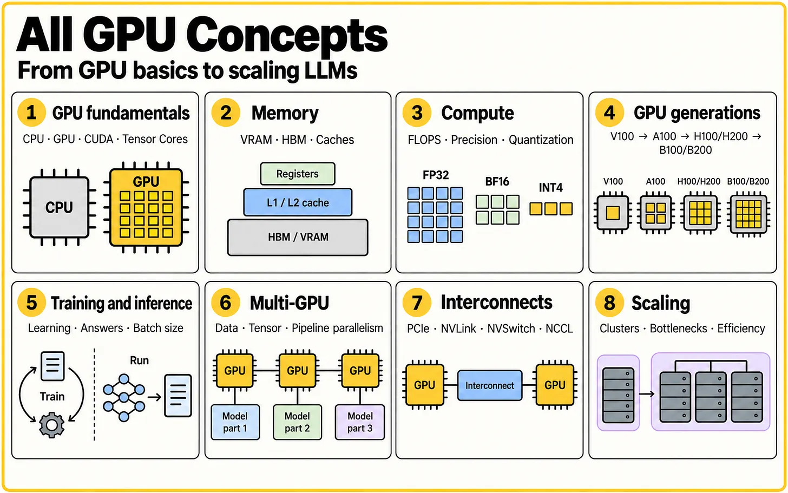
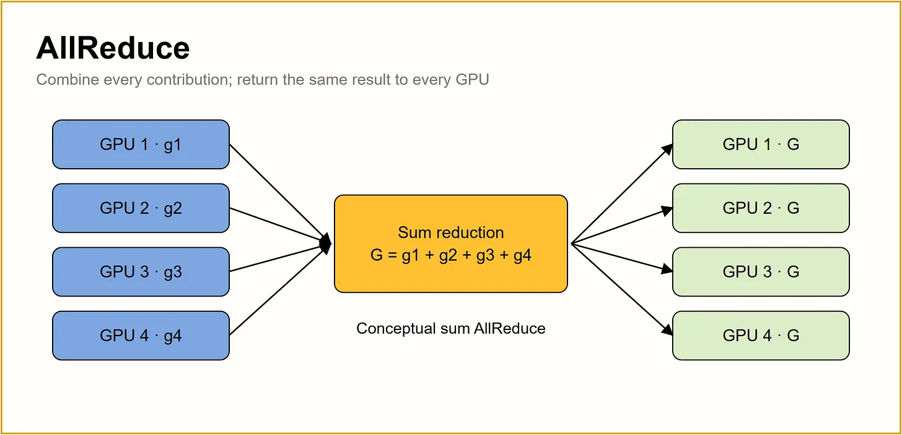

# All GPU Related Concepts Simply Explained

**Author**: [Jam With AI](../entities/Jam%20With%20AI.md)
**URL**: https://jamwithai.substack.com/p/all-gpu-related-concepts-simply-explained
**Source File**: [raw/articles/ai-other/all-gpu-related-concepts-simply-explained.md](../../raw/articles/ai-other/all-gpu-related-concepts-simply-explained.md)
**Curated Visual Diagrams (`11` core sheets)**: [raw/screenshots/all-gpu-related-concepts-simply-explained/00.webp](../../raw/screenshots/all-gpu-related-concepts-simply-explained/00.webp), [raw/screenshots/all-gpu-related-concepts-simply-explained/01.webp](../../raw/screenshots/all-gpu-related-concepts-simply-explained/01.webp), [raw/screenshots/all-gpu-related-concepts-simply-explained/02.webp](../../raw/screenshots/all-gpu-related-concepts-simply-explained/02.webp), [raw/screenshots/all-gpu-related-concepts-simply-explained/03.webp](../../raw/screenshots/all-gpu-related-concepts-simply-explained/03.webp), [raw/screenshots/all-gpu-related-concepts-simply-explained/04.webp](../../raw/screenshots/all-gpu-related-concepts-simply-explained/04.webp), [raw/screenshots/all-gpu-related-concepts-simply-explained/05.webp](../../raw/screenshots/all-gpu-related-concepts-simply-explained/05.webp), [raw/screenshots/all-gpu-related-concepts-simply-explained/06.webp](../../raw/screenshots/all-gpu-related-concepts-simply-explained/06.webp), [raw/screenshots/all-gpu-related-concepts-simply-explained/07.webp](../../raw/screenshots/all-gpu-related-concepts-simply-explained/07.webp), [raw/screenshots/all-gpu-related-concepts-simply-explained/08.webp](../../raw/screenshots/all-gpu-related-concepts-simply-explained/08.webp), [raw/screenshots/all-gpu-related-concepts-simply-explained/09.webp](../../raw/screenshots/all-gpu-related-concepts-simply-explained/09.webp), [raw/screenshots/all-gpu-related-concepts-simply-explained/10.webp](../../raw/screenshots/all-gpu-related-concepts-simply-explained/10.webp)

A plain-English visual reference covering **55+ GPU concepts** across **8 interconnected layers**—helping AI engineers diagnose *why* models run slowly or run out of memory even after upgrading or adding GPUs. All core technical mechanisms are synthesized in [GPU Architecture and Distributed Scaling](../concepts/GPU%20Architecture%20and%20Distributed%20Scaling.md).

---

## 1. Eight-Area Visual Curriculum (`Sections 1–8`)

| Area | Terms Covered in Article | Core Diagnostic Takeaway |
| :-: | :--- | :--- |
| **1. GPU Fundamentals** (`1.1–1.10`) | CPU, GPU, Parallel Computing, Matrix & Tensor Ops, **SM** (`Streaming Multiprocessor`), **CUDA Cores**, **Tensor Cores**, Threads, **Warps (`32` threads)**, **CUDA Kernels** *(Diagram `01.webp`)* | `GPU -> SMs -> CUDA/Tensor Cores -> Threads & Warps executing CUDA kernels`; Tensor Cores specialize in dense deep-learning matmuls. |
| **2. GPU Memory** (`2.1–2.7`) | **VRAM (`CUDA OOM`)**, **HBM**, Memory Bandwidth vs Capacity, 4-tier hierarchy (**Registers / L1 / L2 / HBM**) *(Diagram `02.webp`)*, **Model Weights** (`7B FP16 ≈ 14 GB`), **Activations**, **KV Cache** *(Diagram `03.webp`)* | Model size fixes weight footprint; **workload (context length × batch size × concurrency)** determines KV cache and OOM thresholds. |
| **3. Compute & Precision** (`3.1–3.8`) | `FP32`, **`TF32`** *(compute speedup without halving stored `FP32` memory)*, `FP16`, **`BF16`**, `FP8`, `FP4`, `INT8`, `INT4`, **Mixed Precision** *(Diagram `04.webp`)*, **Quantization**, **FLOPS** | Lower precision shrinks VRAM and accelerates Tensor Cores; theoretical FLOPS never works in isolation from bandwidth and comms. |
| **4. NVIDIA Generations** (`4.1–4.4`) | **Volta (`V100`)**, **Ampere (`A100`)**, **Hopper (`H100` / `H200`)** *(Diagram `05.webp`)*, **Blackwell (`B100` / `B200`)** | Evolution tracks Tensor Cores (`V100`) $\rightarrow$ cluster standard (`A100`) $\rightarrow$ Transformer Engine/`FP8`/larger HBM (`H100`/`H200`) $\rightarrow$ `B100`/`B200`. |
| **5. Training & Inference** (`5.1–5.6`) | LLM Training (*weights + activations + gradients + optimizer states*), LLM Inference (*weights + KV cache*), Batch Size, **`nvidia-smi` Utilization Pitfall**, **Compute-Bound** vs. **Memory-Bound** *(Diagram `06.webp`)* | `100%` utilization in `nvidia-smi` only proves at least one kernel ran; memory-bound inference stalls on HBM bandwidth rather than FLOPS. |
| **6. Multi-GPU Parallelism** (`6.1–6.6`) | Model Sharding, **Data Parallelism (`DP`)**, **Tensor Parallelism (`TP`)**, **Pipeline Parallelism (`PP`)**, **3D Model Parallelism** *(Diagram `07.webp`)*, Communication Overhead | Keep workloads on 1 GPU if they fit; splitting tensors (`TP`) adds frequent GPU-to-GPU syncs, so `2×` GPUs never equals `2×` speed. |
| **7. Interconnects & Comms** (`7.1–7.6`) | `PCIe`, **`NVLink`**, **`NVSwitch`** *(Diagram `08.webp`)*, Inter-GPU Bandwidth, **`NCCL`**, **`AllReduce`** *(Diagram `09.webp`)* | `NVLink` / `NVSwitch` prevent `TP` stalls; `NCCL` `AllReduce` sums/synchronizes tensors (`g1..g4 -> G`) across every participant GPU. |
| **8. Cluster Scaling** (`8.1–8.8`) | Single-GPU, Multi-GPU, Distributed Training, GPU Cluster, Memory/Compute/Communication Bottlenecks, **Scaling Efficiency** *(Diagram `10.webp`)* | Overhead turns ideal `100s -> 50s -> 25s -> 12.5s` scaling into `100s -> 58s -> 36s -> 29s` (`1 -> 2 -> 4 -> 8` GPUs). |

---

## 2. Quick Triage Cheat Sheet ("Where Does That Term Belong?")
- **`HBM` or `CUDA OOM`** $\rightarrow$ **Memory capacity or HBM bandwidth problem** (`VRAM`, KV cache, batch size).
- **`BF16`, `FP8`, `INT4`** $\rightarrow$ **Numerical precision & quantization trade-off** (VRAM footprint vs. Tensor Core speed vs. quality).
- **`Tensor Parallelism` or `Pipeline Parallelism`** $\rightarrow$ **Model sharding across GPUs** (intra-layer matmul split vs. inter-layer stage pipeline).
- **`NVLink`, `NCCL`, `AllReduce`** $\rightarrow$ **Inter-GPU communication** (cluster fabric & collective sync overhead).
- **Config example decoded (`H100 + BF16 + TP=4 + NVLink`)**: Run Hopper hardware using 16-bit Brain Float precision, sharded tensor-parallel across `4` GPUs linked over `NVLink`.

---

## 3. Connected Jam With AI Series & External Pointers
- **Videos Embedded in Article (Already Ingested)**:
  - [How a Production AI Agent System Actually Works](How%20a%20Production%20AI%20Agent%20System%20Actually%20Works.md) (`sKzL0wSN9vQ`)
  - [AI Agent Memory 7 Types Explained in 12 Minutes](AI%20Agent%20Memory%207%20Types%20Explained%20in%2012%20Minutes.md) (`bK1clrG-boc`)
  - [AI System Design 7 Patterns Explained in 17 Minutes](AI%20System%20Design%207%20Patterns%20Explained%20in%2017%20Minutes.md) (`0jCss9xfOiw`)
- **Related Substack Guides Already Ingested**:
  - [Agent Memory The 7 Types You Should Know](Agent%20Memory%20The%207%20Types%20You%20Should%20Know.md)
  - [System Design for AI Engineers 7 Patterns](System%20Design%20for%20AI%20Engineers%207%20Patterns.md)
  - [System Design for Engineers 162 Concepts](System%20Design%20for%20Engineers%20162%20Concepts.md)
- **Additional Substack Pointers *(Not Opened/Ingested)***:
  - [20 AI Engineering Concepts Explained](https://jamwithai.substack.com/p/20-ai-engineering-concepts-explained)
  - [LLM Inference 101](https://jamwithai.substack.com/p/llm-inference-101)

---

## Related Pages
- **Primary Synthesis & Entity**: [GPU Architecture and Distributed Scaling](../concepts/GPU%20Architecture%20and%20Distributed%20Scaling.md), [Jam With AI](../entities/Jam%20With%20AI.md)
- **LLMOps, Quantization & Serving**:
  - [LLMOps & Inference](../topics/LLMOps%20%26%20Inference.md)
  - [LLM Inference Optimization and Security](../concepts/LLM%20Inference%20Optimization%20and%20Security.md)
  - [LLM Pretraining, Optimization and Decoding](../concepts/LLM%20Pretraining%2C%20Optimization%20and%20Decoding.md)
  - [Inference Serving and Deployment Patterns](../concepts/Inference%20Serving%20and%20Deployment%20Patterns.md)
  - [Inference Speed vs Intelligence Trade-off](../concepts/Inference%20Speed%20vs%20Intelligence%20Trade-off.md)
- **System Design & Production AI**:
  - [AI System Design and Production Architecture](../concepts/AI%20System%20Design%20and%20Production%20Architecture.md)
  - [Production AI Resilience and Scaling Patterns](../concepts/Production%20AI%20Resilience%20and%20Scaling%20Patterns.md)
  - [System Design for Engineers 162 Concepts](System%20Design%20for%20Engineers%20162%20Concepts.md)
