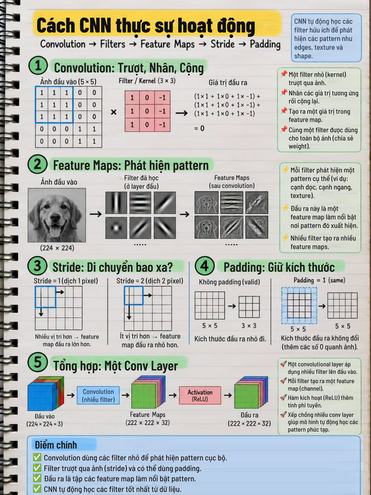
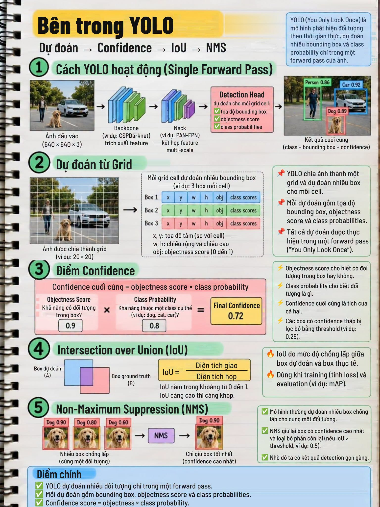
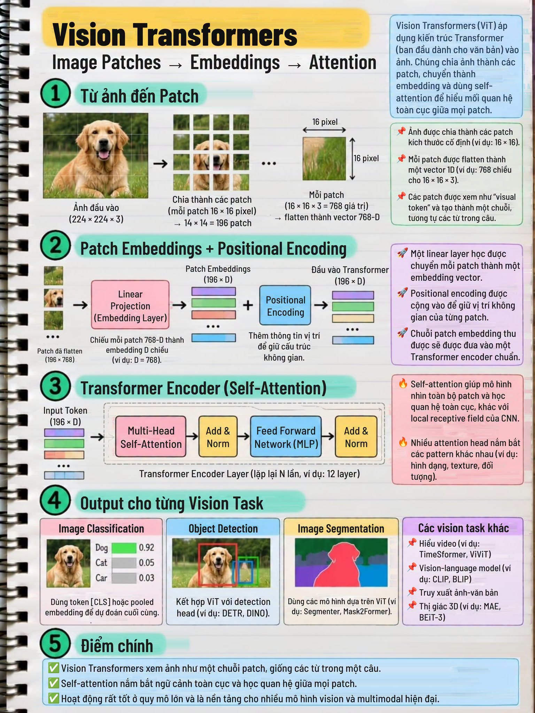
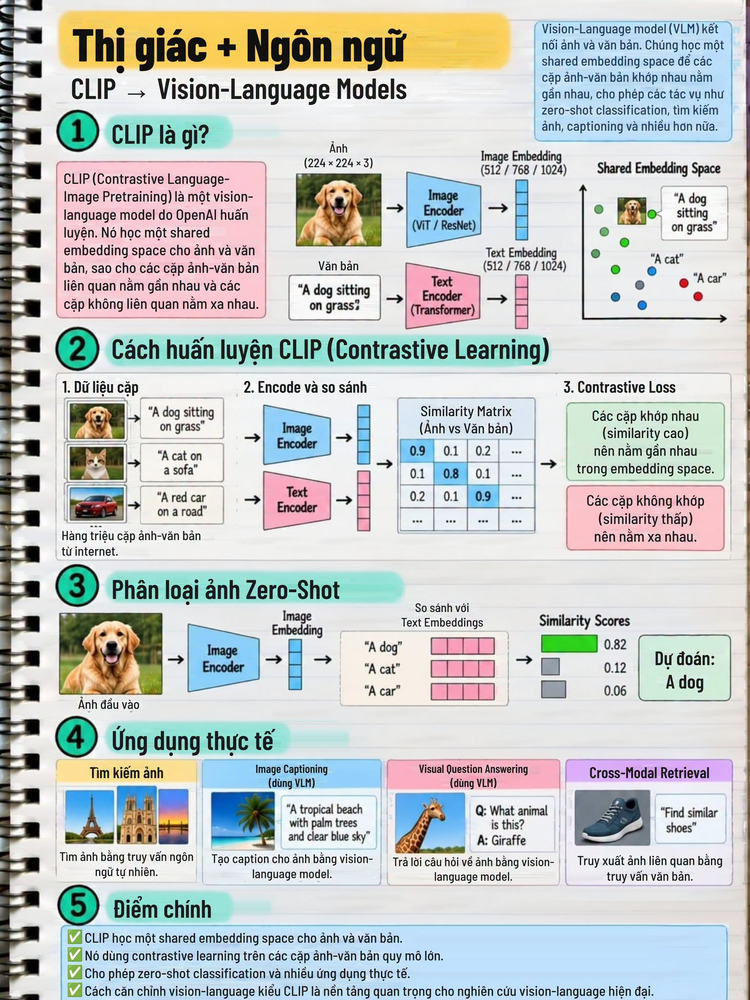
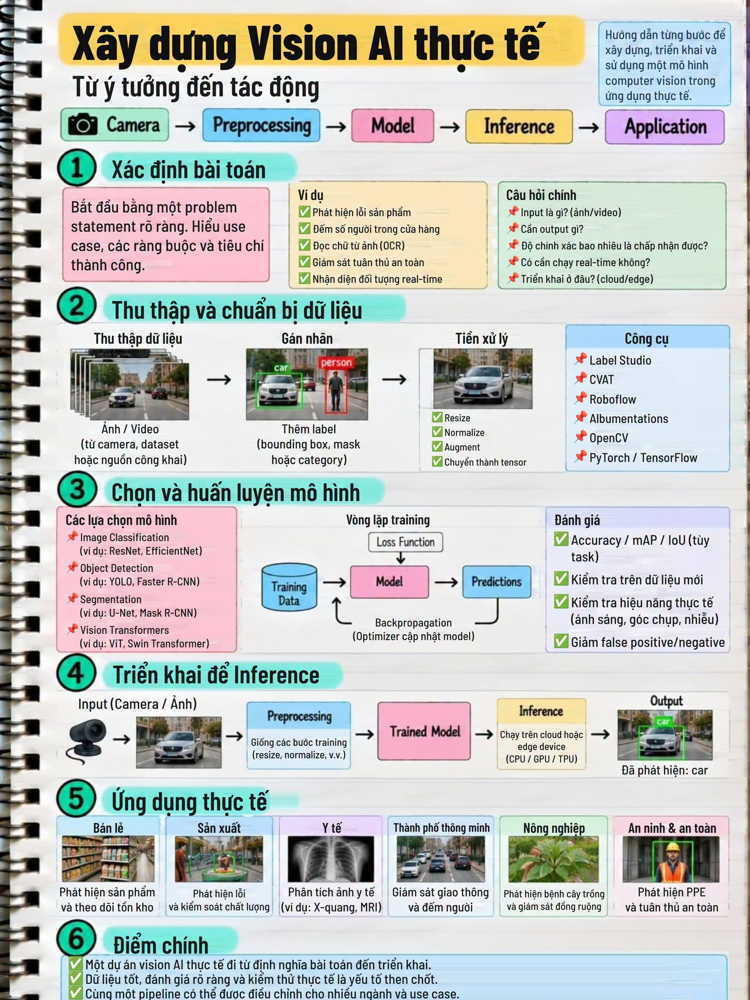

# Computer Vision Handbook (Bộ tổng hợp Computer Vision: 12 bài từ cơ bản đến thực tế)

**Author**: [Viet Nguyen AI](../entities/Viet%20Nguyen%20AI.md) | **Source**: [Facebook Post](https://web.facebook.com/vietnh1009/posts/pfbid02d94uzLq2g1awNnJapARHctQDYfwdwJSU3BgyZbH93rPwUj8Z8yfFFu8dmRoHbBSgl) (original English IG: `https://www.instagram.com/p/DdCsRfok1At/?img_index=1`) | **Raw Transcript & Visuals**: [raw/articles/ai-other/computer-vision-handbook.md](../../raw/articles/ai-other/computer-vision-handbook.md) | **Pages**: 12 handwritten-style visual cheatsheets (`2026-11-12`)

---

## Executive Summary

A 12-page Vietnamese visual cheatsheet suite translated and adapted by [Viet Nguyen AI](../entities/Viet%20Nguyen%20AI.md) providing a complete visual progression across modern **Computer Vision**—from low-level pixel RGB tensor representations, convolutional kernels, and backpropagation training loops through Image Classification, **YOLO** Object Detection, **Semantic/Instance/Panoptic Segmentation**, **Vision Transformers (ViT)**, **CLIP** contrastive alignment, **Multimodal Transformers**, and end-to-end production Vision AI deployment pipelines.

---

## Structured Breakdown Across the 12 Lessons

### 1. Spatial Representation, CNN Mechanics & Classical Vision Tasks (Lessons 1–8)
Synthesized in depth at [Convolutional Neural Networks and Object Detection](../concepts/Convolutional%20Neural%20Networks%20and%20Object%20Detection.md):
- **Lessons 1–2 — Pixels to Semantic Features**: Images represented as `(H, W, 3)` RGB tensors (`0..255` normalized to `[0, 1]` or `[-1, 1]`), learning a compositional hierarchy from **low-level edges** (e.g., `Sobel X`) -> **mid-level textures/shapes** -> **high-level object parts** (`Eye`, `Ear`, `Nose`).
- **Lessons 3–4 — CNN Layers & Training Loop**: Convolution mechanics (`Kernel`, `Stride 1 vs 2`, `Valid vs Same Padding`), `Conv -> ReLU -> Pooling` feature maps `(224x224x3 -> 222x222x32)`, and gradient descent training (`Forward Pass -> Softmax -> Cross-Entropy Loss -> Backpropagation -> SGD/Adam update`).
- **Lessons 5–7 — Classification, Detection & YOLO**:
  - Image Classification (`CNN -> Feature Vector -> FC/Linear -> Softmax`).
  - Object Detection (`Backbone + FPN Neck + Detection Head + NMS`) with bounding boxes `(x1, y1, x2, y2)`.
  - **YOLO** single forward pass (`CSPDarknet + PAN-FPN + 20x20 Grid`), `Final Confidence = objectness * class_prob`, **IoU** overlap ratio, and **NMS** deduplication.
- **Lesson 8 — Image Segmentation**: Comparing **Semantic** (class per pixel), **Instance** (mask per object instance), and **Panoptic** (*things + stuff*) architectures (`ResNet/EfficientNet/Swin -> Upsampling Decoder -> (H, W, num_classes)`).

### 2. Attention, Contrastive Vision-Language, Multimodal & Production Vision AI (Lessons 9–12)
Synthesized in depth at [Vision Transformers and Multimodal AI](../concepts/Vision%20Transformers%20and%20Multimodal%20AI.md):
- **Lesson 9 — Vision Transformers (`ViT`)**: Splits `(224x224x3)` images into `16x16` patches (`14x14 = 196` tokens, flattened to `768-D`), projects with positional encodings into standard Transformer Encoder blocks (`Multi-Head Self-Attention + MLP`) for global context, powering classification (`[CLS]`), detection (`DETR`, `DINO`), segmentation (`Segmenter`, `Mask2Former`), video (`TimeSformer`, `ViViT`), and self-supervised pre-training (`MAE`, `BEiT-3`).
- **Lesson 10 — CLIP Contrastive Alignment**: Dual **Image Encoder** (`ViT/ResNet`) + **Text Encoder** (`Transformer`) aligned on a shared embedding space (`512/768/1024-D`) via diagonal Similarity Matrix contrastive loss—enabling **zero-shot classification** and cross-modal retrieval.
- **Lesson 11 — Multimodal AI**: Combines image, text, audio, and video frame encoders via **Early Fusion**, **Cross-Attention**, or **Late Fusion** inside Multimodal Transformers (`LLaVA`, `GPT-4V`, `Gemini`) for VQA, video understanding, and assistive vision.
- **Lesson 12 — Production Vision AI Stack**: Five-step engineering pipeline (`Camera -> Preprocessing -> Model -> Inference -> App`) integrating labeling tools (`Label Studio`, `CVAT`, `Roboflow`), preprocessing (`Albumentations`, `OpenCV`), training (`PyTorch`, `TensorFlow`), domain metrics (`Accuracy`, `mAP`, `IoU`), and cloud/edge inference (`CPU/GPU/TPU`).

---

## Related Pages
- **Entities**: [Viet Nguyen AI](../entities/Viet%20Nguyen%20AI.md), [Uber](../entities/Uber.md)
- **Concepts**:
  - [Convolutional Neural Networks and Object Detection](../concepts/Convolutional%20Neural%20Networks%20and%20Object%20Detection.md)
  - [Vision Transformers and Multimodal AI](../concepts/Vision%20Transformers%20and%20Multimodal%20AI.md)
  - [Transformer Architecture and Pre-training](../concepts/Transformer%20Architecture%20and%20Pre-training.md)
  - [Machine Learning Paradigms](../concepts/Machine%20Learning%20Paradigms.md)
  - [Data Preprocessing and Feature Engineering](../concepts/Data%20Preprocessing%20and%20Feature%20Engineering.md)
  - [Inference Serving and Deployment Patterns](../concepts/Inference%20Serving%20and%20Deployment%20Patterns.md)
  - [Closed-Loop Evals](../concepts/Closed-Loop%20Evals.md)
- **Cross-References**:
  - [Building Closed-Loop Evals for a Multimodal Agent at Scale](Building%20Closed-Loop%20Evals%20for%20a%20Multimodal%20Agent%20at%20Scale.md)
  - [LLM Handbook 50 Concepts](LLM%20Handbook%2050%20Concepts.md)
  - [Machine Learning Basics Notes](Machine%20Learning%20Basics%20Notes.md)
