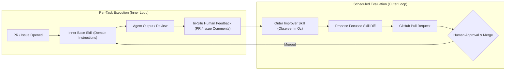

# How Warp Builds Self-Improving Agents on Claude

**Publication**: Anthropic Customer Spotlight / Case Study  
**Company / Product**: [[Warp]] (AI-powered Terminal & Agentic Development Environment)  
**Founders / Leaders**: Zach Lloyd (CEO & Founder)  
**Source URL**: [Anthropic Case Study & Webinar](https://www.anthropic.com/webinars/how-warp-builds-self-improving-agents-on-claude)  
**Demo Repository**: [warpdotdev/warp-agents-demo-github-issue-triage](https://github.com/warpdotdev/warp-agents-demo-github-issue-triage)

---

## Executive Summary

When [[Warp]] deployed internal AI agents for code review and issue triage, they ran into the classic **"noisy experience" problem**: a first-pass prompt that is 80% accurate creates noisy, low-value comments that frustrate developers. Manual prompt rewrites and bloated context files (`AGENTS.md`) failed to scale because agent feedback disappeared as soon as sessions terminated.

To solve this, Warp pioneered a **Dual-Skill Self-Improvement Architecture** on the [[Anthropic]] Claude Platform. By structuring agents around two complementary file-based skills—an **Inner Base Skill** executing domain tasks and an **Outer Improver Skill** analyzing human feedback and opening Git pull requests—Warp established an autonomous self-improving loop governed by human code-review gates.

---

## Key Architectural Primitives & Findings

### 1. The Dual-Skill Architecture (Inner vs. Outer Loop)
- **Inner / Base Skill**: Contains domain knowledge, execution guidelines, and deterministic resource scripts. Runs synchronously on task triggers (e.g. `issue-triage` runs when a GitHub issue is opened).
- **In-Situ Human Feedback**: Captured with zero friction directly where developers work (commenting on PRs or issues). The maintainer explains *what* was expected and *why*.
- **Outer / Improver Skill (Observer Agent)**: Runs on a scheduled basis inside **Oz** (Warp's agent orchestration platform). Authenticates to GitHub, executes helper scripts to collect feedback signals, synthesizes root causes, and proposes the smallest code diff to the Base Skill.
- **GitOps Human Gate**: The proposed skill change is submitted as a standard Git PR with full justification. Once approved and merged by a human maintainer, all subsequent runs of the Base Skill inherit the upgraded behavior.

### 2. Skills vs. Memory Paradigm
| Dimension | File-Based Agent Skills | Inference-Time Memory |
| :--- | :--- | :--- |
| **Nature** | Procedural, stable ("how to do X") | Declarative, conversational facts |
| **Lifecycle** | Run-agnostic, persistent across org | Dynamic, per-session or per-user |
| **Modification** | Changed deliberately via PR review | Auto-written by model at inference |
| **Version Control**| Full Git history, diffs, blame | Key-value store or vector embeddings |

### 3. Warp's 6 Best Practices for Self-Improving Agent Skills
1. **Write Principles, Not Rules**: Instruct agents like smart senior engineers rather than micro-managing with fragile syntax rules ("Look for repeated code" generalizes far better than exhaustive variable lists).
2. **Always Explain the "Why"**: Providing the architectural rationale behind a guideline allows the model to generalize across edge cases.
3. **Capture Feedback In-Situ With Zero Friction**: Collect signal directly inside PRs and issues without requiring custom feedback forms.
4. **Progressive Disclosure & Small Skills**: Keep `SKILL.md` concise; bundle deterministic helper scripts (e.g., Python feedback extractors) as resources.
5. **Quality Trumps Volume**: Detailed feedback with architectural context from a senior engineer outweighs thousands of binary thumbs-up/down clicks.
6. **Invest in the Improver Skill**: Observer/Improver skills are domain-agnostic and reusable across triage, code-review, and spec-writing agents.

### 4. Failure Modes & Mitigations
- **Bad / Noisy Feedback**: Never let agents ingest feedback blindly. Incorporate deterministic evals, restrict signal ingestion to verified domain maintainers, and keep human approval on the final PR merge.
- **Verifiability Ladder**: Build automated verification harnesses first (golden datasets, deterministic test suites) before enabling autonomous self-tuning loops.

---

## Production Scale & Impact

- **Developers**: 800,000 monthly developers; 56% of the Fortune 500.
- **Volume**: Over **10,000,000 Claude Code sessions** run inside Warp (400,000+ per week); 40,000,000 total agent conversations.
- **Deployment**: Applied across Warp's open-source repositories for spec writing, PR code review, and automated issue triage.

---

## Related Knowledge Nodes

- **Concepts**: [[Self-Improving Agents]], [[Loop Engineering]], [[Agent Skills Architecture]], [[Agent Skills Best Practices]], [[Verification Loop]], [[Harness Engineering]], [[Progressive Disclosure]].
- **Entities**: [[Warp]], [[Anthropic]], [[Claude Code]].
- **Sources**: [[5 Best Practices for Building AI Agent Skills]], [[The Art of Loop Engineering]], [[12 Agentic Harness Patterns from Claude Code]].
