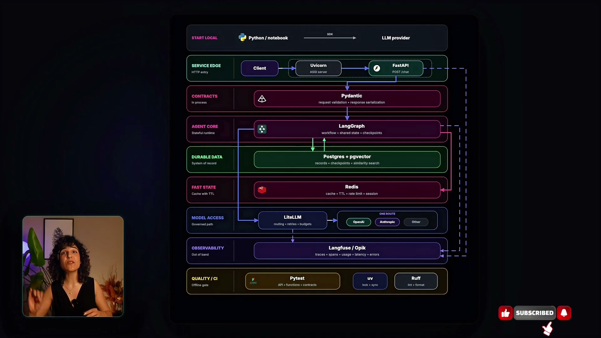
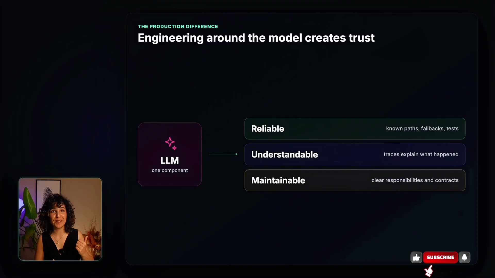

# How a Production AI Agent System Actually Works

**Channel**: [Jam With AI](../entities/Jam%20With%20AI.md) (`Jam With AI | Shirin Khosravi Jam`)
**Speaker**: Shirin Khosravi Jam
**URL**: https://www.youtube.com/watch?v=sKzL0wSN9vQ *(Published 2026-08-21)*
**Duration**: 11m 41s
**Transcript**: [raw/video-transcripts/how-a-production-ai-agent-system-actually-works.md](../../raw/video-transcripts/how-a-production-ai-agent-system-actually-works.md)
**Curated Keyframes**: [raw/screenshots/how-a-production-ai-agent-system-actually-works/01.jpg](../../raw/screenshots/how-a-production-ai-agent-system-actually-works/01.jpg), [raw/screenshots/how-a-production-ai-agent-system-actually-works/02.jpg](../../raw/screenshots/how-a-production-ai-agent-system-actually-works/02.jpg), [raw/screenshots/how-a-production-ai-agent-system-actually-works/03.jpg](../../raw/screenshots/how-a-production-ai-agent-system-actually-works/03.jpg), [raw/screenshots/how-a-production-ai-agent-system-actually-works/04.jpg](../../raw/screenshots/how-a-production-ai-agent-system-actually-works/04.jpg), [raw/screenshots/how-a-production-ai-agent-system-actually-works/05.jpg](../../raw/screenshots/how-a-production-ai-agent-system-actually-works/05.jpg), [raw/screenshots/how-a-production-ai-agent-system-actually-works/06.jpg](../../raw/screenshots/how-a-production-ai-agent-system-actually-works/06.jpg), [raw/screenshots/how-a-production-ai-agent-system-actually-works/07.jpg](../../raw/screenshots/how-a-production-ai-agent-system-actually-works/07.jpg)

A step-by-step architectural teardown taking a local Python/notebook LLM script into a reliable, observable, and maintainable production AI agent service—showing why the **LLM itself is only one small component**, why individual tools are replaceable once their responsibilities are understood, and how the inner application stack separates cleanly from outer infrastructure concerns (Video 1 prequel to [AI System Design 7 Patterns Explained in 17 Minutes](AI%20System%20Design%207%20Patterns%20Explained%20in%2017%20Minutes.md)).

---

## 1. Core Thesis & Architectural Scope (`00:00 - 01:19`)
- **Replaceable Tools, Enduring Responsibilities**: Companies rarely share an identical toolset, and nearly every logo can be swapped out. What endures across real production systems is the **responsibility each layer owns**: *"Don't memorize the logos, understand why every box exists."*
- **Inner Core Stack vs. Outer Deployment Infrastructure (`01.jpg`)**: This walkthrough deliberately isolates the **core Python application service** (`Service Edge -> Contracts -> Agent Core -> Data -> State -> Model Access -> Observability -> Quality/CI`), leaving deployment orchestration, load balancing, and autoscaling (`Kubernetes`, gateways, queues) as a distinct surrounding infrastructure layer covered in Video 2 ([AI System Design 7 Patterns Explained in 17 Minutes](AI%20System%20Design%207%20Patterns%20Explained%20in%2017%20Minutes.md)).

---

## 2. Layer-by-Layer Core Application Stack (`01:19 - 10:26`)

| Layer | Reference Stack | Core Responsibility & Production Rationale |
| :--- | :--- | :--- |
| **Service Edge** *(Slide `02.jpg`)* | `Uvicorn` + `FastAPI` (`async/await`) | Exposes the local agent over HTTP (`/chat`); `FastAPI` defines routes while `Uvicorn` (`ASGI`) accepts connections. Native **async Python** reclaims idle I/O wait time across slow LLM, DB, and tool calls |
| **Contracts** *(Slide `03.jpg`)* | `Pydantic` | Enforces strict input schemas upfront (returning `HTTP 422 validation error` before invalid payloads consume compute) and validates structured LLM response payloads (`answer`, `category`, `sources`) on egress |
| **Agent Core** | `LangGraph` | Skip orchestration frameworks for single-prompt calls; adopt `LangGraph` when workflows need branching tool decisions, shared multi-step state, **persistent checkpointing** (crash recovery), and **human-in-the-loop (HITL)** pauses |
| **Durable Data** | `PostgreSQL` + `pgvector` | System of record for users, conversations, and checkpoints—adding `pgvector` keeps relational state and **RAG embeddings** in one database before introducing a separate dedicated vector store |
| **Fast State** | `Redis` | Ultra-fast, temporary, TTL-bounded tier for response/embedding caching, ephemeral session state, and rate-limiting counters (distinct role from durable Postgres) |
| **Model Access** *(Slide `04.jpg`)* | `LiteLLM` (`OpenAI`, `Anthropic`, `Gemini`, ...) | Start calling a single provider directly; add a model gateway (`LiteLLM`) when routing cheap classification vs. strong reasoning models across vendors with retries and budgets. **Critical caveat**: never swap a fallback model blindly without running evals |
| **Observability** | `Langfuse` / `Opik` | **`HTTP 200 OK` can still be completely wrong** (wrong retrieved doc, wrong tool, latency spike). Out-of-band tracing records full multi-step spans (`retrieval -> model -> tool -> response`) so bugs are inspectable instead of guessed |
| **Quality / CI** | `Pytest` + **AI Evals** | `Pytest` tests deterministic code, API contracts, and tool schemas; **AI Evals** catch silent quality regressions (e.g., after a 1-line system prompt edit) across representative test sets measuring answer quality, retrieval precision, tool choice, and hallucinations |
| **Dev Toolchain** *(Slide `05.jpg`)* | `uv` + `Ruff` | Offline developer feedback loop (`uv sync --locked` reproducible environments + `Ruff` linting/formatting) keeping the codebase clean outside the live request path |

---

## 3. Complete Core Stack Recap & The Production Difference (`10:26 - 11:41`)
- **Engineering Around the Model (`06.jpg`)**: Calling an LLM is no longer the hard part. Wrapping one small LLM component in the surrounding application layers delivers three production properties:
  1. **Reliable**: Known execution paths, schema gates, provider fallbacks, and CI tests.
  2. **Understandable**: Full execution traces explain *what actually happened* when an answer fails.
  3. **Maintainable**: Clear layer boundaries, contracts, and swappable tools.

---

## Synthesis Notes
- **Video 1 + Video 2 Two-Layer Architecture**: Forms the direct prequel to [AI System Design 7 Patterns Explained in 17 Minutes](AI%20System%20Design%207%20Patterns%20Explained%20in%2017%20Minutes.md) and [System Design for AI Engineers 7 Patterns](System%20Design%20for%20AI%20Engineers%207%20Patterns.md). Here, Shirin defines the **internal 9-layer Core AI Service** (synthesized in [Production AI Agent Service Stack](../concepts/Production%20AI%20Agent%20Service%20Stack.md)); in Video 2, that complete service zooms down into a single *"Core AI Service"* box wrapped by **seven outer traffic & scaling patterns** ([Production AI Resilience and Scaling Patterns](../concepts/Production%20AI%20Resilience%20and%20Scaling%20Patterns.md)).
- **Strong Alignment Across Knowledge Graph**: Validates the three-tier evaluation separation (*Code unit tests `Pytest` $\neq$ Traces `Langfuse/Opik` $\neq$ Behavioral AI Evals*) taught in [Product Evals and Error Analysis](../concepts/Product%20Evals%20and%20Error%20Analysis.md), reinforces pragmatic unified storage (`Postgres + pgvector` first, dedicated vector DB only when scale demands it) alongside [Retrieval-Augmented Generation and Vector DBs](../concepts/Retrieval-Augmented%20Generation%20and%20Vector%20DBs.md), and echoes stateful checkpointing principles in [Agent Graph](../concepts/Agent%20Graph.md) and [Loop Engineering](../concepts/Loop%20Engineering.md).

## Related Pages
- **Entities**: [Jam With AI](../entities/Jam%20With%20AI.md)
- **Concepts**:
  - [Production AI Agent Service Stack](../concepts/Production%20AI%20Agent%20Service%20Stack.md)
  - [Production AI Resilience and Scaling Patterns](../concepts/Production%20AI%20Resilience%20and%20Scaling%20Patterns.md)
  - [AI System Design and Production Architecture](../concepts/AI%20System%20Design%20and%20Production%20Architecture.md)
  - [Agent Graph](../concepts/Agent%20Graph.md)
  - [Loop Engineering](../concepts/Loop%20Engineering.md)
  - [Retrieval-Augmented Generation and Vector DBs](../concepts/Retrieval-Augmented%20Generation%20and%20Vector%20DBs.md)
  - [Product Evals and Error Analysis](../concepts/Product%20Evals%20and%20Error%20Analysis.md)
  - [Closed-Loop Evals](../concepts/Closed-Loop%20Evals.md)
- **Sources**: [AI System Design 7 Patterns Explained in 17 Minutes](AI%20System%20Design%207%20Patterns%20Explained%20in%2017%20Minutes.md), [System Design for AI Engineers 7 Patterns](System%20Design%20for%20AI%20Engineers%207%20Patterns.md)
