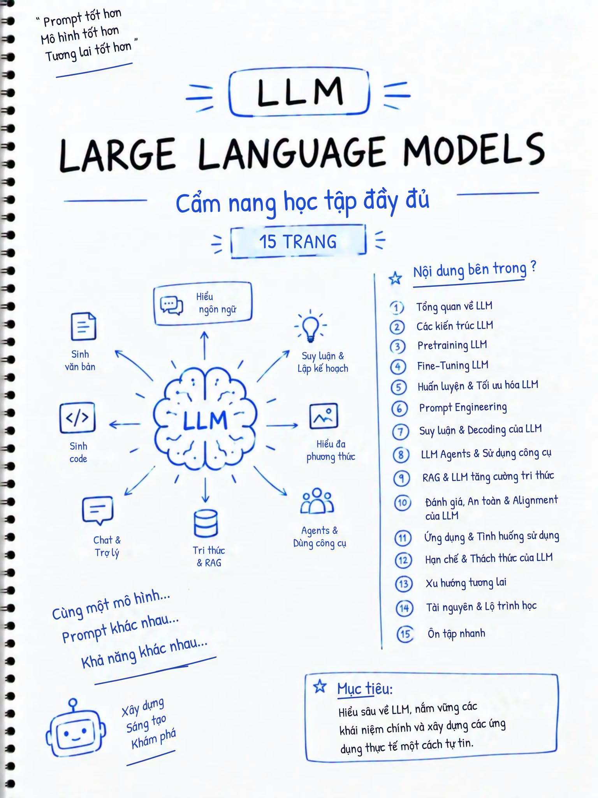

# LLM Handwritten Study Guide 15 Pages (Cẩm nang LLM viết tay)

**Author / Translator:** [[Viet Nguyen AI]] (`vietnh1009`, `2026-11-20`)
**Source Post:** [Facebook Post](https://web.facebook.com/vietnh1009/posts/pfbid02JAT4PtPQHZyZuYVzMDAq6gKGvMXh6dNpj6kDeE8FCCRq7q2dKtCW9HjT5KoV93sdl) (60 reactions, 1 comment, 90 shares)
**Original English Source Cited:** [Instagram Post](https://www.instagram.com/p/DdjICn_iJg5/?img_index=1)
**Raw Source File:** [[raw/articles/ai-other/llm-handwritten-handbook-15-pages.md]] (`15` handwritten-style pages in `raw/screenshots/llm-handwritten-handbook-15-pages/00.jpg`–`14.jpg`)

---

## Executive Summary

**LLM Handwritten Study Guide 15 Pages** is a formula-dense, notebook-style Vietnamese LLM curriculum translated and shared by [[Viet Nguyen AI]]. While sharing an introductory lineage with [[LLM Handbook 50 Concepts]] (a high-level 50-item overview), this 15-page notebook dives systematically into **mathematical equations and systems internals**: sinusoidal positional encodings, LayerNorm/FFN dimensions, quadratic attention complexity, `SimHash`/`MinHash` pretraining deduplication, `AdamW` & Cosine Annealing schedules, `BF16` mixed precision, `Houlsby`/`Pfeiffer`/`Compacter` PEFT adapters, decoding logits (`Temperature`, `Repetition Penalty`, `Beam Search`), and the exact **DPO objective formula**.

> [!NOTE] Pagination & Community Terminology Observations
> - **Cover TOC vs. Inner Sheets**: Slide `00.jpg` lists 15 TOC topics (ending with *11. Ứng dụng ... 15. Ôn tập nhanh*), whereas the 14 inner study sheets (`01.jpg`–`14.jpg`, titled *LLM - Trang 1* through *LLM - Trang 14*) expand core modules 1–10 (Pretraining, Optimization, Fine-Tuning, Decoding, RAG, Agents, Safety/DPO) without rendering items 11–15 from the cover list.
> - **Community Terminology Feedback**: Reader comment by *Chan Đục* noted that AI-assisted translation causes minor terminology drift (*attention*, *alignment*) across slides, underscoring the value of preserving canonical English technical terms alongside Vietnamese notes.

---

## 15-Page Curriculum Map

| Page | Slide Title | Key Equations, Mechanisms & Frameworks | Linked Wiki Concept |
| :--- | :--- | :--- | :--- |
| `00.jpg` | **Cover (`15 TRANG`)** | 8 core LLM capability hubs; *"Same model + different prompts -> different capabilities"* | [[Prompt Engineering]] |
| `01.jpg` | **Trang 1: Nền tảng LLM** | `AI > ML > DL > LLM` hierarchy; Foundation model traits; forward flow | [[Transformer Architecture and Pre-training]] |
| `02.jpg` | **Trang 2: Text & Tokenization** | 5 preprocessing steps; `BPE` vs `WordPiece` vs `SentencePiece`; `[PAD]/[UNK]/[BOS]/[EOS]/[MASK]` | [[Tokenization]] |
| `03.jpg` | **Trang 3: Embeddings** | Dense vs Sparse (`BoW/TF-IDF`); Sinusoidal $PE(pos,2i)$; `Cosine`/`Euclidean`/`Dot`/`Manhattan` | [[Transformer Architecture and Pre-training]] |
| `04.jpg` | **Trang 4: Transformer** | Encoder vs Decoder stacks; `FFN` (`ReLU`/`GELU`, $512 \rightarrow 2048$); `LayerNorm` equation + Residual | [[Transformer Architecture and Pre-training]] |
| `05.jpg` | **Trang 5: Attention Mechanics** | $Q=XW_Q, K=XW_K, V=XW_V$; `MultiHead` concat; Cross vs Causal mask (`-inf`); $O(n^2 d)$ time / $O(n^2)$ space | [[Transformer Architecture and Pre-training]] |
| `06.jpg` | **Trang 6: Kiến trúc LLM** | Encoder-only vs Decoder-only vs Encoder-decoder; MoE gating; Sparse architectures (`Longformer`, `BigBird`) | [[Transformer Architecture and Pre-training]] |
| `07.jpg` | **Trang 7: Pretraining LLM** | Cross-entropy $L=-\sum y_i\log(\hat{y}_i)$; 4 training objectives; `SimHash`/`MinHash` dedup; `DDP`/`DeepSpeed`/`Megatron-LM` | [[LLM Pretraining, Optimization and Decoding]] |
| `08.jpg` | **Trang 8: Huấn luyện & Tối ưu** | Backprop chain rule; **`AdamW`** decoupled decay; **Cosine Annealing LR**; `BF16` mixed precision (`amp`, `GradScaler`); `GPU` vs `TPU` | [[LLM Pretraining, Optimization and Decoding]] |
| `09.jpg` | **Trang 9: Fine-Tuning LLM** | $L_{\text{SFT}}$; `LoRA` ($W+BA$), `QLoRA` (`NF4`), **`Adapters`** (`Houlsby`, `Pfeiffer`, `Compacter`); `FLAN`/`ShareGPT`/`Distilabel` | [[LLM Fine-Tuning and Alignment]] |
| `10.jpg` | **Trang 10: Prompt Engineering** | 8 techniques (`Zero/Few-shot`, `Role`, `System`, `CoT`, `JSON Structured`, `Templates`, `Iterative Optimization`) | [[Prompt Engineering]] |
| `11.jpg` | **Trang 11: Inference & Decoding** | `Greedy`, `Beam Search (k)`, **Scaled Temperature**, `Top-K`, `Top-P`, **`Repetition Penalty`** ($r\in[1.1,1.5]$), `KV Cache` | [[LLM Pretraining, Optimization and Decoding]] |
| `12.jpg` | **Trang 12: RAG & Tri thức** | Chunking (`500/200`), `L2` vs Cosine distance, Cross-encoder rerank, `Faithfulness`/`Answer & Context Relevance` | [[Retrieval-Augmented Generation and Vector DBs]] |
| `13.jpg` | **Trang 13: LLM Agents & Tools** | Agent architecture; `Short/Long/Entity Memory`; `Observe -> Reason -> Act -> Evaluate`; `Supervisor`/`P2P`/`Hierarchical` multi-agent | [[Agent Loop Lifecycle]], [[Parallel Agent Architecture]] |
| `14.jpg` | **Trang 14: Eval, Safety & Alignment** | `MMLU`/`GSM8K`/`TruthfulQA`/`HELM`; `Perspective API`/`Detoxify`/`HateCheck`; **$\mathcal{L}_{\text{DPO}}$ equation**; Red Teaming; 5 Responsible AI pillars | [[LLM Fine-Tuning and Alignment]], [[AI Evaluation, Safety and Governance]] |

---

## Related Pages
- **Entities**: [[Viet Nguyen AI]], [[Abhinav Gupta]]
- **Companion Overview**: [[LLM Handbook 50 Concepts]], [[Transformers Detailed Notes and Revision Guide]], [[AI Complete Handbook]]
- **Primary Concept Created**: [[LLM Pretraining, Optimization and Decoding]]
- **Enriched Concepts**: [[Transformer Architecture and Pre-training]], [[LLM Fine-Tuning and Alignment]], [[AI Evaluation, Safety and Governance]], [[Tokenization]], [[Retrieval-Augmented Generation and Vector DBs]]
