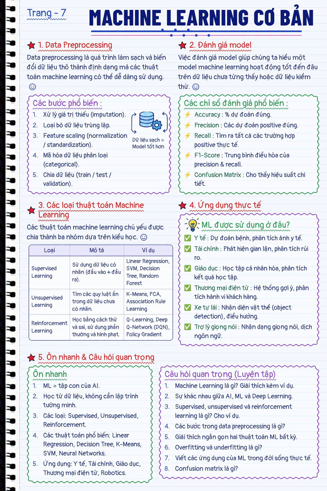
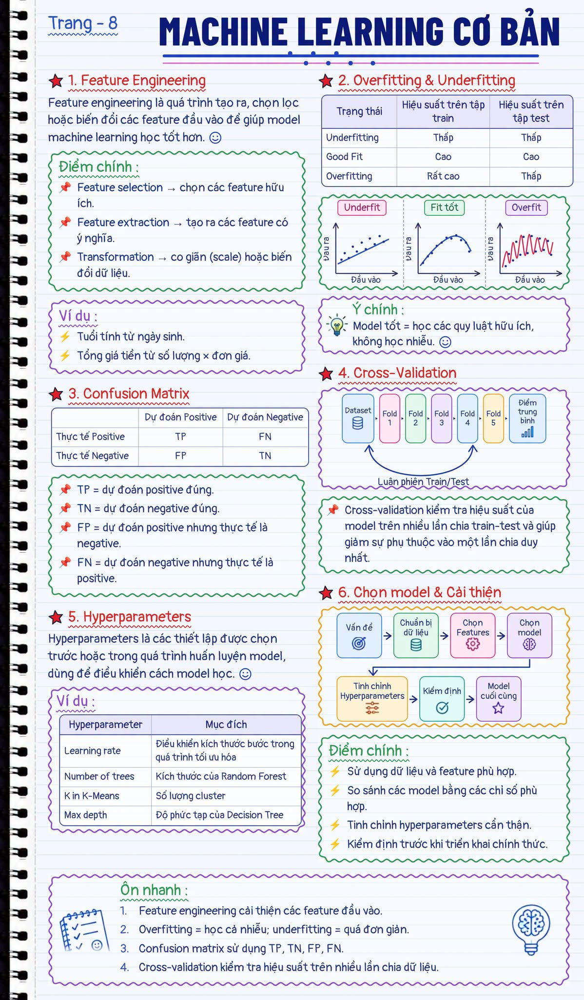
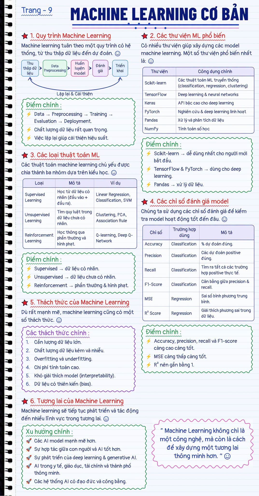

# Machine Learning Basics Notes (Machine Learning cơ bản bằng tiếng Việt)

**Author**: [Viet Nguyen AI](../entities/Viet%20Nguyen%20AI.md) | **Source**: [Facebook Post](https://web.facebook.com/vietnh1009/posts/pfbid0VjsaAcLhw46M4aEwWgsX4VVAMYVap3tZq4RvNAfU5eHBzWVWPohrAJJoyX3kXPSyl) (original English IG: `https://www.instagram.com/p/DdsZBMinyzO/?img_index=1`) | **Raw Transcript & Visuals**: [raw/articles/ai-other/machine-learning-basics-notes.md](../../raw/articles/ai-other/machine-learning-basics-notes.md) | **Pages**: 9 handwritten-style visual slides (`2026-11-15`)

---

## Executive Summary

A 9-page Vietnamese visual notebook translated and adapted by [Viet Nguyen AI](../entities/Viet%20Nguyen%20AI.md) introducing end-to-end foundational **Machine Learning**. Whereas [Types of Machine Learning Handbook](Types%20of%20Machine%20Learning%20Handbook.md) focuses deeply on algorithmic taxonomies (`Self-Supervised`, `Regression/Classification`, `Clustering`, `PCA/LDA/t-SNE`), this companion primer highlights the **data preparation & operational modeling lifecycle**: data formats (`Structured`, `Unstructured`, `Semi-structured`), the 5-step **Data Preprocessing** pipeline, **Feature Engineering**, **Overfitting vs. Underfitting** diagnostics, **Hyperparameters** vs. **Cross-Validation**, and the core **Python ML library stack** (`Scikit-learn`, `PyTorch`, `TensorFlow`, `Keras`, `Pandas`, `NumPy`).

---

## High-Signal Knowledge Highlights (Pages 1–9)

### 1. Core ML Loop, Data Types & Three Paradigms (Pages 1–6)
- **End-to-End Lifecycle**: `Data Collection -> Preprocessing (Cleaning + Feature Extraction) -> Model Training -> Evaluation & Deployment -> (Iterate & Improve)`, underpinned by `"Better Data -> Better Model -> Better Decisions"`.
- **Three Data Formats (Page 2)**: `Structured` (CSV, SQL tables), `Unstructured` (text, images, audio, video), and `Semi-structured` (JSON, XML with markup tags).
- **Learning Paradigms & Standard Split**: Contrasts Supervised (`Classification`, `Regression`), Unsupervised (`Clustering`, `PCA`, `Association Rules`), and Reinforcement Learning (`Agent -> Action -> Environment -> State/Reward`; `Q-Learning`, `DQN`, `Policy Gradient`), paired with the baseline `70–80%` Training / `20–30%` Testing split. Links cleanly to [Machine Learning Paradigms](../concepts/Machine%20Learning%20Paradigms.md) and [Supervised Learning Algorithms](../concepts/Supervised%20Learning%20Algorithms.md).

### 2. Data Preprocessing, Feature Engineering & Fit Diagnostics (Pages 7–8)
Synthesized in depth at [Data Preprocessing and Feature Engineering](../concepts/Data%20Preprocessing%20and%20Feature%20Engineering.md):
- **5-Step Preprocessing Pipeline**: (1) Imputation for missing values, (2) Deduplication, (3) Feature scaling (`normalization / standardization`), (4) Categorical encoding, and (5) Train / Validation / Test splitting.
- **Feature Engineering Pillars**: Feature selection, domain feature extraction (e.g., `age` from birth date, `total = quantity * unit_price`), and data transformation.
- **Fit Diagnostics & Hyperparameters**:
  - `Underfitting` (Low Train / Low Test) vs. `Good Fit` (High Train / High Test) vs. `Overfitting` (Very High Train / Low Test — learning noise).
  - Visualizes **5-Fold Cross-Validation** rotation alongside key hyperparameters (`Learning rate`, `Number of trees` in Random Forest, `K` in K-Means, `Max depth` in Decision Tree) inside the 7-stage model selection pipeline.

### 3. Python ML Ecosystem, Challenges & Future Trends (Page 9)
- **Core Python Library Stack**: **Scikit-learn** (classical ML algorithms), **Pandas** (tabular wrangling & analysis), **NumPy** (numerical computation), **PyTorch** (flexible research & deep learning), **TensorFlow** (deep learning & neural networks), and **Keras** (high-level DL API) — building directly atop [Python Handbook](Python%20Handbook.md) foundations.
- **Macro Challenges & Outlook**: Large data requirements, noise/bias, compute cost, model interpretability, and Overfitting/Underfitting—trending toward stronger foundation LLMs (`GPT`), human-AI collaboration, Generative AI, and ethical/fair AI governance.

---

## Related Pages
- **Entities**: [Viet Nguyen AI](../entities/Viet%20Nguyen%20AI.md)
- **Concepts**:
  - [Data Preprocessing and Feature Engineering](../concepts/Data%20Preprocessing%20and%20Feature%20Engineering.md)
  - [Machine Learning Paradigms](../concepts/Machine%20Learning%20Paradigms.md)
  - [Supervised Learning Algorithms](../concepts/Supervised%20Learning%20Algorithms.md)
  - [Unsupervised Learning and Dimensionality Reduction](../concepts/Unsupervised%20Learning%20and%20Dimensionality%20Reduction.md)
  - [Model Evaluation and Validation](../concepts/Model%20Evaluation%20and%20Validation.md)
  - [Python Handbook](Python%20Handbook.md)
- **Companion Source**: [Types of Machine Learning Handbook](Types%20of%20Machine%20Learning%20Handbook.md)
