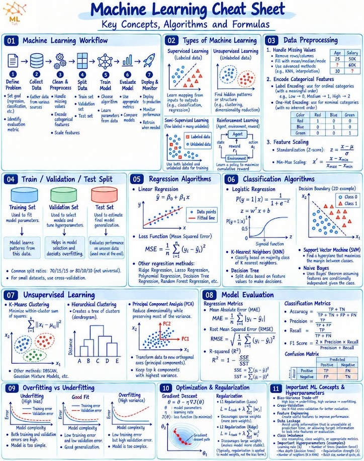
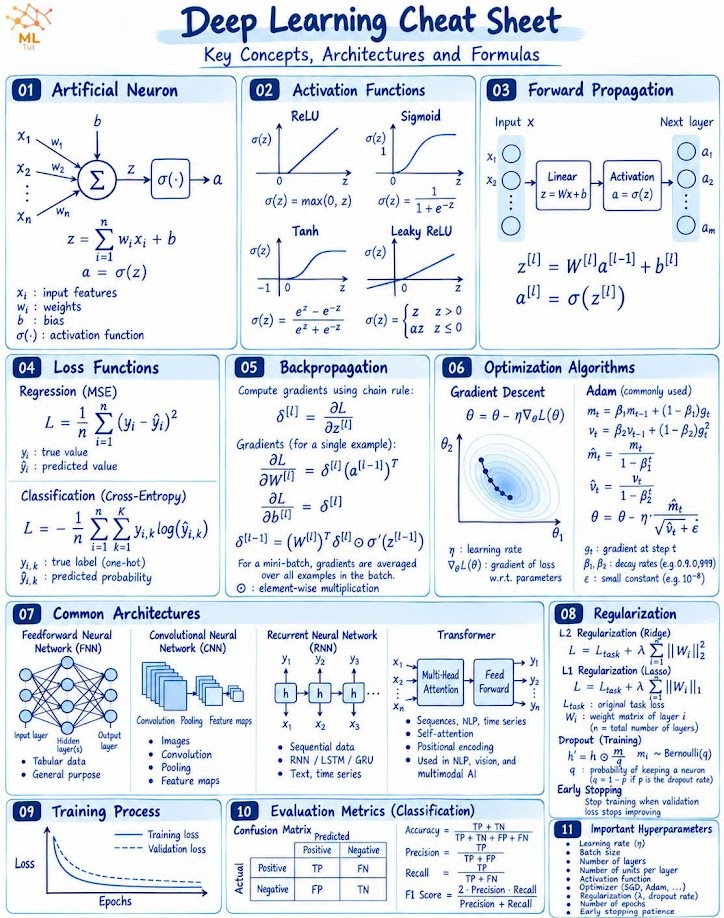

# Machine Learning & Deep Learning Cheat Sheets (ML Tut)

**Author / Creator**: ML Tut
**Archived Visual Assets**:
- **Sheet 1 (Machine Learning)**: [[raw/assets/ml-dl-cheat-sheets-ml-tut-01.jpg]] (`724x918`, SHA-256 `d9cb7dc1151f`)
- **Sheet 2 (Deep Learning)**: [[raw/assets/ml-dl-cheat-sheets-ml-tut-02.jpg]] (`724x918`, SHA-256 `2a66ada8c4b2`)

Two dense 11-panel formula reference sheets bridging **classical Machine Learning workflows, preprocessing, supervised/unsupervised models, and evaluation diagnostics** with **core Deep Learning mathematics (`Forward/Backprop`, `Adam`, `FNN/CNN/RNN/Transformer`, `L1/L2`, `Inverted Dropout`)**.

---

## Part I — Machine Learning Cheat Sheet (`11 Panels`, Sheet 01)

| Panel | Topic & Concrete Equations / Rules | Connected Vault Concepts |
| :-: | :--- | :--- |
| **01** | **Machine Learning Workflow (7 Steps)**: `Define Problem` $\rightarrow$ `Collect Data` $\rightarrow$ `Clean & Preprocess` $\rightarrow$ `Split Data` $\rightarrow$ `Train Model` $\rightarrow$ `Evaluate Model` $\rightarrow$ `Deploy & Monitor` (monitor + retrain) | [[Data Preprocessing and Feature Engineering]], [[AI Deployment Lifecycle and Environments]] |
| **02** | **Types of Machine Learning (4 Paradigms)**: Supervised (labeled), Unsupervised (unlabeled), Semi-Supervised (few labeled + many unlabeled), Reinforcement Learning (*agent state $s_t \rightarrow$ action $a_t \rightarrow$ environment reward $r_t$*) | [[Machine Learning Paradigms]] |
| **03** | **Data Preprocessing**: Missing values (drop / mean-median-mode / KNN interpolation); Categorical encoding (**Label Encoding** for ordinal, **One-Hot Encoding** for nominal); **Z-score** $z = \frac{x-\mu}{\sigma}$ & **Min-Max Scaling** $x' = \frac{x-x_{\min}}{x_{\max}-x_{\min}}$ | [[Data Preprocessing and Feature Engineering]] |
| **04** | **Train / Validation / Test Split**: Train (fit parameters) / Validation (tune hyperparameters & prevent overfitting) / Test (**used once at the end** for unseen generalization); common `70/15/15` or `80/10/10` splits, plus CV on small datasets | [[Data Preprocessing and Feature Engineering]], [[Model Evaluation and Validation]] |
| **05** | **Regression Algorithms**: Linear ($\hat{y} = \beta_0 + \beta_1 x$), MSE loss ($\frac{1}{n}\sum (y_i - \hat{y}_i)^2$), Ridge, Lasso, Polynomial, Decision Tree, Random Forest | [[Supervised Learning Algorithms]] |
| **06** | **Classification Algorithms**: Logistic Regression ($P(y=1\mid x) = \frac{1}{1+e^{-z}}$, $z = w^T x + b$), KNN, Decision Tree, SVM (max-margin hyperplane), Naive Bayes | [[Supervised Learning Algorithms]] |
| **07** | **Unsupervised Learning**: K-Means ($\min \sum_{i=1}^k \sum_{x \in C_i} \lVert x - \mu_{C_i} \rVert^2$), Hierarchical Clustering (dendrogram), PCA (orthogonal principal components `PC1`, `PC2`), plus DBSCAN & GMMs | [[Unsupervised Learning and Dimensionality Reduction]] |
| **08** | **Model Evaluation**: `MAE`, `RMSE`, $R^2 = 1 - \frac{SSE}{SST}$; Confusion Matrix + `Accuracy`, `Precision`, `Recall`, `F1 Score` | [[Model Evaluation and Validation]] |
| **09** | **Overfitting vs Underfitting**: Underfitting (*high bias*: high train & val error) $\rightarrow$ Good Fit $\rightarrow$ Overfitting (*high variance*: low train error, high val error) | [[Data Preprocessing and Feature Engineering]], [[Model Evaluation and Validation]] |
| **10** | **Optimization & Regularization**: Gradient Descent ($\theta = \theta - \eta \nabla J(\theta)$); L1 Lasso ($L_{\text{task}} + \lambda \sum \lvert w_j \rvert$) & L2 Ridge ($L_{\text{task}} + \lambda \sum w_j^2$) — **notes bias term is typically excluded from penalty** | [[Supervised Learning Algorithms]], [[Neural Networks and Deep Learning Foundations]] |
| **11** | **Important ML Concepts & Hyperparameters**: Bias–Variance tradeoff, Cross-Validation, Feature Engineering, **Data Leakage** *(never leak future or target info into features/eval)*, **Class Imbalance** *(resampling, class weights, appropriate metrics)*, plus key hyperparameters | [[Data Preprocessing and Feature Engineering]], [[Model Evaluation and Validation]] |

---

## Part II — Deep Learning Cheat Sheet (`11 Panels`, Sheet 02)

All mathematical formulations in Sheet 2 (`01 Artificial Neuron` $\rightarrow$ `02 Activation Functions` $\rightarrow$ `03 Forward Propagation` $\rightarrow$ `04 Loss Functions` $\rightarrow$ `05 Backpropagation` $\rightarrow$ `06 Gradient Descent & Adam` $\rightarrow$ `07 FNN / CNN / RNN / Transformer` $\rightarrow$ `08 L1 / L2 / Inverted Dropout / Early Stopping` $\rightarrow$ `09 Training vs Validation Loss Curves` $\rightarrow$ `10 Confusion Matrix Metrics` $\rightarrow$ `11 Hyperparameters`) are synthesized cleanly with full KaTeX notation in [[Neural Networks and Deep Learning Foundations]].

---

## Synthesis Notes
- **Completing the Foundations Stack**: Bridges the vault's classical tabular notes ([[Machine Learning Basics Notes]], [[Types of Machine Learning Handbook]]) directly to matrix backpropagation, `Adam` optimization, and modern Transformer/LLM notes ([[LLM Handwritten Study Guide 15 Pages]], [[Transformers Detailed Notes and Revision Guide]], [[Convolutional Neural Networks and Object Detection]]) via [[Neural Networks and Deep Learning Foundations]].
- **Three High-Value Practical Details Added**:
  1. Explicit separation of **Ordinal (`Label Encoding`) vs. Nominal (`One-Hot Encoding`)**, exact **Z-score / Min-Max** scaling equations, and **Data Leakage / Class Imbalance** guards.
  2. Explicit reminder that **regularization penalties apply to model weights $w_j$ and exclude bias terms**.
  3. Complete **matrix backpropagation equations** ($\delta^{[l]}$ chain rule) and **Inverted Dropout** scaling ($h' = h \odot \frac{m}{q}$) connecting intro DL cleanly to modern Transformer pretraining.

## Related Pages
- **Primary Concept**: [[Neural Networks and Deep Learning Foundations]]
- **ML Sources & Companions**: [[Machine Learning Basics Notes]], [[Types of Machine Learning Handbook]], [[LLM Handwritten Study Guide 15 Pages]], [[Transformers Detailed Notes and Revision Guide]]
- **ML/DL Concepts**: [[Machine Learning Paradigms]], [[Data Preprocessing and Feature Engineering]], [[Supervised Learning Algorithms]], [[Unsupervised Learning and Dimensionality Reduction]], [[Model Evaluation and Validation]], [[Convolutional Neural Networks and Object Detection]], [[Transformer Architecture and Pre-training]], [[LLM Pretraining, Optimization and Decoding]]
