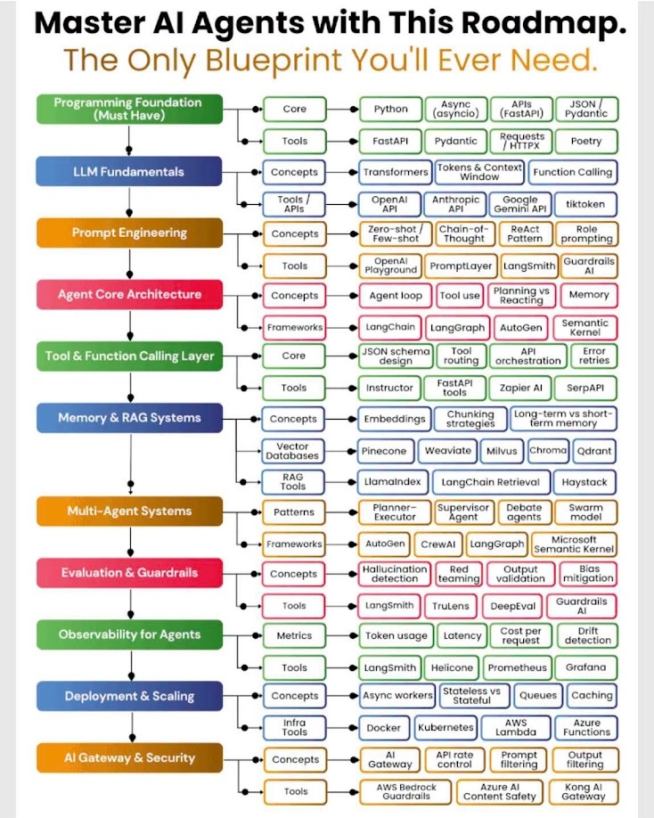

# Master AI Agents with This Roadmap: 11-Layer Blueprint

**Source Image**: [[raw/assets/master-ai-agents-roadmap-blueprint-01.jpg]] (`734x918`, SHA-256 `d7775a470838`)
**Format**: Collected visual infographic — 11-layer vertical learning & production architecture blueprint (*"Master AI Agents with This Roadmap. The Only Blueprint You'll Ever Need."*)

---

## 1. Complete 11-Layer Blueprint Breakdown

| Layer | Concepts / Patterns / Metrics | Frameworks, APIs & Tools Listed | Connected Vault Pages |
| :-: | :--- | :--- | :--- |
| **1. Programming Foundation (Must Have)** | `Python`, `Async (asyncio)`, `APIs (FastAPI)`, `JSON / Pydantic` | `FastAPI`, `Pydantic`, `Requests / HTTPX`, `Poetry` | [[Python Core Syntax and Control Flow]], [[Python Collections and File Handling]], [[Production AI Agent Service Stack]] |
| **2. LLM Fundamentals** | `Transformers`, `Tokens & Context Window`, `Function Calling` | `OpenAI API`, `Anthropic API`, `Google Gemini API`, `tiktoken` | [[Transformer Architecture and Pre-training]], [[Tokenization]], [[Context Window Management]], [[Token and API Price Guide]] |
| **3. Prompt Engineering** | `Zero-shot / Few-shot`, `Chain-of-Thought`, `ReAct Pattern`, `Role prompting` | `OpenAI Playground`, `PromptLayer`, `LangSmith`, `Guardrails AI` | [[Prompt Engineering]], [[Few-Shot Prompting]], [[Chain-of-Thought Prompting]], [[Advanced Prompting Patterns]] |
| **4. Agent Core Architecture** | `Agent loop`, `Tool use`, `Planning vs Reacting`, `Memory` | `LangChain`, `LangGraph`, `AutoGen`, `Semantic Kernel` | [[Agent Loop Lifecycle]], [[Loop Engineering]], [[Harness Engineering]], [[AI Agent Memory Types]] |
| **5. Tool & Function Calling Layer** | `JSON schema design`, `Tool routing`, `API orchestration`, `Error retries` | `Instructor`, `FastAPI tools`, `Zapier AI`, `SerpAPI` | [[Model Context Protocol]], [[Tool Search Architecture]], [[Programmatic Tool Calling]], [[Dynamic Tool Loading]] |
| **6. Memory & RAG Systems** | `Embeddings`, `Chunking strategies`, `Long-term vs short-term memory` | **Vector DBs**: `Pinecone`, `Weaviate`, `Milvus`, `Chroma`, `Qdrant` · **RAG Tools**: `LlamaIndex`, `LangChain Retrieval`, `Haystack` | [[Retrieval-Augmented Generation and Vector DBs]], [[AI Agent Memory Types]], [[Memory Architecture]], [[Context Engineering]] |
| **7. Multi-Agent Systems** | `Planner-Executor`, `Supervisor Agent`, `Debate agents`, `Swarm model` | `AutoGen`, `CrewAI`, `LangGraph`, `Microsoft Semantic Kernel` | [[Agent Graph]], [[Graph Engineering]], [[Parallel Agent Architecture]], [[Agent Teams Architecture]], [[Subagent Architecture]] |
| **8. Evaluation & Guardrails** | `Hallucination detection`, `Red teaming`, `Output validation`, `Bias mitigation` | `LangSmith`, `TruLens`, `DeepEval`, `Guardrails AI` | [[Product Evals and Error Analysis]], [[LLM-as-a-Judge and Eval Alignment]], [[Closed-Loop Evals]], [[AI Evaluation, Safety and Governance]], [[Verification Loop]] |
| **9. Observability for Agents** | `Token usage`, `Latency`, `Cost per request`, `Drift detection` | `LangSmith`, `Helicone`, `Prometheus`, `Grafana` | [[Token Economics]], [[Cost Optimization]], [[Production AI Agent Service Stack]], [[Production AI Resilience and Scaling Patterns]] |
| **10. Deployment & Scaling** | `Async workers`, `Stateless vs Stateful`, `Queues`, `Caching` | `Docker`, `Kubernetes`, `AWS Lambda`, `Azure Functions` | [[Production AI Resilience and Scaling Patterns]], [[AI Deployment Lifecycle and Environments]], [[Inference Serving and Deployment Patterns]], [[AWS Databases, Containers and Messaging]] |
| **11. AI Gateway & Security** | `AI Gateway`, `API rate control`, `Prompt filtering`, `Output filtering` | `AWS Bedrock Guardrails`, `Azure AI Content Safety`, `Kong AI Gateway` | [[Production AI Resilience and Scaling Patterns]], [[LLM Inference Optimization and Security]], [[Enterprise Agent Stack]], [[Cloud Agent Sandbox and Auto Mode]] |

---

## 2. Synthesis & Cross-Check Against Vault Architecture
- **Core Stack Alignment**:
  - **Layers 1–6 (Core Runtime & State)** align with the internal application core documented in [[Production AI Agent Service Stack]] (`FastAPI`, `Pydantic`, `LangGraph`, relational/vector state, `Context Engineering`, and `AI Agent Memory Types`).
  - **Layers 7–11 (Orchestration, Quality, Ops & Gateway)** mirror the outer traffic/resilience patterns of [[Production AI Resilience and Scaling Patterns]] (`async workers`, `queues`, `caching`, `AI Gateway`, `rate control`) combined with product-specific evals and observability ([[Product Evals and Error Analysis]]).
- **Important Evolving Tooling Nuances (`2025 -> 2026`)**:
  - > ⚠️ **Evolving tooling note (Python Toolchain & Observability)**: Layer 1 recommends `Poetry` and Layers 3/8/9 center heavily on `LangSmith`. In newer 2026 production blueprints ([[Production AI Agent Service Stack]]), teams frequently favor **`uv` + `Ruff`** for Python dependency/lint tooling and open-source LLM telemetry (`Langfuse`, `Opik`) alongside `Helicone`/`Prometheus`/`Grafana`.
  - > ⚠️ **Evolving tooling note (Standardized Tooling & Skills)**: Layer 5 captures bespoke JSON schema routing (`Instructor`, `FastAPI tools`, `Zapier AI`, `SerpAPI`), whereas modern agent harnesses increasingly standardize external tool integration via [[Model Context Protocol]] (`MCP`) and package repeatable domain workflows into portable [[Agent Skills Architecture]] (`SKILL.md`).

---

## Related Pages
- **Topic & Core Architectures**: [[Agentic Engineering]], [[Production AI Agent Service Stack]], [[Production AI Resilience and Scaling Patterns]], [[Enterprise Agent Stack]]
- **Loops, Graphs & Memory**: [[Loop Engineering]], [[Graph Engineering]], [[AI Agent Memory Types]], [[Retrieval-Augmented Generation and Vector DBs]], [[Model Context Protocol]], [[Agent Skills Architecture]]
- **Evals, Economics & Security**: [[Product Evals and Error Analysis]], [[AI Evaluation, Safety and Governance]], [[Token Economics]], [[LLM Inference Optimization and Security]]
