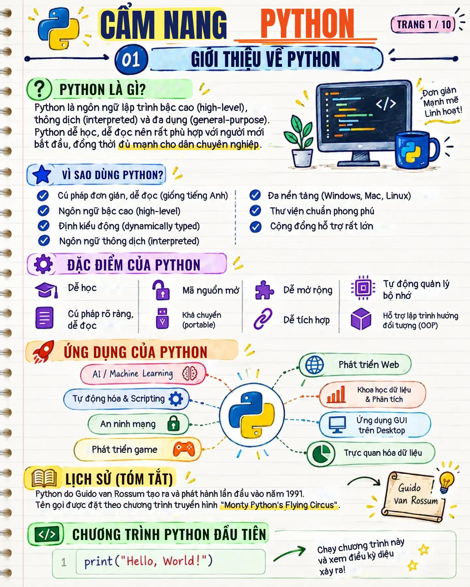
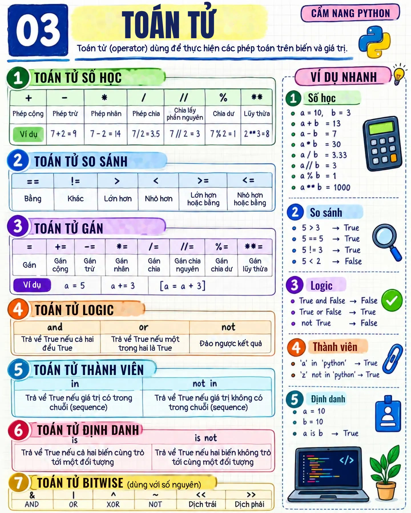
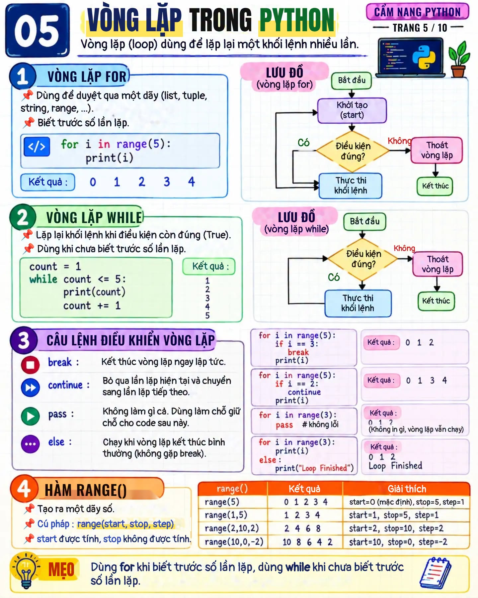
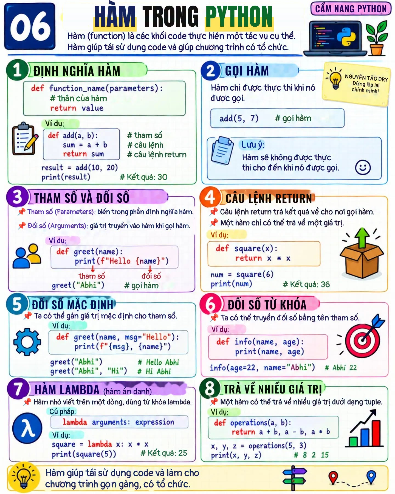
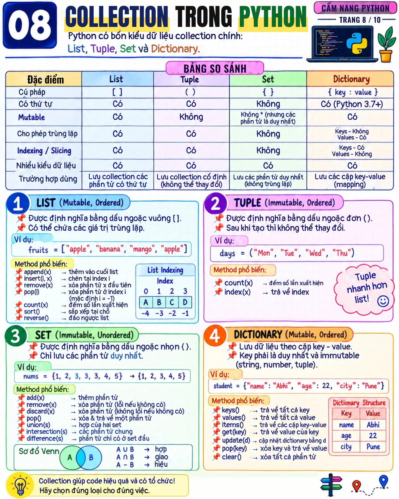
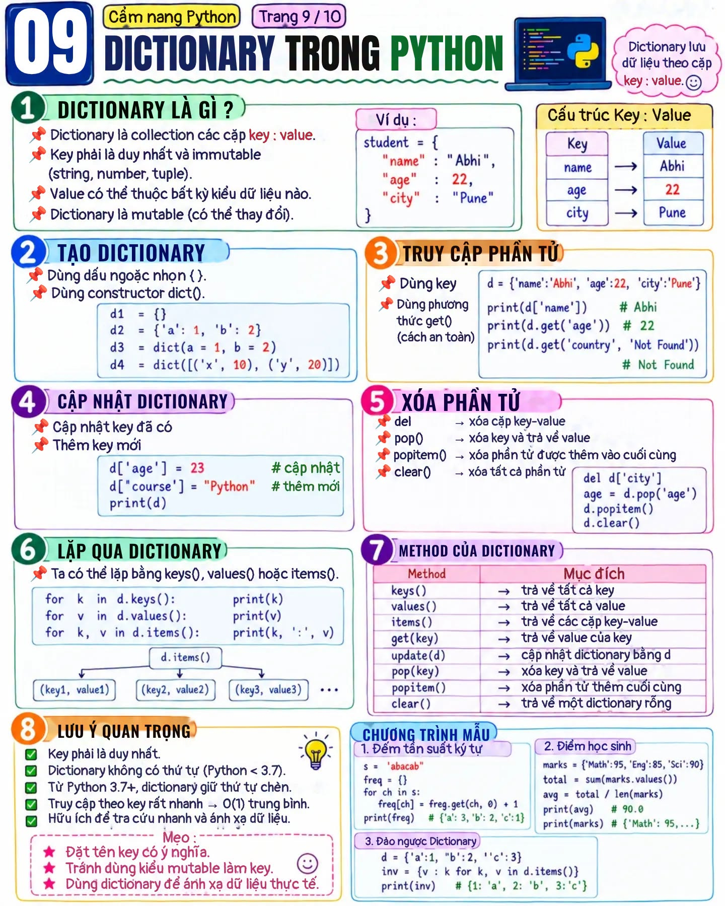
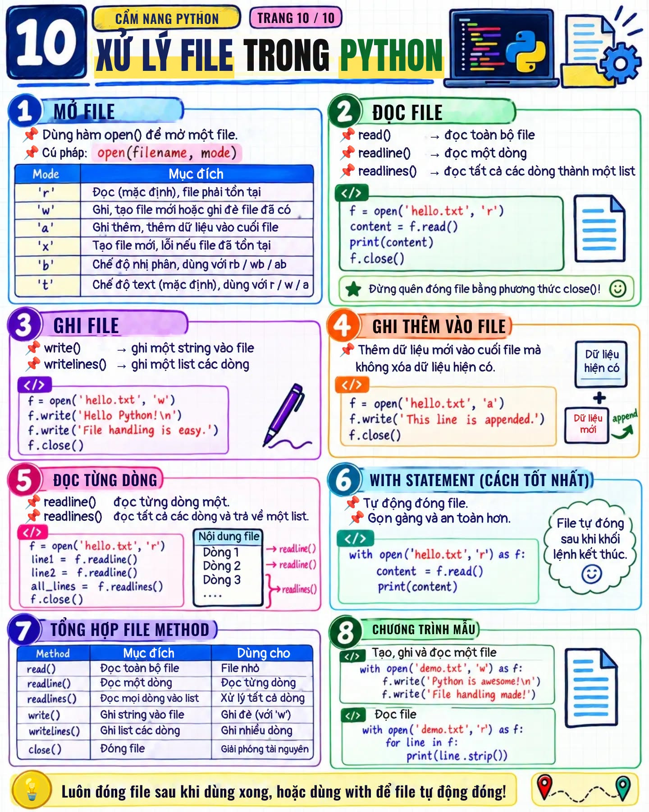

# Python Handbook (Cẩm nang Python bằng tiếng Việt)

**Author**: [[Viet Nguyen AI]] | **Source**: [Facebook Post](https://web.facebook.com/vietnh1009/posts/pfbid02wJj6RDERuLsVqGBvCBp71djHx1goEu2TdcUYfyiTzGCXWdMDuSqowFBtfPTPySj2l) | **Raw Transcript & Visuals**: [[raw/articles/ai-other/python-handbook.md]] | **Pages**: 10 visual sketchnote slides (`2026-11-17`)

---

## Executive Summary

A 10-page Vietnamese visual handbook by [[Viet Nguyen AI]] condensing foundational **Python** programming concepts, syntax comparisons, control-flow diagrams, and quick-reference tables. Designed as both a beginner onboarding primer and a daily cheat sheet covering core execution semantics (`high-level`, `interpreted`, `dynamically typed`), control structures, functions (`DRY`, keyword/default arguments, `lambda`), immutable string operations, the 4 built-in collections (`List`, `Tuple`, `Set`, `Dictionary`), and safe file I/O using `with` context managers.

---

## Page-by-Page Architecture Breakdown

### 1. Language Identity, Variables & Operators (Pages 1–3)
- **Introduction (Page 1)**: Python (created by Guido van Rossum, released 1991, named after *Monty Python's Flying Circus*) combines high-level readability, dynamic typing, automatic memory management, OOP support, and portability across AI/ML, data science, automation/scripting, web backends, cybersecurity, and GUI/game tooling.
- **Variables & Primitive Types (Page 2)**: Identifier naming constraints (`[a-zA-Z_][a-zA-Z0-9_]*`, case-sensitive, reserved keywords disallowed) and the five core primitive types inspected via `type()`: `int`, `float`, `str`, `bool`, and `NoneType` (`None`).
- **Seven Operator Families (Page 3)**: Arithmetic (`+`, `-`, `*`, `/`, `//` integer floor division, `%` modulo, `**` power), comparison (`==`, `!=`, `<`, `>`, `<=`, `>=`), compound assignment (`+=`, `//=`, `**=`), boolean logic (`and`, `or`, `not`), sequence membership (`in`, `not in`), object identity (`is`, `is not`), and integer bitwise operations (`&`, `|`, `^`, `~`, `<<`, `>>`).

### 2. Control Flow, Functions & Strings (Pages 4–7)
- **I/O & Conditionals (Page 4)**: `input()` always returns `str` (cast explicitly via `int(...)`), strict **4-space indentation**, `if / elif / else` branching, nested conditions, and **truthiness rules** (`0`, `False`, `None`, `""`, `()`, `[]`, `{}` evaluate to `False`; non-zero/non-empty evaluate to `True`).
- **Loops & `range()` (Page 5)**: `for` loops (known iteration count over iterables) vs. `while` loops (condition-driven), loop modifiers (`break`, `continue`, `pass`, and Python's loop `else:` block running only on normal completion without `break`), plus `range(start, stop, step)` inclusive-start / exclusive-stop behavior including negative steps (`range(10, 0, -2)`).
- **Functions & Modularity (Page 6)**: `def` / `return` anchored on the **DRY** principle, **parameters** vs. **arguments**, default parameter values, keyword arguments (`info(age=22, name="Abhi")`), inline anonymous `lambda` expressions, and implicit tuple packing/unpacking for multiple return values.
- **Strings (Page 7)**: Immutable character sequences supporting single/double/triple quotes, dual positive (`0..N-1`) and negative (`-N..-1`) indexing, extended slicing `s[start:stop:step]` (including string reversal `s[::-1]`), common methods (`upper/lower/capitalize/title`, `replace`, `split`, `strip`), escape characters (`\n`, `\t`, `\r`, `\\`), and modern **f-string** formatting.

### 3. Built-in Collections, Dictionary Patterns & File I/O (Pages 8–10)
- **Four Core Collections (Page 8)**: Side-by-side matrix comparing **List** `[ ]` (ordered, mutable, duplicates allowed), **Tuple** `( )` (ordered, immutable, faster than lists), **Set** `{ }` (unordered, unique elements, Venn operations `union`, `intersection`, `difference`, safe `discard()` vs. raising `remove()`), and **Dictionary** `{k: v}` (insertion-ordered since Python 3.7+, mutable values, unique immutable keys).
- **Dictionary Deep-Dive (Page 9)**: Safe key lookup with `.get(key, default)` instead of direct subscripting, `.pop()` vs. `.popitem()`, iteration via `.keys()` / `.values()` / `.items()`, **$O(1)$ average-time lookup**, and canonical patterns: frequency counting (`freq.get(ch, 0) + 1`), value aggregation (`sum(marks.values()) / len(marks)`), and dictionary inversion via comprehension (`{v: k for k, v in d.items()}`).
- **File Handling (Page 10)**: `open(filename, mode)` covering `'r'`, `'w'`, `'a'`, `'x'`, `'b'`, `'t'`, comparing `read()` / `readline()` / `readlines()` / `write()` / `writelines()`, and prioritizing the **`with open(...) as f:` context manager** for guaranteed resource cleanup plus streaming line iteration (`for line in f:`).

---

## Key Takeaways & Technical Nuance Notes

- **Editorial Note on Visual Infographics**:
  1. **Page 8 (Set Mutability)**: The printed card titles `SET (Immutable, Unordered)` and marks Mutable as `Không *`; technically, Python's `set` container itself *is* mutable (`add`, `remove`, `discard`, `pop` mutate it in place), while only its **elements** must be immutable/hashable (contrast `frozenset` for an immutable set).
  2. **Page 3 (Arithmetic Table Typos)**: The example under `-` prints `7 - 2 = 14` (`7 * 2 = 14`; subtraction should be `7 - 2 = 5`).
- **Second Brain Synergy**: Establishes the foundational programming reference beneath Python-heavy AI engineering workflows across [[Types of Machine Learning Handbook]], [[LLM Handbook 50 Concepts]], [[Programmatic Tool Calling]], and [[How Anthropic runs large-scale code migrations with Claude Code]].

---

## Related Pages
- **Entities**: [[Viet Nguyen AI]]
- **Concepts**: [[Python Core Syntax and Control Flow]], [[Python Collections and File Handling]], [[Programmatic Tool Calling]]
- **Sibling Handbooks**: [[Types of Machine Learning Handbook]], [[LLM Handbook 50 Concepts]]
