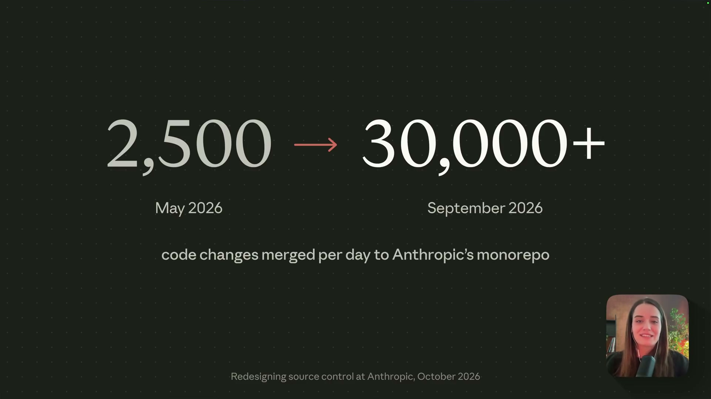
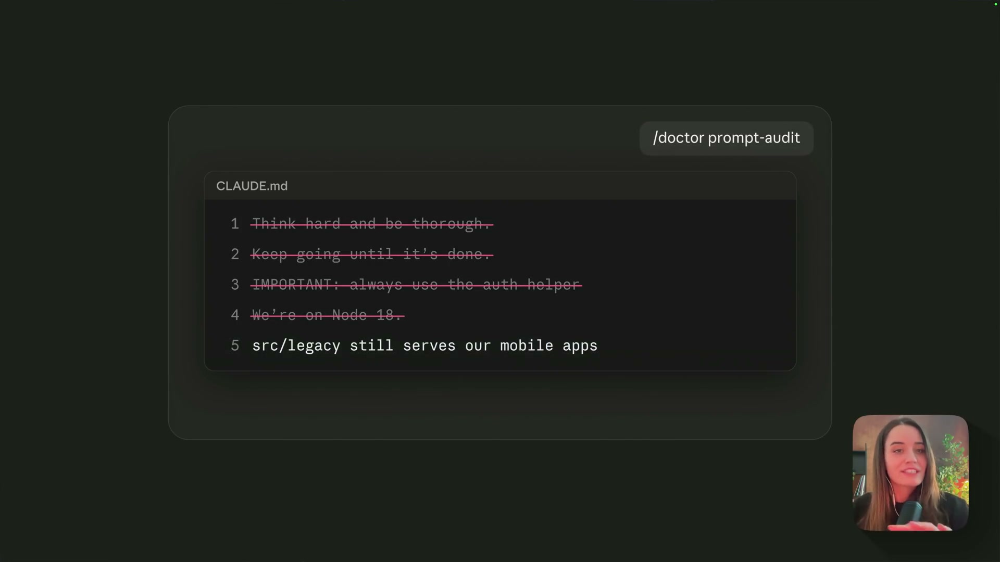
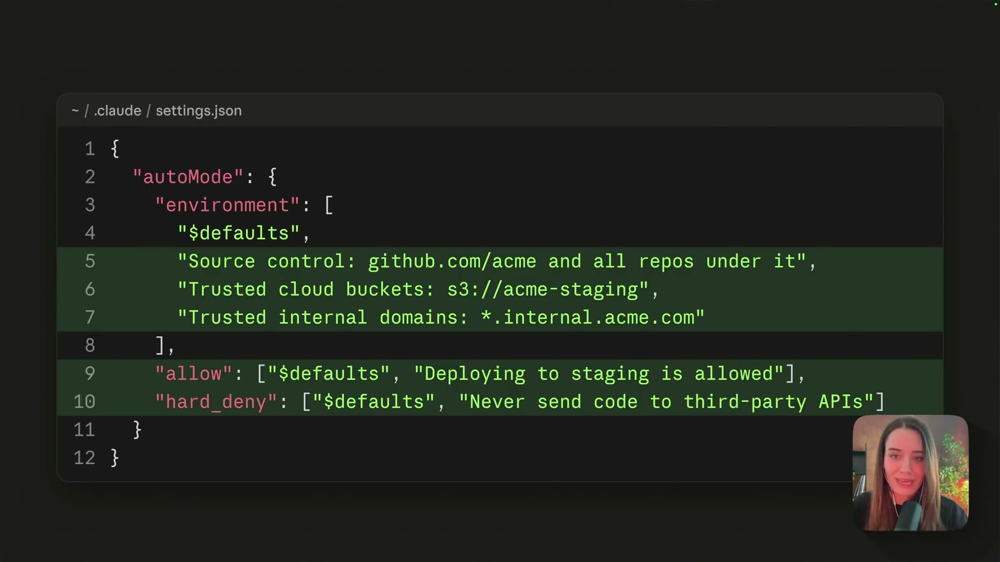
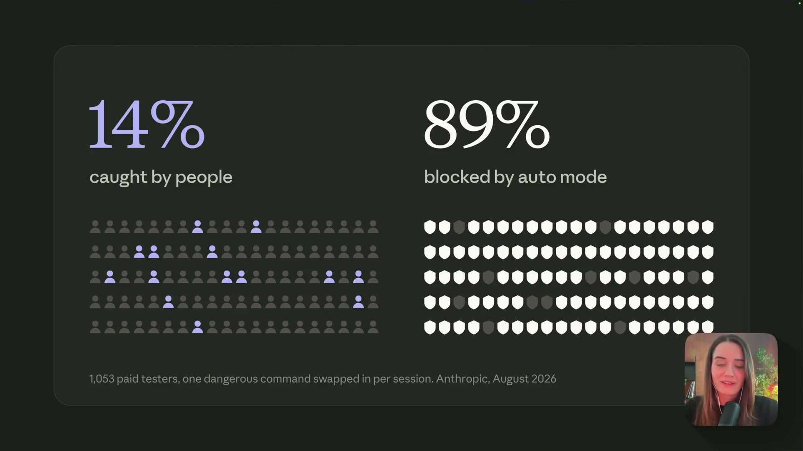
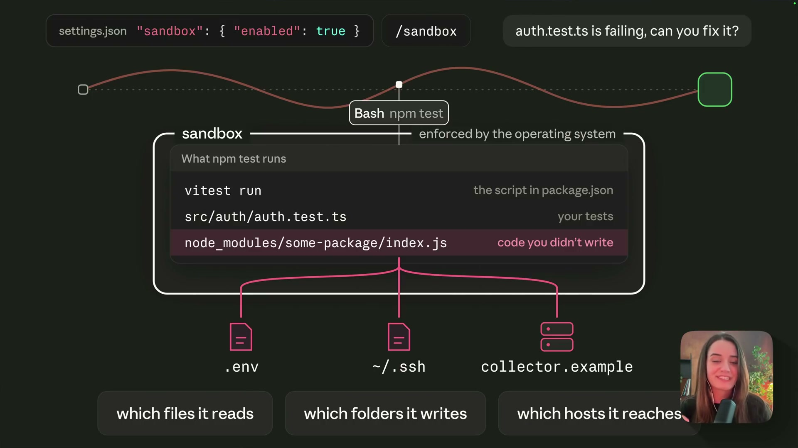
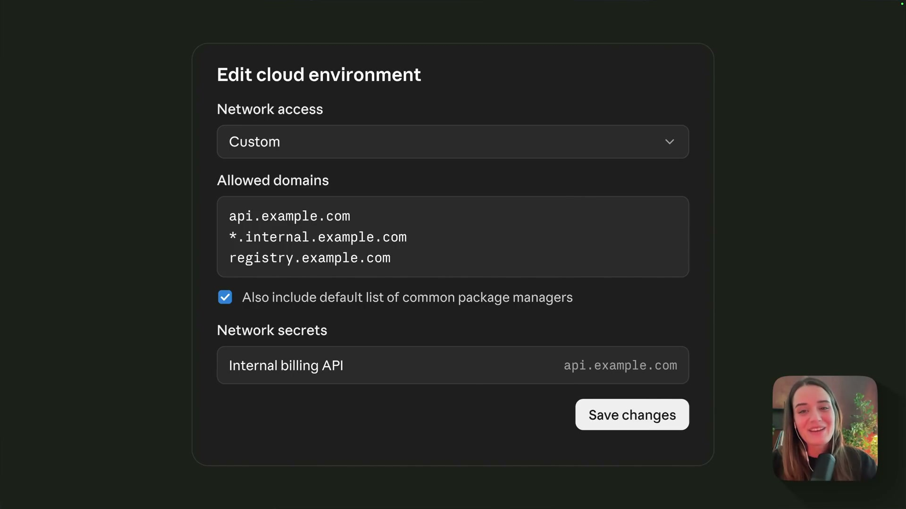
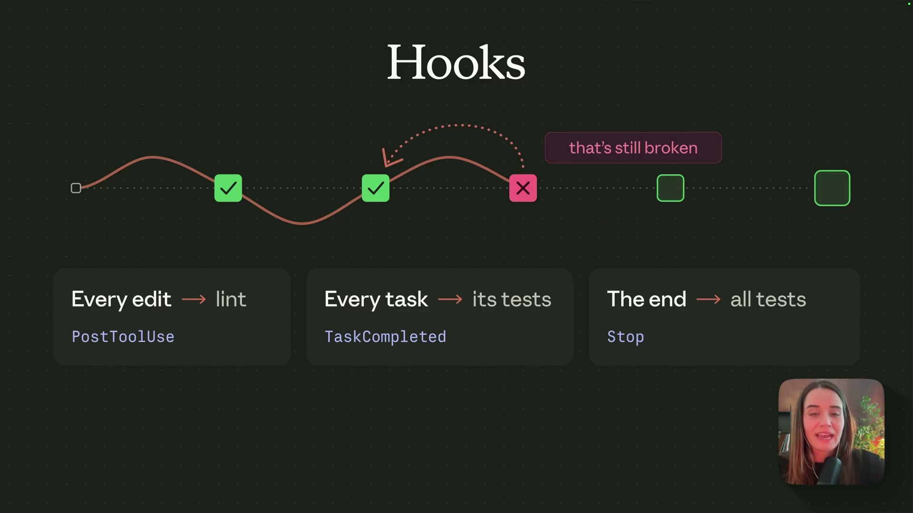
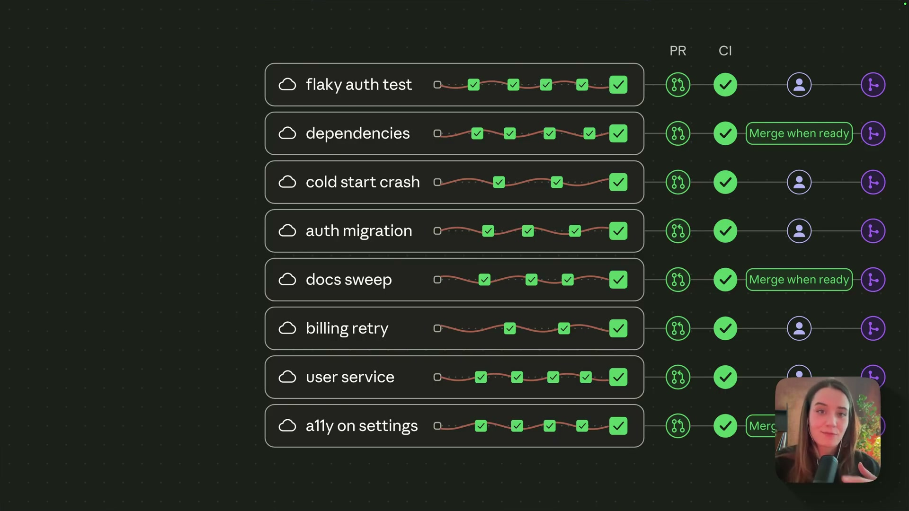
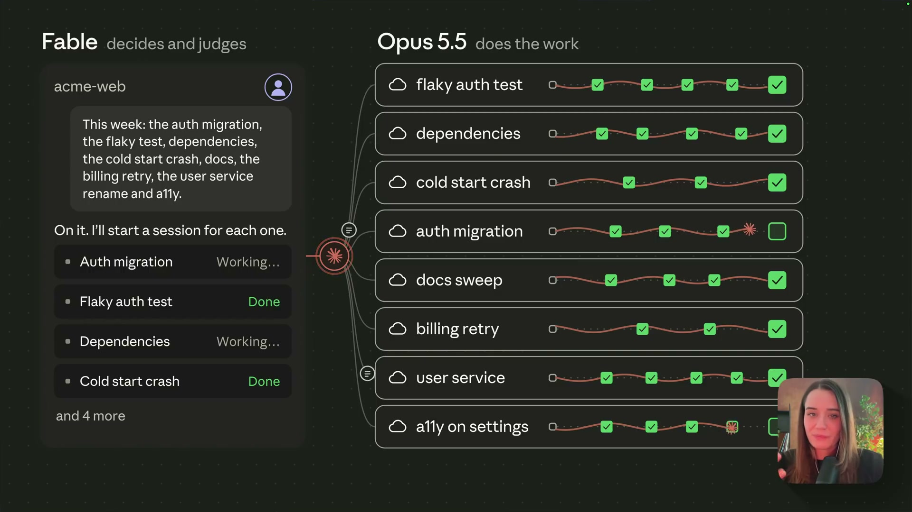

# Rethinking Claude Code Best Practices — Lydia Hallie, Anthropic

**Source**: [[raw/video-transcripts/rethinking-claude-code-best-practices-lydia-hallie-anthropic.md]] | **Speaker**: [[Lydia Hallie]] ([[Anthropic]], Claude Code Team) | **Channel**: [[AI Engineer]] | **URL**: https://www.youtube.com/watch?v=vlfCjWuv4es | **Uploaded**: 2026-11-12 | **Duration**: 17m 31s

---

## Executive Summary

[[Lydia Hallie]] presents Anthropic's late-2026 paradigm shift for working with [[Claude Code]] (`Opus 5.5` and `Fable 5.2`). As Anthropic's internal monorepo throughput jumped from **`2,500` merged changes/day (May 2026)** to **`30,000+` changes/day (September 2026)**, engineers moved from hand-holding 1–2 interactive sessions (`Opus 4.5`) to supervising **dozens of hours-long autonomous sessions**—delegating steering to the model, approvals to **Auto Mode**, safety boundaries to **deny rules / OS sandboxes / Cloud Environments**, checks to **Hooks & CI**, and session spawning to **Claude Code Projects**.

---

## Core Takeaways by Chapter

### 1. Workflow Evolution & `CLAUDE.md` Minimalism (`00:00 - 04:11`)
- **Out-of-the-Loop Management**: Every human action removed from the inner loop must be explicitly covered by **the Model** (steering), **the Harness** (`autoMode`, hooks, deny rules), or **the Environment** (`OS sandbox`, `Cloud sessions`).
- **Rethinking `CLAUDE.md` ([[Unhobbling Claude]])**: Directives written for earlier models (`"Think hard and be thorough"`, `"Keep going until it's done"`, `"IMPORTANT: always use the auth helper"`, `"We're on Node 18"`) trigger extra tool calls and worse runs on `Opus 5.5`. Retain *only* context invisible inside code (`"src/legacy still serves our mobile apps"`).
- **Automated Context Audit (`/doctor prompt-audit`)**: Audits `CLAUDE.md` and `SKILL.md` files against the active frontier model to flag obsolete instructions automatically.

### 2. Managing Auto Mode & Safety Study (`04:11 - 08:16`)
Synthesized deeply in [[Cloud Agent Sandbox and Auto Mode]]:
- **Plain-English `autoMode` Settings (`~/.claude/settings.json`)**: Auto Mode became the default permission mode in August 2026, routing non-trivial commands through a safety classifier tuned via natural-language rules (`"environment"`, `"allow"`, `"hard_deny"`, preserving `"$defaults"`) for trusted GitHub orgs, staging buckets (`s3://acme-staging`), and internal domains.
- **Safety Study (`August 2026`, `1,053` paid testers)**: When swapping one dangerous command per session, human reviewers caught only **`14%`**, whereas the **Auto Mode classifier blocked `89%`**—still leaving `~11%` passing through.
- **Reversibility Heuristic & Pre-Classifier Deny Rules**: Enforce hard harness `deny` rules whenever a single error is irreversible (`discarding uncommitted work`, `leaking .env secrets into transcripts`). Deny rules run **before** Auto Mode—so the classifier never sees rejected calls.

### 3. Local `/sandbox` vs. Cloud-Based Environments (`08:16 - 10:53`)
- **Why Deny Rules Alone Fail on Subprocesses**: Checking `npm test` approves the test command, but child scripts (`node_modules/some-package/index.js`) can still exfiltrate `.env` or `~/.ssh` outside Claude Code's pre-check.
- **OS-Enforced `/sandbox` (`"sandbox": { "enabled": true }`)**: Restricts **which files child processes read**, **which folders they write**, and **which hosts they reach** at the OS kernel level—though local MCP servers, hooks, and host files remain outside the shell sandbox.
- **Cloud-Based Sessions**: Boot each autonomous task in an isolated disposable VM with a fresh repository clone, **running even with your laptop closed**. Local `.env`/SSH/GitHub tokens are absent; legitimate API keys inject via **Network Secrets** (`api.example.com`) without ever appearing in LLM context, and outbound hosts default strictly to package managers + GitHub. Repo-committed `autoMode` + `deny` rules still police outbound commits and connectors.

### 4. Verification Hooks & Scaling with CI/PRs (`10:53 - 15:10`)
- **Three-Stage Hook Verification Cadence**: Move verification out of fragile prose prompts into [[Deterministic Lifecycle Hooks]]:
  - `PostToolUse` (every edit) -> run **linter**
  - `TaskCompleted` (every task) -> run **scoped tests** (e.g., auth tests)
  - `Stop` (end of session) -> run **full test suite**
- **CRITICAL GOTCHA — Exit Code `2` vs. Exit Code `1`**: Most test runners emit exit code `1` on failure, under which Claude Code marks the task completed anyway; hook scripts must explicitly return **exit code `2`** to block completion and force Claude back to fix the failure.
- **CI Auto-Fix, Fresh Review & Risk-Tiered Merging**: Every session PR triggers standard CI + optional **CI auto-fix** + **fresh-context Claude PR review** verified by secondary falsification agents (matching [[Automated Multi-Agent Code Review]] and [[Second Opinion Pattern]]). Human review scales strictly with risk: `Merge when ready` auto-merges green docs/copy/dependency bumps; standard product PRs take 1 reviewer; risky diffs take 2.

### 5. Two-Model Orchestration in `Claude Code Projects` (`15:10 - 17:31`)
- To eliminate manual human context switching across 8+ concurrent sessions, **Claude Code Projects** (beta) uses a single conversational **Orchestrator** (`Fable` deciding, delegating, and judging thread verification) supervising parallel worker threads running `Opus 5.5`—with **fully automatic context management** (no manual `/compact` or `/clear`).

---

## Synthesis & Evolution Against Earlier Practices

| Earlier Practice ([[Best practices for Claude Code]]) | Modern Shift (Nov 2026 Talk) |
| :--- | :--- |
| Detailed `CLAUDE.md` stack rules + `IMPORTANT!` emphasis | Minimalist `CLAUDE.md` limited to non-code facts + `/doctor prompt-audit` |
| Manual command approvals or risky `--dangerously-skip-permissions` | `autoMode` default + plain-English `settings.json` + pre-classifier `deny` |
| Local worktrees + manual `/compact` / `/clear` management | Isolated **Cloud Sessions** (`6h+` unattended) & **Claude Code Projects** auto-context |
| Ad-hoc prompt testing | Tri-stage Hooks (`PostToolUse`/`TaskCompleted`/`Stop` + **`exit 2`**) -> CI Auto-Fix -> Risk-tiered `Merge when ready` |

## Related Pages
- **Entities**: [[Lydia Hallie]], [[Anthropic]], [[Claude Code]], [[AI Engineer]], [[Thariq Shihipar]]
- **Concepts**: [[Cloud Agent Sandbox and Auto Mode]], [[Unhobbling Claude]], [[Deterministic Lifecycle Hooks]], [[Verification Loop]], [[Parallel Agent Architecture]], [[Automated Multi-Agent Code Review]], [[Second Opinion Pattern]]
- **Prior Sources**: [[Best practices for Claude Code]], [[The new rules of context engineering for Claude 5 generation models]], [[Automate actions with hooks]]
