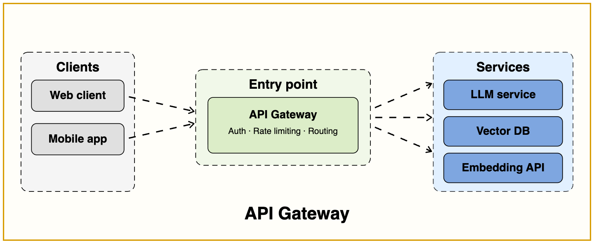

# System Design for AI Engineers: 7 patterns you should know in your interviews

**Author**: Shirin Khosravi Jam ([Jam With AI](../entities/Jam%20With%20AI.md))
**URL**: https://jamwithai.substack.com/p/system-design-for-ai-engineers-7 *(Published 2026-04-09)*
**Source File**: [raw/articles/ai-other/system-design-for-ai-engineers-7-patterns.md](../../raw/articles/ai-other/system-design-for-ai-engineers-7-patterns.md)
**Visual Diagrams**: [raw/screenshots/system-design-for-ai-engineers-7-patterns/00.png](../../raw/screenshots/system-design-for-ai-engineers-7-patterns/00.png), [raw/screenshots/system-design-for-ai-engineers-7-patterns/01.jpg](../../raw/screenshots/system-design-for-ai-engineers-7-patterns/01.jpg), [raw/screenshots/system-design-for-ai-engineers-7-patterns/02.png](../../raw/screenshots/system-design-for-ai-engineers-7-patterns/02.png), [raw/screenshots/system-design-for-ai-engineers-7-patterns/03.png](../../raw/screenshots/system-design-for-ai-engineers-7-patterns/03.png), [raw/screenshots/system-design-for-ai-engineers-7-patterns/04.png](../../raw/screenshots/system-design-for-ai-engineers-7-patterns/04.png), [raw/screenshots/system-design-for-ai-engineers-7-patterns/05.png](../../raw/screenshots/system-design-for-ai-engineers-7-patterns/05.png), [raw/screenshots/system-design-for-ai-engineers-7-patterns/06.jpg](../../raw/screenshots/system-design-for-ai-engineers-7-patterns/06.jpg)

An AI-engineering interview and production readiness guide addressing *"How would you deploy and scale this system in production?"*—showing how seven infrastructure patterns keep inference endpoints, RAG pipelines, and GPU clusters reliable under `10,000` concurrent requests while optimizing unit cost.

---

## 1. Seven Patterns & Interview Signals

| # | Pattern | Core AI Failure / Bottleneck | Key Concrete Details & Interview Signal |
| :-: | :--- | :--- | :--- |
| **01** | **API Gateway** *(Diagram `00.png`)* | Clients coupled directly to separate `Embedding API`, `Vector DB`, `LLM service`, and post-processing microservices | Centralizes auth, validation, rate limiting, and routing **before a single GPU cycle is spent**; always begin request-flow whiteboard answers at the gateway |
| **02** | **Rate Limiting** *(Diagram `01.jpg`)* | Misconfigured clients or bad actors burning thousands of dollars in minutes (**Denial-of-Wallet**) or starving tenants | Sliding window example (`100 req/min` per client token $\rightarrow$ `429 Too Many Requests` blocked upstream); budget **TPM alongside RPM** |
| **03** | **Caching** *(Diagram `02.png`)* | Redundant embedding calls on repeated queries (`200×` `"how to reset my password"`) | **Embedding generation** is the most cacheable RAG layer; **Redis / Memcached** cuts latency from `100s ms` to **single-digit ms**; apply **semantic caching** similarity thresholds cautiously |
| **04** | **Message Queues** *(Diagram `03.png`)* | Synchronous request loops crashing on batch workloads (`50,000` document summarization, offline evals) | Decouple producers from worker pools via **`RabbitMQ`**, **`AWS SQS`**, or **`Kafka`** with built-in retry semantics |
| **05** | **Circuit Breakers** *(Diagram `04.png`)* | Multi-hop RAG cascading failure (`Vector Store` stall $\rightarrow$ connection pool exhaustion $\rightarrow$ `Embedding API` collapse) | Name all three states (**`CLOSED -> OPEN -> HALF-OPEN`**) and specify a fast fallback instead of letting threads stall mid-query |
| **06** | **Load Balancing** *(Diagram `05.png`)* | GPU node saturation (`A100` limits) and uneven inference load across `vLLM` workers | **Round-robin fails for variable-cost LLMs** (`50-token` vs `4,000-token` generations) $\rightarrow$ prefer **weighted** or **least-connections balancing** + health checks |
| **07** | **Auto Scaling** *(Diagram `06.jpg`)* | `10×` diurnal peaks (`9am` vs `3am`) burning budget on idle `4× A100` instances `24/7` | Scale on **`p99` latency, inference queue depth, GPU util** (`10% CPU / 95% GPU` pitfall); combine **predictive + reactive scaling** for model-loading cold starts |

---

## 2. Outside-In Interview Walkthrough & Recommended References
- **Whiteboard Flow (`~90%` interview coverage)**: Start outside and walk inward—`API Gateway` (auth, failover) $\rightarrow$ `Rate Limiting` (Denial-of-Wallet, `RPM` vs `TPM`) $\rightarrow$ `Caching` (embeddings, semantic caching) $\rightarrow$ `Message Queues` (async bulk docs/evals) $\rightarrow$ `Circuit Breakers` (3 states + fallback) $\rightarrow$ `Load Balancing` (weighted/least-connections across GPU nodes, health checks) $\rightarrow$ `Auto Scaling` (GPU metrics + predictive warm-up for cold starts).
- **Recommended Books Cited**:
  1. *System Design Interview – An Insider's Guide (Vol. 1 & 2)* — Alex Xu
  2. *Designing Data-Intensive Applications* — Martin Kleppmann
  3. *Building Generative AI Services with FastAPI* — Alireza Parandeh *(O'Reilly, 2025)*

---

## 3. Synthesis & Companion Diff vs. Video Follow-Up
This April 2026 article serves as the written precursor to [Jam With AI](../entities/Jam%20With%20AI.md)'s September 2026 deep dive video [AI System Design 7 Patterns Explained in 17 Minutes](AI%20System%20Design%207%20Patterns%20Explained%20in%2017%20Minutes.md):
- **What This Written Guide Adds**: Names concrete production failure scenarios and interview cues (**Denial-of-Wallet** economics, `50K`-document batch queues, specific stack names `RabbitMQ/SQS/Kafka`, RAG connection-pool cascades, **`vLLM` GPU-node balancing with weighted/least-connections instead of naive round-robin**, `10% CPU vs 95% GPU` utilization mismatch, **predictive + reactive scaling**, and exact single-digit ms latency impact of Redis embedding caches).
- **What the Later Video Deepens**: Adds the distinction between **Inbound API Gateway vs. Outbound Model Gateway**, **Live vs. Batch lane isolation + DLQ + worker idempotency**, **Bulkheads**, **PostgreSQL durable checkpoints + Redis shared short-lived state** for stateless FastAPI replicas, and the **Metrics + Traces + AI Evaluations** observability triad.
- > ⚠️ **Evolving nuance (Semantic Caching Safety)**: Here, [Jam With AI](../entities/Jam%20With%20AI.md) highlights *semantic similarity thresholds* as an interview bonus for near-duplicate RAG queries. Five months later in [AI System Design 7 Patterns Explained in 17 Minutes](AI%20System%20Design%207%20Patterns%20Explained%20in%2017%20Minutes.md), she sharpens the production constraint: *"Questions that sound similar are not automatically safe to be shared"*—requiring strict `tenant_id + permissions + TTL` cache-key isolation before sharing cached outputs.

---

## Related Pages
- **Companion Source & Entity**: [AI System Design 7 Patterns Explained in 17 Minutes](AI%20System%20Design%207%20Patterns%20Explained%20in%2017%20Minutes.md), [Jam With AI](../entities/Jam%20With%20AI.md)
- **Core Concepts**:
  - [Production AI Resilience and Scaling Patterns](../concepts/Production%20AI%20Resilience%20and%20Scaling%20Patterns.md)
  - [AI System Design and Production Architecture](../concepts/AI%20System%20Design%20and%20Production%20Architecture.md)
  - [Inference Serving and Deployment Patterns](../concepts/Inference%20Serving%20and%20Deployment%20Patterns.md)
  - [LLM Inference Optimization and Security](../concepts/LLM%20Inference%20Optimization%20and%20Security.md)
  - [System Prompt Caching Optimization](../concepts/System%20Prompt%20Caching%20Optimization.md)
- **Cross-References**:
  - [AI Engineer Interview Notes](AI%20Engineer%20Interview%20Notes.md)
  - [AI Deployment Notes](AI%20Deployment%20Notes.md)
  - [Retrieval-Augmented Generation and Vector DBs](../concepts/Retrieval-Augmented%20Generation%20and%20Vector%20DBs.md)
  - [Product Evals and Error Analysis](../concepts/Product%20Evals%20and%20Error%20Analysis.md)
