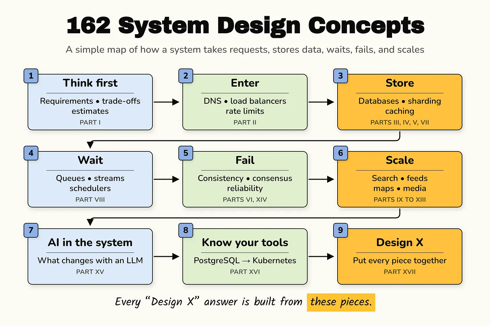

# System Design for Engineers: 162 Concepts Resource Guide

**Author**: [Jam With AI](../entities/Jam%20With%20AI.md)
**Source File**: [raw/articles/ai-other/system-design-for-engineers.md](../../raw/articles/ai-other/system-design-for-engineers.md)
**Full 162-Concept & 324-Link Directory**: [System Design 162 Concepts Resource Map](../references/System%20Design%20162%20Concepts%20Resource%20Map.md)
**Visual Lifecycle Map**: [raw/assets/system-design-for-engineers-01.webp](../../raw/assets/system-design-for-engineers-01.webp)

A structured, 17-part curriculum cataloging **162 foundational, distributed, AI-era, and "Design X" system design concepts**, pairing each concept with curated external reading (`162` articles) and walkthrough videos (`162` videos)—all preserved verbatim without external expansion inside [System Design 162 Concepts Resource Map](../references/System%20Design%20162%20Concepts%20Resource%20Map.md).

---

## 1. 9-Stage System Lifecycle & Study Strategy
> *"System design is not about memorising answers. It is about understanding the pieces, so you can put them together. Every 'Design X' answer is built from these pieces."*

Rather than tackling terms in isolation, the guide organizes request flow, persistence, reliability, and scaling across **nine sequential lifecycle stages**:
1. **Think first (`Part I`)**: Requirements, trade-offs, back-of-the-envelope estimation.
2. **Enter (`Part II`)**: DNS, load balancers, timeouts/retries, rate limiting, CDNs.
3. **Store (`Parts III, IV, V, VII`)**: Relational modeling, B-trees, MVCC/WAL, sharding, consistent hashing, caching layers, LSM/Bitcask, blob storage.
4. **Wait (`Part VIII`)**: Queues, pub/sub, Kafka logs, schedulers, DAGs, fan-out.
5. **Fail (`Parts VI, XIV`)**: Consistency models, replication, CAP/PACELC, clocks, Raft consensus, distributed locks, outbox, circuit breakers, SRE/SLOs, DR.
6. **Scale (`Parts IX–XIII`)**: Search/BM25/hybrid RAG, probabilistic sketches, real-time/social feeds, geospatial indexing, media streaming & delta sync.
7. **AI in the system (`Part XV`)**: Token economics, tail latency, feature stores, RAG bots, and code assistants.
8. **Know your tools (`Part XVI`)**: Trade-offs across PostgreSQL, MySQL, MongoDB, Redis, Memcached, DynamoDB, Cassandra, Elasticsearch, RabbitMQ, SQS, Flink, Spark, Lambda, Nginx, ZooKeeper, Docker, Kubernetes, and Prometheus.
9. **Design X (`Part XVII`)**: 47 end-to-end architecture walkthroughs (`#116–#162`).

**Three Recommended Ways to Use This Curriculum:**
- **Short on time**: Master the **15 ⭐ Essential Starter Concepts** first (`#1–#4`, `#12`, `#13`, `#15`, `#21`, `#24`, `#25`, `#29`, `#32`, `#38`, `#42`, `#50`).
- **Preparing for interviews**: Pick a **Design X** prompt (`Part XVII`), sketch your own design for `20` minutes *before* watching the walkthrough, and target weak spots back to Parts I–XVI.
- **Learning on the job**: Build minimal primitives (a rate limiter or API cache) and **break them on purpose** to internalize failure modes.

---

## 2. 17-Part Curriculum Overview & Interview Signals

| Part | Topic & Concept Range | Lifecycle Stage | Why It Matters & Interview Signal | Connected Vault Pages |
| :-: | :--- | :--- | :--- | :--- |
| **I** | **Foundations & Interview Approach** (`#1–#7`) | `1. Think first` | Clarify NFRs, trade-offs, and math in the first 5 minutes (*"How many RPS are we talking about?"*) | [AI System Design and Production Architecture](../concepts/AI%20System%20Design%20and%20Production%20Architecture.md) |
| **II** | **Networking, APIs & Traffic** (`#8–#16`) | `2. Enter` | Ingress lifecycle (DNS, TCP/UDP, gRPC/REST, LB, retries/idempotency, backpressure, rate limit, CDN) — trace requests from DNS outward | [AWS Foundation, Networking and Compute](../concepts/AWS%20Foundation%2C%20Networking%20and%20Compute.md), [Production AI Resilience and Scaling Patterns](../concepts/Production%20AI%20Resilience%20and%20Scaling%20Patterns.md) |
| **III** | **Relational Databases & Modeling** (`#17–#22`) | `3. Store` | Normalization, B-trees, isolation/MVCC, WAL recovery, replicas, cursor vs offset pagination (*fix slow queries without adding infra*) | [AWS Databases, Containers and Messaging](../concepts/AWS%20Databases%2C%20Containers%20and%20Messaging.md) |
| **IV** | **NoSQL, Partitioning & IDs** (`#23–#28`) | `3. Store` | Splitting data cleanly (SQL vs NoSQL, sharding, consistent hashing, Snowflake IDs, Bloom filters, hot/cold storage; hot-shard mitigation) | [AWS Databases, Containers and Messaging](../concepts/AWS%20Databases%2C%20Containers%20and%20Messaging.md) |
| **V** | **Caching** (`#29–#30`) | `3. Store` | Cache-aside/read-through/write-through/write-back & distributed caches (*what happens to cache when underlying data mutates?*) | [Production AI Resilience and Scaling Patterns](../concepts/Production%20AI%20Resilience%20and%20Scaling%20Patterns.md), [System Prompt Caching Optimization](../concepts/System%20Prompt%20Caching%20Optimization.md) |
| **VI** | **Distributed Systems Core** (`#31–#43`) | `5. Fail` | Linearizability vs eventual consistency, replication, CAP/PACELC, Lamport/vector clocks, Raft, locks/fencing tokens, circuit breakers, 2PC vs saga, outbox, Kafka EOS | [AWS Databases, Containers and Messaging](../concepts/AWS%20Databases%2C%20Containers%20and%20Messaging.md), [Production AI Resilience and Scaling Patterns](../concepts/Production%20AI%20Resilience%20and%20Scaling%20Patterns.md) |
| **VII** | **Storage Engines & Blob Storage** (`#44–#48`) | `3. Store` | LSM trees vs B-trees, Bitcask, keeping large binaries in S3/object storage rather than transactional DBs | — |
| **VIII** | **Async Work, Queues & Streams** (`#49–#56`) | `4. Wait` | Decoupling batch work (`50K` docs) via queues, pub/sub, Kafka logs, schedulers, DAGs, fanout, flash-sale inventory locking | [AWS Databases, Containers and Messaging](../concepts/AWS%20Databases%2C%20Containers%20and%20Messaging.md), [Production AI Resilience and Scaling Patterns](../concepts/Production%20AI%20Resilience%20and%20Scaling%20Patterns.md), [AI Agent Memory Types](../concepts/AI%20Agent%20Memory%20Types.md), [Loop Engineering](../concepts/Loop%20Engineering.md) |
| **IX** | **Search & Retrieval** (`#57–#63`) | `6. Scale` | Inverted index, BM25, MRR/MAP/NDCG retrieval evals, Elasticsearch shards, web crawlers, **vector + hybrid retrieval**, typeahead | [Retrieval-Augmented Generation and Vector DBs](../concepts/Retrieval-Augmented%20Generation%20and%20Vector%20DBs.md) |
| **X** | **Analytics & Probabilistic Data Structures** (`#64–#69`) | `6. Scale` | Sharded counters, HyperLogLog, Count-Min Sketch, reservoir sampling, tumbling/sliding/session windows, live comments | — |
| **XI** | **Realtime, Social & Feeds** (`#70–#73`) | `6. Scale` | WebSockets vs SSE vs polling, Meta TAO social graph, push/pull/hybrid feed fanout, Slack unread counters | — |
| **XII** | **Geospatial & Matching** (`#74–#77`) | `6. Scale` | Geohashing/QuadTrees/Hilbert curves, point-in-polygon geofencing, recommendation candidate gen, ETA/routing | [Machine Learning Paradigms](../concepts/Machine%20Learning%20Paradigms.md) |
| **XIII** | **Media, Files & Video** (`#78–#82`) | `6. Scale` | Direct S3 multipart uploads, edge image resizing, HLS/ABR video pipeline, WebRTC, Dropbox delta block deduplication | — |
| **XIV** | **Reliability & Operations** (`#83–#92`) | `5. Fail` | Metrics/logs/traces, SLOs & error budgets, incident management, blue-green/canary rollouts, RTO/RPO DR, multi-region, GDPR erasure, OWASP, multitenancy | [AWS Observability and Cryptographic Security](../concepts/AWS%20Observability%20and%20Cryptographic%20Security.md), [AI Deployment Lifecycle and Environments](../concepts/AI%20Deployment%20Lifecycle%20and%20Environments.md), [Software Supply Chain Security](../concepts/Software%20Supply%20Chain%20Security.md), [LLM Inference Optimization and Security](../concepts/LLM%20Inference%20Optimization%20and%20Security.md) |
| **XV** | **AI-Era System Design** (`#93–#97`) | `7. AI in the system` | Expensive LLM calls, tail latency, hidden wrong-answer failures (*dashboards green while quality fails*), ChatGPT design, feature stores, RAG bots, code assistants | [AI System Design and Production Architecture](../concepts/AI%20System%20Design%20and%20Production%20Architecture.md), [Production AI Agent Service Stack](../concepts/Production%20AI%20Agent%20Service%20Stack.md), [Data Preprocessing and Feature Engineering](../concepts/Data%20Preprocessing%20and%20Feature%20Engineering.md) |
| **XVI** | **Technology Deep Dives** (`#98–#115`) | `8. Know your tools` | Concrete component selection & trade-offs across 18 core infra systems (*"Why RabbitMQ here instead of Kafka?"*) | [AWS Databases, Containers and Messaging](../concepts/AWS%20Databases%2C%20Containers%20and%20Messaging.md), [Production AI Agent Service Stack](../concepts/Production%20AI%20Agent%20Service%20Stack.md), [Inference Serving and Deployment Patterns](../concepts/Inference%20Serving%20and%20Deployment%20Patterns.md) |
| **XVII** | **“Design X” Walkthroughs** (`#116–#162`) | `9. Design X` | 47 classic end-to-end interview problems from URL Shortener, Payment System, WhatsApp, Uber, Netflix, Dropbox & S3/Chubby to Leaderboard & Online Chess | [AWS Foundation, Networking and Compute](../concepts/AWS%20Foundation%2C%20Networking%20and%20Compute.md), [Production AI Resilience and Scaling Patterns](../concepts/Production%20AI%20Resilience%20and%20Scaling%20Patterns.md) |

> See [System Design 162 Concepts Resource Map](../references/System%20Design%20162%20Concepts%20Resource%20Map.md) for all `162` numbered concept rows and all `324` clickable article + video URLs verbatim.

---

## 3. 15 ⭐ Essential Starter Concepts & 8 Follow-Up Diagnostics

### The 15 ⭐ Core Concepts
- **Think first**: `#1` Approaching a System Design Problem · `#2` Non-Functional Requirements · `#3` Thinking in Trade-offs · `#4` Back-of-the-Envelope Estimation
- **Enter**: `#12` Load Balancers · `#13` Retries, Timeouts & Idempotency · `#15` Rate Limiting
- **Store**: `#21` Scaling Relational Databases · `#24` Sharding & Partitioning · `#25` Consistent Hashing · `#29` Caching Layers
- **Fail**: `#32` Consistency Models · `#38` Circuit Breakers · `#42` Keeping Data in Sync (*Transactional Outbox Pattern*)
- **Wait**: `#50` Distributed Message Queue

### Eight Classic Follow-Up Failure Prompts
1. *Payment crashed after charging card, before saving order* $\rightarrow$ Distributed transactions & outbox (`#41`, `#42`)
2. *Two workers grabbed the same lock* $\rightarrow$ Distributed locks, leases & fencing tokens (`#37`)
3. *One celebrity account melts a single shard* $\rightarrow$ Sharding, hot partitions & fanout (`#24`, `#55`, `#72`)
4. *Retries made the outage worse* $\rightarrow$ Backoff with jitter, backpressure & circuit breakers (`#13`, `#14`, `#38`)
5. *Users still see stale data after an update* $\rightarrow$ Caching, consistency models & replication (`#29`, `#32`, `#33`)
6. *Same message processed twice* $\rightarrow$ Idempotency & exactly-once processing (`#13`, `#43`)
7. *User asks to delete all personal data* $\rightarrow$ Data retention, deletion & GDPR privacy (`#89`)
8. *Inference API slowed down during spike* $\rightarrow$ Load protection, rate limiting & AI-era architecture (`#14`, `#15`, `#93`)

---

## 4. Series Continuity & External Reading Links
- **Introductory Visual Videos Referenced in Guide (Already Ingested)**:
  - [AI System Design 7 Patterns Explained in 17 Minutes](AI%20System%20Design%207%20Patterns%20Explained%20in%2017%20Minutes.md) (`0jCss9xfOiw`)
  - [How a Production AI Agent System Actually Works](How%20a%20Production%20AI%20Agent%20System%20Actually%20Works.md) (`sKzL0wSN9vQ`)
  - [AI Agent Memory 7 Types Explained in 12 Minutes](AI%20Agent%20Memory%207%20Types%20Explained%20in%2012%20Minutes.md) (`bK1clrG-boc`)
- **AI-Era Pattern & Hardware Companions**: [System Design for AI Engineers 7 Patterns](System%20Design%20for%20AI%20Engineers%207%20Patterns.md), [All GPU Related Concepts Simply Explained](All%20GPU%20Related%20Concepts%20Simply%20Explained.md) *(synthesized in [GPU Architecture and Distributed Scaling](../concepts/GPU%20Architecture%20and%20Distributed%20Scaling.md))*
- **Additional Substack & Course Pointers Retained *(Not Opened/Ingested)***:
  - [20 AI Engineering Concepts Explained](https://jamwithai.substack.com/p/20-ai-engineering-concepts-explained)
  - [LLM Inference 101](https://jamwithai.substack.com/p/llm-inference-101)
  - [Agentic RAG System Course](https://jamwithai.com/courses/rag/)

---

## Related Pages
- **Full Link Directory & Entity**: [System Design 162 Concepts Resource Map](../references/System%20Design%20162%20Concepts%20Resource%20Map.md), [Jam With AI](../entities/Jam%20With%20AI.md)
- **AI & Production System Design**:
  - [AI System Design and Production Architecture](../concepts/AI%20System%20Design%20and%20Production%20Architecture.md)
  - [Production AI Resilience and Scaling Patterns](../concepts/Production%20AI%20Resilience%20and%20Scaling%20Patterns.md)
  - [Production AI Agent Service Stack](../concepts/Production%20AI%20Agent%20Service%20Stack.md)
  - [System Design for AI Engineers 7 Patterns](System%20Design%20for%20AI%20Engineers%207%20Patterns.md)
  - [AI System Design 7 Patterns Explained in 17 Minutes](AI%20System%20Design%207%20Patterns%20Explained%20in%2017%20Minutes.md)
  - [How a Production AI Agent System Actually Works](How%20a%20Production%20AI%20Agent%20System%20Actually%20Works.md)
  - [AI Agent Memory Types](../concepts/AI%20Agent%20Memory%20Types.md)
  - [AI Agent Memory 7 Types Explained in 12 Minutes](AI%20Agent%20Memory%207%20Types%20Explained%20in%2012%20Minutes.md)
- **Cloud, Data & Retrieval**:
  - [AWS Foundation, Networking and Compute](../concepts/AWS%20Foundation%2C%20Networking%20and%20Compute.md)
  - [AWS Databases, Containers and Messaging](../concepts/AWS%20Databases%2C%20Containers%20and%20Messaging.md)
  - [AWS Observability and Cryptographic Security](../concepts/AWS%20Observability%20and%20Cryptographic%20Security.md)
  - [Retrieval-Augmented Generation and Vector DBs](../concepts/Retrieval-Augmented%20Generation%20and%20Vector%20DBs.md)
  - [Inference Serving and Deployment Patterns](../concepts/Inference%20Serving%20and%20Deployment%20Patterns.md)
  - [System Prompt Caching Optimization](../concepts/System%20Prompt%20Caching%20Optimization.md)
