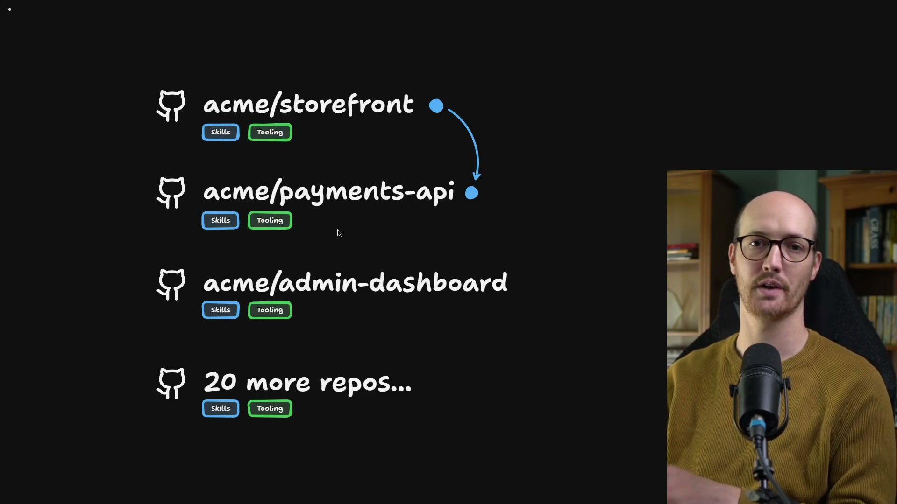
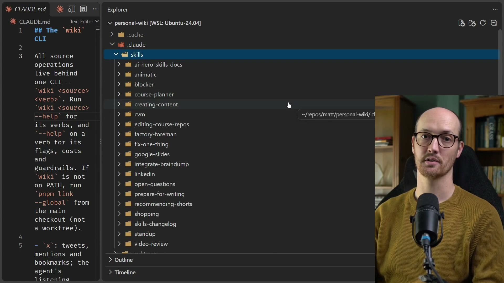
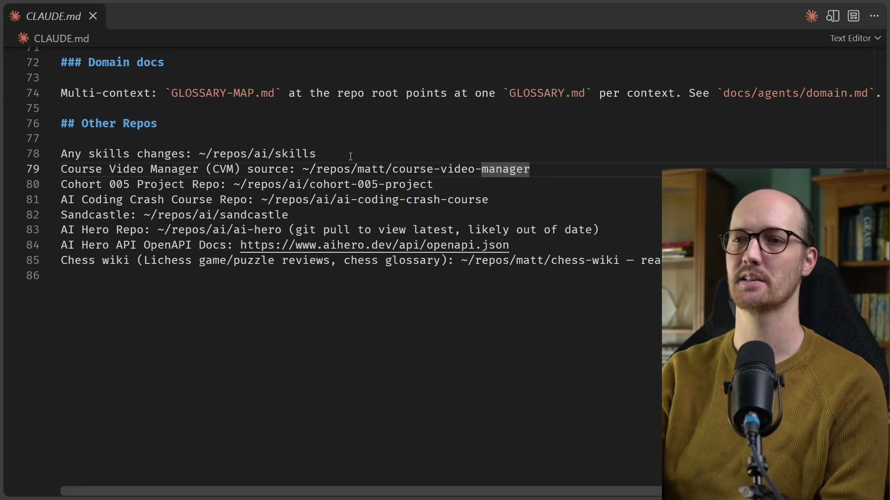
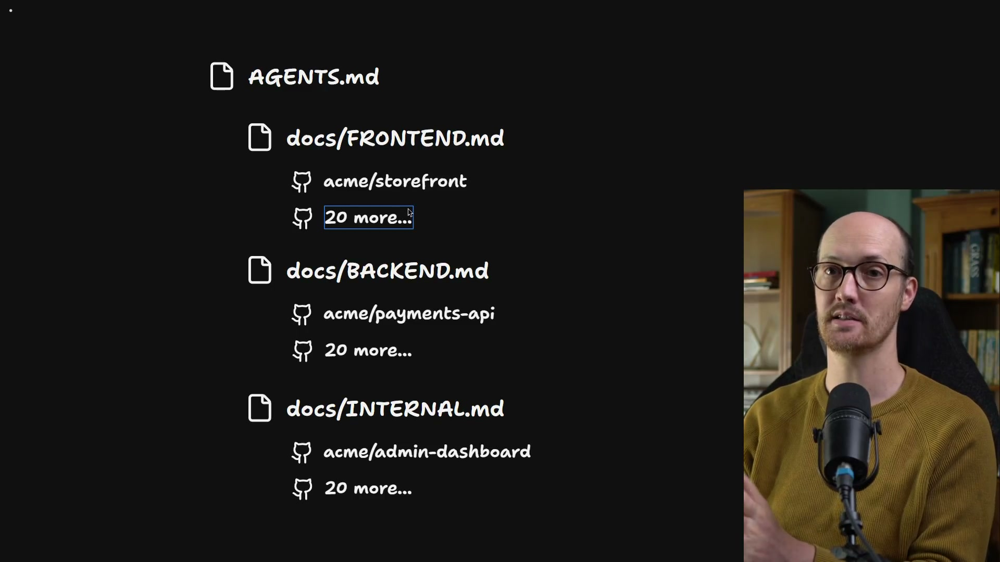
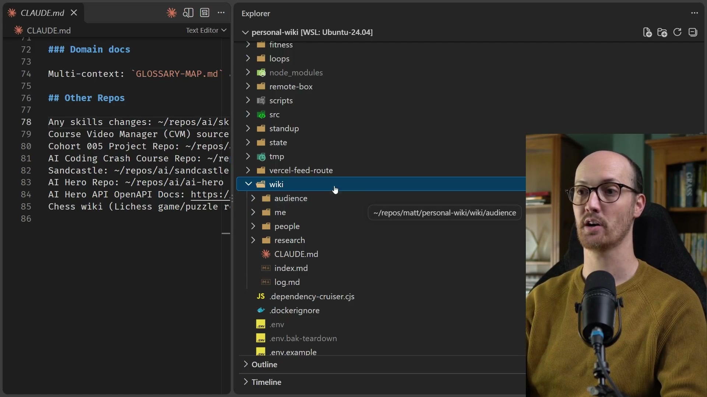
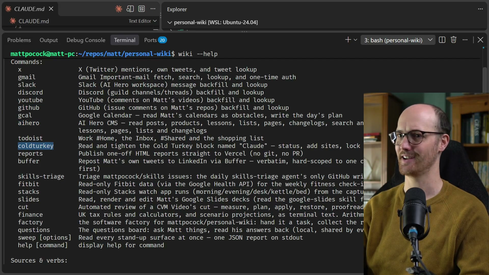

# The Home Repo: The effortless multi-repo agent setup

**Source**: [raw/video-transcripts/the-home-repo-the-effortless-multi-repo-agent-setup.md](../../raw/video-transcripts/the-home-repo-the-effortless-multi-repo-agent-setup.md) | **Speaker / Channel**: [Matt Pocock](../entities/Matt%20Pocock.md) (`@mattpocockuk`) | **URL**: https://www.youtube.com/watch?v=hWe-j78vNpc | **Uploaded**: 2026-11-12 | **Duration**: 8m 53s

---

## Executive Summary

[Matt Pocock](../entities/Matt%20Pocock.md) presents the **[Home Repo Pattern](../concepts/Home%20Repo%20Pattern.md)**—a deceptively simple architecture for running coding agents effortlessly across `20–40+` separate Git repositories without duplicating steering files/skills or relying on fragile unversioned configs in `~/.claude`. By anchoring all agent sessions inside a single central **"Home Repo"** (`personal-wiki`) containing private `.claude/skills/`, `settings.json`, `CLAUDE.md`/`AGENTS.md` navigation pointers, a Karpathy-style **[llm-wiki](../concepts/llm-wiki.md)**, and a unified **`wiki <source> <verb>`** CLI, agents seamlessly clone, branch via git worktrees, and ship coordinated pull requests across codebases, business SaaS tools, and content pipelines.

---

## Core Takeaways by Chapter

### 1. The Multi-Repo Agent Dilemma (`00:00 - 02:20`)
Organizations routinely span dozens of service repos (`acme/storefront`, `acme/payments-api`, `acme/admin-dashboard`, plus `20+` supporting repos). Running multi-directory edits in one session leaves two flawed traditional choices for shared skills, scripts, and onboarding docs (`AGENTS.md` / `CLAUDE.md`):
- **Copy into every repo**: Immediately drifts out of sync across 30–40 repositories.
- **Dump into the user home directory (`~/.claude`)**: Invisible in repository version control, diverges from team standards over time, and conflates personal preferences with shared organizational tooling.

### 2. The Home Repo Solution & Real Walkthrough (`02:20 - 04:42`)
- **Single Execution Hub**: Keep one central repository (`personal-wiki`) holding private business-sensitive skills (`.claude/skills/`), versioned `settings.json`, `CLAUDE.md`/`AGENTS.md`, `wiki/`, and custom scripts—then **always launch agents inside the Home Repo**.
- **Walkthrough of `personal-wiki` Structure (`04.jpg` & `05.jpg`)**:
  - **Private `.claude/skills/`**: Holds specialized internal skills (`cvm`, `course-planner`, `editing-course-repos`, `factory-foreman`, `video-review`, `google-slides`, `skills-changelog`, etc.) available in every session.
  - **`## Other Repos` Pointer Block in `CLAUDE.md`**: Simple path registry mapping projects (`~/repos/ai/skills`, `~/repos/matt/course-video-manager`, `~/repos/ai/cohort-005-project`, `~/repos/ai/ai-coding-crash-course`, `~/repos/ai/sandcastle`, `~/repos/ai/ai-hero`, `~/repos/matt/chess-wiki`) alongside API specs (`aihero.dev/api/openapi.json`).
  - **Zero-Setup Auto-Cloning & Worktrees**: On a fresh machine, if a target path is missing, the agent automatically clones it; when parallel agents modify the same repo, they automatically use git worktrees (compare [Git Worktree Isolation](../concepts/Git%20Worktree%20Isolation.md)).
  - **Multi-Context Disambiguation**: Root `GLOSSARY-MAP.md` points to domain-specific `GLOSSARY.md` definitions (`docs/agents/domain.md`).

### 3. Scaling Beyond 40 Repos & Monorepo Trade-offs (`04:42 - 05:43`)
- **Scaling to ~400+ Repos**: Swap flat repo lists inside `AGENTS.md` for tiered **[Progressive Disclosure](../concepts/Progressive%20Disclosure.md)** pointers (`docs/FRONTEND.md`, `docs/BACKEND.md`, `docs/INTERNAL.md`), letting file-system navigation resolve the exact service repo on demand.
- **Home Repo vs. Monorepos**: As former Turborepo DevRel at Vercel, Pocock strongly prefers monorepos (see [Monorepo Context Engineering](../concepts/Monorepo%20Context%20Engineering.md)) *when feasible*, but notes monorepos break down whenever teams mix public open-source repos with private commercial code or face organizational boundaries—making the Home Repo the practical default.

### 4. Personal Karpathy-Style LLM Wiki & Unified `wiki` CLI (`05:43 - 08:53`)
- **Persistent Business Knowledge Hub (`07.jpg`)**: `personal-wiki/wiki/` implements an [llm-wiki](../concepts/llm-wiki.md) (*Karpathy style*) organized into `audience/`, `me/`, `people/`, `research/` alongside `CLAUDE.md`, `index.md`, and `log.md`, compiling business research that directly feeds course planning and content workflows.
- **Unified `wiki <source> <verb>` CLI (`08.jpg`)**: Exposing custom integrations behind one cohesive CLI linked via `pnpm link --global` (with per-subcommand `--help` documenting flags, costs, and guardrails) unlocks compound cross-system workflows—e.g., querying Discord feedback -> fixing a bug in the crash course repo -> editing the corresponding course module via the `cvm` skill in one session. Observed live commands include `x`, `gmail`, `slack`, `discord`, `youtube`, `github`, `gcal`, `aihero`, `todoist`, `coldturkey`, `reports` (Vercel one-off HTML publishing), `buffer`, `skills-triage`, `fitbit`, `stacks`, `slides`, `cut`, `finance`, `factory`, `questions`, and `sweep`.

---

## Synthesis & Connections

- Validates and extends our own [Memory Architecture](../concepts/Memory%20Architecture.md) and [tluc-wiki 2nd Brain Architecture](../../mem/projects/tluc-wiki%202nd%20Brain%20Architecture.md): operating a central versioned Markdown workspace (`GEMINI.md` / `CLAUDE.md` + `wiki/` + `.agents/skills/` + deterministic Python/TS scripts) turns an agent from a single-repo coder into an organization-wide knowledge & operations hub.
- Complements [Monorepo Context Engineering](../concepts/Monorepo%20Context%20Engineering.md) cleanly by defining what to do when repository boundaries *cannot* be merged into one monorepo.
- Mirrors the deterministic CLI-over-raw-API insight emphasized in [Poteto Trust Pyramid](../concepts/Poteto%20Trust%20Pyramid.md) and [Progressive Disclosure](../concepts/Progressive%20Disclosure.md): encapsulating `gmail`, `discord`, `cms`, and `vercel` workflows under clean CLI help pages minimizes context waste and standardizes guardrails.

## Related Pages
- **Entities**: [Matt Pocock](../entities/Matt%20Pocock.md)
- **Concepts**:
  - [Home Repo Pattern](../concepts/Home%20Repo%20Pattern.md)
  - [Monorepo Context Engineering](../concepts/Monorepo%20Context%20Engineering.md)
  - [llm-wiki](../concepts/llm-wiki.md)
  - [Progressive Disclosure](../concepts/Progressive%20Disclosure.md)
  - [Agent Onboarding Files](../concepts/Agent%20Onboarding%20Files.md)
  - [Claude Directory Architecture](../concepts/Claude%20Directory%20Architecture.md)
  - [Git Worktree Isolation](../concepts/Git%20Worktree%20Isolation.md)
  - [Poteto Trust Pyramid](../concepts/Poteto%20Trust%20Pyramid.md)
