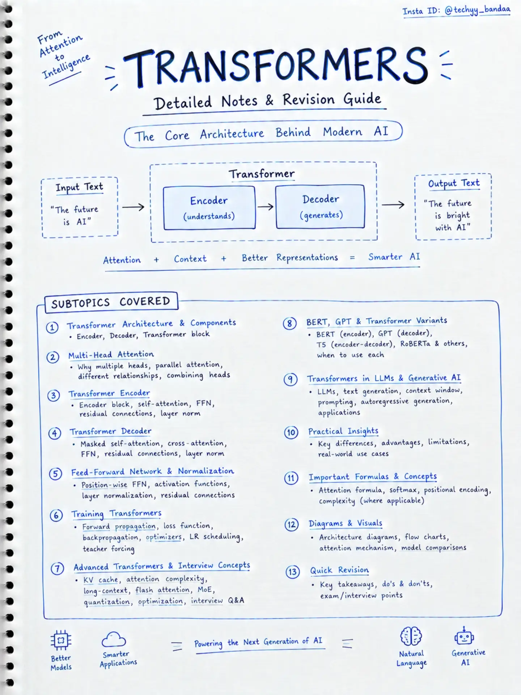

# Transformers: Detailed Notes & Revision Guide

**Author:** [Abhinav Gupta](../entities/Abhinav%20Gupta.md) (`@techyy_bandaa` / `@techyy_bandaa2.0`)
**Published Date:** `2026-09-14`
**Source Post:** [Instagram Post](https://www.instagram.com/techyy_bandaa/p/DdQPCJoEuaU/) (`910` likes, `1,103` comments, `71` shares)
**Raw Source File:** [raw/articles/ai-other/transformers-detailed-notes-revision-guide.md](../../raw/articles/ai-other/transformers-detailed-notes-revision-guide.md) (`16` native-English `.webp` pages in `raw/screenshots/transformers-detailed-notes-revision-guide/00.webp`–`15.webp`)

---

## Executive Summary

**Transformers: Detailed Notes & Revision Guide** is an original 16-page English handwritten revision handbook by [Abhinav Gupta](../entities/Abhinav%20Gupta.md) (`@techyy_bandaa`) tracing the Transformer stack *"From Attention to Intelligence"*. Unlike general LLM overviews, it provides rigorous first-principles derivations of **Encoder vs. Decoder sublayers**, **Permutation Invariance & Sinusoidal/Learned Positional Encodings**, **Scaled Dot-Product & Multi-Head Attention**, **`GELU` vs `ReLU` & Feature-Wise `LayerNorm`**, **`Teacher Forcing`** during training, **exact Adam moments & Warmup + Cosine Decay**, **5 BERT Encoder Variants**, **Flash Attention $O(n)$ space vs. Linear Attention**, **Long-Context Scaling (`RoPE`, `ALiBi`, `LongRoPE`, `YaRN`)**, **`PTQ`/`QAT` Quantization**, and **10 interview revision questions**.

---

## 16-Slide Map & Key Technical Deltas

| Slide | Page / Subtopic | High-Signal Contributions & Formulas | Linked Wiki Concepts |
| :--- | :--- | :--- | :--- |
| `00.webp` | **Cover (`13 Subtopics`)** | Architecture mantra: `Attention + Context + Better Representations = Smarter AI` | [Transformer Architecture and Pre-training](../concepts/Transformer%20Architecture%20and%20Pre-training.md) |
| `01.webp` | **Page 1: Introduction** | Why Transformers beat RNN/LSTM (parallel training, global context, zero sequential bottleneck) | [Transformer Architecture and Pre-training](../concepts/Transformer%20Architecture%20and%20Pre-training.md) |
| `02.webp` | **Page 2: Architecture** | Original Vaswani 2017 `N=6` Encoder–Decoder diagram (`output shifted right` + Cross-Attention) | [Transformer Architecture and Pre-training](../concepts/Transformer%20Architecture%20and%20Pre-training.md) |
| `03.webp` | **Page 3: Tokenization & Inputs** | Vocabulary fixed pre-training (`10K–100K+`); `[PAD]=0, [UNK]=1, [CLS], [SEP]`; Word vs `BPE`/`WordPiece`/Char; `Input = Token Emb + Positional Enc` | [Tokenization](../concepts/Tokenization.md) |
| `04.webp` | **Page 4: Positional Encoding** | Permutation invariance (`"dog bites man"` vs `"man bites dog"`); worked `d_model=6` sinusoidal table; Learned PE vs Relative PE (`Transformer-XL`, `T5`) | [Transformer Architecture and Pre-training](../concepts/Transformer%20Architecture%20and%20Pre-training.md) |
| `05.webp` | **Page 5: Self-Attention** | Intuitive `Q/K/V` role definitions, `(seq_len × d_model)` tensor shapes, 4-step workflow | [Transformer Architecture and Pre-training](../concepts/Transformer%20Architecture%20and%20Pre-training.md) |
| `06.webp` | **Page 6: Scaled Dot-Product** | Why $1/\sqrt{d_k}$ stops softmax saturation & vanishing gradients + hand-worked example | [Transformer Architecture and Pre-training](../concepts/Transformer%20Architecture%20and%20Pre-training.md) |
| `07.webp` | **Page 7: Multi-Head Attention** | Subspace specialization diagram (*Syntactic, Coreference, Local, Long-range heads*) + `Concat * W^O` | [Transformer Architecture and Pre-training](../concepts/Transformer%20Architecture%20and%20Pre-training.md) |
| `08.webp` | **Page 8: Encoder Block** | 2-sublayer stack, $d_{\text{ff}} = 4 \times d_{\text{model}}$, Residual + feature-wise `LN(x)` formula | [Transformer Architecture and Pre-training](../concepts/Transformer%20Architecture%20and%20Pre-training.md) |
| `09.webp` | **Page 9: Decoder Block** | 3-sublayer stack, explicit $-\infty$ upper-triangle mask (`seq_len=4`), Cross-Attention (`Q` Decoder, `K/V` Encoder), autoregressive decoding | [Transformer Architecture and Pre-training](../concepts/Transformer%20Architecture%20and%20Pre-training.md) |
| `10.webp` | **Page 10: FFN & Normalization** | **`GELU`** ($x\,\Phi(x)$, Gaussian CDF) vs `ReLU` vs `Tanh`; why `LayerNorm` works on small batch sizes | [Transformer Architecture and Pre-training](../concepts/Transformer%20Architecture%20and%20Pre-training.md) |
| `11.webp` | **Page 11: Training Transformers** | Full batch Cross-Entropy loss + **Label Smoothing**; **Adam moment equations** ($m_t, v_t, \hat{m}_t, \hat{v}_t$); Warmup + Cosine Decay; **`Teacher Forcing`** *(train-only ground-truth feeding)* | [LLM Pretraining, Optimization and Decoding](../concepts/LLM%20Pretraining%2C%20Optimization%20and%20Decoding.md) |
| `12.webp` | **Page 12: Pre-training & Fine-Tuning** | `MLM` masked prediction, Transfer Learning vs. task-specific fine-tuning (`BERT` / `GPT` / `T5`) | [LLM Fine-Tuning and Alignment](../concepts/LLM%20Fine-Tuning%20and%20Alignment.md) |
| `13.webp` | **Page 13: BERT, GPT & Variants** | **`RoBERTa`**, **`ALBERT`**, **`DistilBERT`**, **`ELECTRA`**, **`DeBERTa`** comparison matrix & model-selection guide | [Transformer Architecture and Pre-training](../concepts/Transformer%20Architecture%20and%20Pre-training.md) |
| `14.webp` | **Page 14: Transformers in LLMs** | `Text -> Transformer -> LM Head`; context sizes (`4K–128K`); prompting + decoding integration | [Prompt Engineering](../concepts/Prompt%20Engineering.md) |
| `15.webp` | **Page 15: Advanced & Interview Qs** | `KV Cache`; **Complexity table** (`Standard O(n^2) space` vs **`Flash Attention O(n) space`** vs `Linear O(n)`); **Long-Context PE (`RoPE`, `ALiBi`, `LongRoPE`, `YaRN`)**; `MoE`; **`PTQ`/`QAT`**; **`Lion`**; **Gradient Checkpointing**; **10 Interview Qs** | [LLM Inference Optimization and Security](../concepts/LLM%20Inference%20Optimization%20and%20Security.md), [Transformer Architecture and Pre-training](../concepts/Transformer%20Architecture%20and%20Pre-training.md), [LLM Pretraining, Optimization and Decoding](../concepts/LLM%20Pretraining%2C%20Optimization%20and%20Decoding.md) |

---

## Cross-Source Synthesis & Companion Notes

- **Original Source Style vs. Vietnamese Adaptations**: Provides primary native-English precision alongside the translated handwritten series shared by [Viet Nguyen AI](../entities/Viet%20Nguyen%20AI.md) in [LLM Handwritten Study Guide 15 Pages](LLM%20Handwritten%20Study%20Guide%2015%20Pages.md), eliminating AI-translation drift while deepening sublayer derivations (`GELU`, `Teacher Forcing`, `Adam` moments, `Flash Attention` asymptotic space reduction, and `RoPE/ALiBi/YaRN` extrapolation).

---

## Related Pages
- **Entities**: [Abhinav Gupta](../entities/Abhinav%20Gupta.md), [Viet Nguyen AI](../entities/Viet%20Nguyen%20AI.md)
- **Core Concepts**:
  - [Transformer Architecture and Pre-training](../concepts/Transformer%20Architecture%20and%20Pre-training.md)
  - [LLM Pretraining, Optimization and Decoding](../concepts/LLM%20Pretraining%2C%20Optimization%20and%20Decoding.md)
  - [LLM Inference Optimization and Security](../concepts/LLM%20Inference%20Optimization%20and%20Security.md)
  - [Tokenization](../concepts/Tokenization.md)
  - [LLM Fine-Tuning and Alignment](../concepts/LLM%20Fine-Tuning%20and%20Alignment.md)
- **Companion Sources**: [LLM Handwritten Study Guide 15 Pages](LLM%20Handwritten%20Study%20Guide%2015%20Pages.md), [LLM Handbook 50 Concepts](LLM%20Handbook%2050%20Concepts.md)
