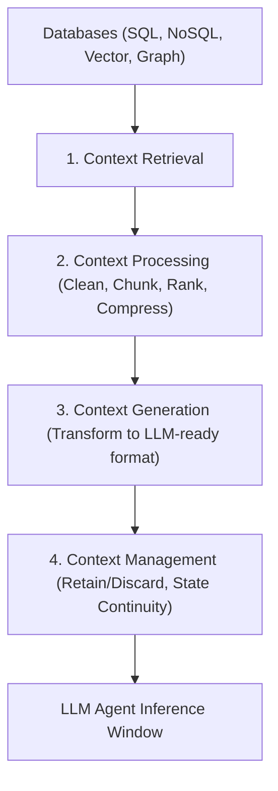

# What Is Context Engineering?

**URL**: https://www.ibm.com/think/topics/context-engineering  
**Author**: [Joshua Noble](../entities/Joshua%20Noble.md) (IBM Think)  
**Source File**: [raw/articles/ai-other/what-is-context-engineering.md](../../raw/articles/ai-other/what-is-context-engineering.md)  

---

## Executive Summary

This foundational IBM article by [Joshua Noble](../entities/Joshua%20Noble.md) defines **Context Engineering** as the holistic discipline of designing, structuring, and optimizing everything an LLM or AI agent sees at inference time.

Context Engineering unifies **Prompt Engineering** (instruction phrasing) and **Retrieval-Augmented Generation (RAG)** (document retrieval) into an interdependent 6-step lifecycle (Selection $\rightarrow$ Structuring $\rightarrow$ Prompt Design $\rightarrow$ Compression $\rightarrow$ Sequencing $\rightarrow$ Tool/Memory Integration) to eliminate context rot, prevent hallucinations, and maximize multi-step agent reasoning reliability.

---

## The 6 Core Steps of Context Engineering

```
┌─────────────────────────────────────────────────────────────────────────────┐
│                   The 6-Step Context Engineering Lifecycle                   │
├─────────────────────────────────────────────────────────────────────────────┤
│ 1. Context Selection   : Filter noise, rerank, prevent context poisoning.   │
│ 2. Context Structuring : Format via Markdown/JSON; separate data from rules.│
│ 3. Prompt Engineering  : Frame instructions, constraints, and JSON schemas. │
│ 4. Context Compression : Summarize and deduplicate to maximize token space. │
│ 5. Context Sequencing  : Order payload (Rules 1st -> Relevant Context 2nd). │
│ 6. Tool & Memory Integ.: Manage API output insertion and state updates.     │
└─────────────────────────────────────────────────────────────────────────────┘
```

---

## The Interdependent Context Pipeline



### Key Technical Concepts
1. **Context Sequencing**: Ordering is critical. System rules and constraints MUST appear first, followed by high-relevance retrieved context, with distant conversation history placed towards the back of the payload.
2. **Context Poisoning Prevention**: Selection filtering must guard against malicious or inaccurate inputs entering the active inference window.
3. **Database Topology**: Aligning storage engines (Vector DBs for semantic search, Graph DBs for entity relationships, SQL for schema joins) with appropriate input data formats (JSON, Markdown, Tabular CSV).

---

## Related Knowledge Nodes

- **Concepts**:
  - [Context Engineering](../concepts/Context%20Engineering.md)
  - [Context Selection and Sequencing](../concepts/Context%20Selection%20and%20Sequencing.md)
  - [Context Engineering Pipeline](../concepts/Context%20Engineering%20Pipeline.md)
  - [Context Processing and Management](../concepts/Context%20Processing%20and%20Management.md)
  - [Context Rot](../concepts/Context%20Rot.md)
  - [Harness Engineering](../concepts/Harness%20Engineering.md)
- **Entities**:
  - [Joshua Noble](../entities/Joshua%20Noble.md)
  - [IBM](../entities/IBM.md)
  - [IBM Technology](../entities/IBM%20Technology.md)
